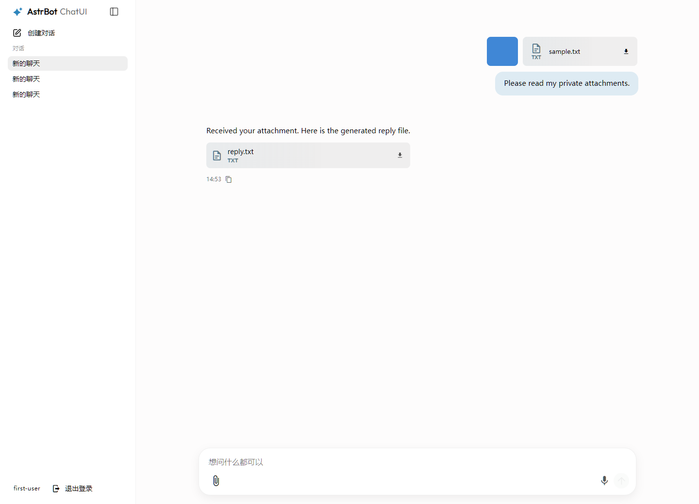
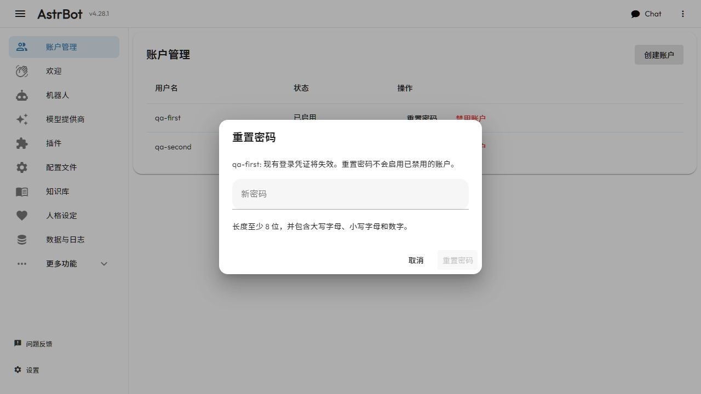
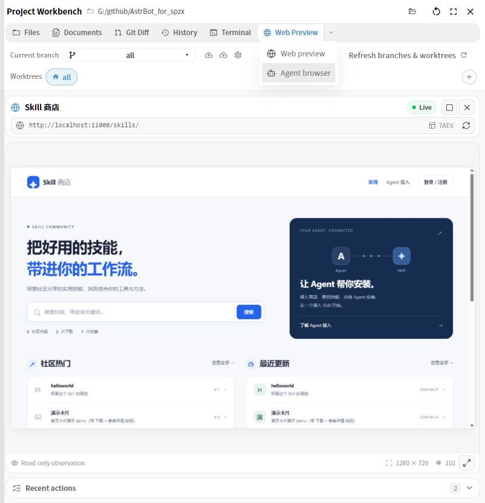

# WebUI

The AstrBot admin panel features plugin management, log viewing, visual configuration, statistics viewing, and more.

## Navigation and Previous Entry Points

These paths use the current default sidebar. If you customized it, open `Settings → Appearance → Customize Sidebar` at the bottom of the sidebar to review or reset the layout.

| Previous entry point or name | Current entry point |
| --- | --- |
| Providers → Add Provider → Agent Runner | Config → Select a profile → AI → `…` beside the AI heading → Change execution mode |
| Data / Dashboard | Data & Logs → Statistics |
| Conversation Management / Conversations | Data & Logs → Conversations |
| Logs / Console | Data & Logs → Logs |
| Trace | Data & Logs → Trace |
| Config → Normal Config | Config → Select a profile |
| Config → System Config | Settings → General, Appearance, Network, or Security, depending on the setting |
| Commands / Command Management | Extensions → Handlers → Command |
| Standalone MCP / Skills entries | Extensions → MCP Servers / Skills |
| Custom Rules / Future Tasks / SubAgents | More Features → The corresponding feature |
| Agent Teams → Members | More Features → Agent Teams → Migrate previous definitions → Assets → Role templates; original conversations remain in Runs → History |
| Agent Teams → Workflow Editor, Run Monitor | Assets → Workflows → Start Run is the default; New Canvas Workflow opens the versioned editor, and Runs displays frozen snapshots. Resolve owned legacy runs in the top notice first |
| Workflow Assets → Export workflow JSON / Import workflow package | Assets → Teams / Workflows → Export asset JSON / Import asset package → Validate and preview → Confirm installation; includes exact nested versions and grouped dependencies. Edit Asset / Start Run remain. Upgrades add versions; pending entries cannot run until their dependencies are ready |
| Legacy members, team definitions and saved workflows → new versioned definitions | Agent Teams → Migrate previous definitions → Preview → Confirm migration → Assets; review pending configuration before starting a fresh run. Read previous runs and long-term member conversations in Runs → History, labelled Legacy engine / Read-only history. Still-live legacy work stays in the previous engine. See [migration steps](./agent-team-workflows.md#preview-and-migrate-previous-definitions) |
| Previous History / member long-term conversations | Agent Teams → Runs → History → Legacy engine / Read-only history; migrated definitions can prepare a fresh run. The top notice lets original owned runs finish or be explicitly stopped |
| Legacy autonomous team sidebar / Run Monitor | Versioned autonomous assets: Assets → Teams → New Autonomous Team; Runs → View Run displays dynamic members, task relationships and complete artifacts |
| Runs → View Run → select task → Continue the same attempt | Compatible remote executors show **Query original remote run**; built-in checkpoint recovery retains **Continue the same attempt**. The action stays in the selected task's details. |
| New runs only showed waiting reasons | Agent Teams → Assets → Workflows → Edit Asset configures human questions / version approval; Runs → View Run → Human requests handles answers, previews, approvals or rejection and exact-version exports |

Old log, trace, conversation, and statistics URLs still redirect to the corresponding tabs. Agent runners are now saved in each profile; they are no longer created as model providers. See [Agent Runners](./agent-runner.md) for the setup steps.

## Accessing the Admin Panel

See [Agent Teams role templates](./agent-team-roles.md) for resource bindings, inheritance previews and versioned saving.
See [Asset and run workspace](./agent-team-workflows.md) for saving, starting and inspecting workflows and task results.

After starting AstrBot, you can access the admin panel by visiting `http://localhost:6185` in your browser.

> [!TIP]
> - If you're deploying AstrBot on a cloud server, replace `localhost` with your server's IP address.

## Login

For first-time login, AstrBot generates a random initial password and prints it in startup logs. Please read the startup log line containing the WebUI credential and use that password to log in (username is usually `astrbot`).

## Multiple accounts and basic chat

The existing single-account login remains the original administrator's entry point. Administrators retain the **Bot / Chat** switch and can open **Accounts → Create account** in the Bot sidebar to set an ordinary user's unique login name and initial password. This creates an ordinary account; there is no registration, role assignment, or cross-account sharing.

| Previous entry point | Current entry point |
| --- | --- |
| Original WebUI administrator login | The same login page; administrators retain Bot and their own Chat |
| Chat through a shared administrator login | An administrator creates ordinary accounts; each user signs in on the same page and goes directly to their own Chat |

Ordinary users see only chat navigation. Select **New Chat**, enter a message, and select **Send** to receive a streamed reply using the selected profile. Open one of your sidebar conversations to reopen its history. Ordinary accounts support text and multimedia conversations, profile selection, and the input parameters described below. Projects, archiving, message editing, and stream recovery are not yet available, and their controls are hidden. Administrators maintain shared configuration; ordinary users do not edit instance configuration.

Use **Upload files** (the paperclip), drag files into Chat, or paste an image to send images, audio, video, and files. The microphone retains the existing recorded-audio upload flow. Large files retain chunk progress, retry, and cancellation. Preview or remove staged attachments before sending; reopen your history to preview media or select **Download** for uploaded and model-generated files. Legacy administrator attachments remain with the original administrator. Knowing another account's attachment ID, upload task, stored filename, or download token does not grant access, message reuse, or cleanup permission.

On narrow screens, use the sidebar button at the top left of Chat to open your conversation list. **New Chat**, saved conversations, and **Log out** remain available in that drawer; Bot navigation stays hidden.

Select **Log out** before switching accounts in the same browser. Conversation lists, unsent text drafts, staged attachments, upload queues, media previews, and old requests are cleared or invalidated. Daily WebChat queries and operations enforce ownership for every account, including administrators. Administrators retain full backups and operational logs, so this feature does not promise confidentiality from trusted server maintainers.

### Reset passwords and disable ordinary accounts

As an administrator, open **Bot → Accounts**, find the ordinary account and select **Reset password**. Enter a new password that meets the displayed policy and confirm. The user must log in again with the new password; the old password and existing login credentials stop working immediately. Existing conversations stay with the same account. Resetting a password does not enable a disabled account.

Select **Disable account** and review the target login name and consequences before confirming. The status becomes **Disabled**. The account cannot log in, and its old credentials cannot send messages, download protected resources or subscribe to chat streams again. Running tasks keep their existing lifecycle. Other users and the administrator remain unaffected. These controls manage ordinary accounts only; they do not change roles, disable administrators or re-enable accounts.

When a subsequent request reports an invalid credential, the user interface ends that identity's access, clears visible chat state and drafts, and returns to login. Revoked credentials also lose access to protected attachments. Stream recovery remains unavailable to ordinary users at this stage.

### Choose a profile and chat input parameters

Use the configuration chip beside the input to select a profile created by an administrator. The selection belongs to the current conversation, including the first message; choosing `Default Configuration` explicitly overrides broader routing rules. A new conversation starts with your last profile choice. Reopening a conversation restores its own saved binding.

For profiles using the local agent runner, the existing model menu lets you choose an enabled, administrator-configured chat model. The thinking-effort menu selects an existing preset and a value; your saved preset and value belong to your account and each message carries its own choice. Existing quick messages remain available. These choices do not change shared configuration. Changing accounts resets live model selection and uses that account's remembered choices.

| Previous behavior | Current behavior |
| --- | --- |
| Configuration chip reads management configuration/routes | Same chip selects a profile through an owned-conversation API |
| Thinking-effort selection changes the instance default | Selection is saved for the signed-in account; administrators separately edit shared preset definitions |

Only administrators can create or edit profiles, providers, model definitions, thinking-effort presets, and quick-message definitions. Ordinary users see consumption controls without configuration editing, provider connection tests, or management pages. Profile metadata contains only its ID, name and runner type; model choices omit credentials and server endpoints.

## Open Agent file references

In the main chat, click an explicit file link in an Agent reply to open the
existing file pane. No loaded project is required; a host file outside the
project opens at the same absolute location even after you switch projects.
The pane reads the **current disk contents**, including when you reopen an old
reply. This does not attach the file to the chat or change Agent permissions.

Use `[name](G:/project/main.py)` for a whole file, `#L12` for one source line,
or `#L12-L18` for a closed source-line range. POSIX host paths such as
`[source](/home/user/main.py#L12)` are supported too. Use forward slashes and
percent-encode spaces and special filename characters, for example
`[notes](G:/My%20Project/notes%23draft.md#L2-L4)`. Plain path text, code blocks,
relative links, and web links keep their existing behavior. Incomplete streamed
links do not read files.

File references use authenticated spcode
services and host account permissions, independently of the Agent's project,
worktree, execution directory or permission mode. Install or enable spcode if
the pane asks for it. Missing, unreadable, unsupported, oversized files and invalid
line ranges display an explicit state; an invalid range is not highlighted.
Markdown references with a line target show source text so line numbers remain
meaningful. The existing project Files, Git, Documents, Terminal and Browser
entries remain in the same workbench.
With a project loaded, click **Files** to leave a reference and return to the
project file list. From **Git Diff**, use a file's **Open → Open in file browser**
menu to open that project file instead of the previous reference. These explicit
actions preserve the existing check for unsaved edits; background project or
worktree refreshes leave the reference in place.

### Preview images, documents and spreadsheets

Absolute references to images, PDF, DOCX, XLSX, CSV and Markdown open the
existing viewers in the same file pane, inside or outside the loaded project,
or with no project loaded. Whole CSV files open as tables; CSV and Markdown
citations with line targets display **source text**, including quoted multiline
CSV rows. Images, PDF and Office documents show an explicit message when a
text line target cannot be located. These previews do not add Office, PDF or
image editors.

Binary previews retain the existing extension/MIME whitelist and 50 MiB limit;
source text retains its 5 MiB limit. Encoded spaces, Chinese names, `#` and `%`
refer to the actual filename. Reopening a citation reads current disk bytes.
Changing targets cancels or ignores old byte/parse requests and releases image
URLs and PDF tasks. spcode must remain enabled for both metadata and bytes.

### Edit files and handle conflicts

Click **Edit** in a text preview to edit and save text up to 2 MiB without loading its directory as a project. Manual saves use host account permissions even in Agent read-only or workspace mode. They leave Agent permissions, allowed directories, project and worktree unchanged and preserve the original encoding, BOM and dominant newline style.

Leaving a draft through a citation, directory, path, workbench tab, sidebar or session offers **Save and open**, **Discard and open**, or **Cancel**. A failed or conflicting save stops navigation and keeps the complete draft. Browser refresh and closing use the browser's own leave warning.

When another program changes the file, a normal save leaves disk contents intact. Choose **Reload from disk** to discard the draft, or **Overwrite confirmed version** to save it against the disk revision you confirmed. Another disk change causes another conflict. Text entered while a save is pending remains unsaved even after the earlier request succeeds.

Background worktree changes, project unloads and project switches keep the displayed file and draft. Polling does not close the editor. Use an explicit citation, workbench tab or return to the current project files to leave through Save, Discard or Cancel.

This is optimistic concurrency control: the service rechecks the disk revision after staging and before replacement, but cannot lock arbitrary external editors out of the final check-to-replace interval. Missing files, permission, encoding and write errors preserve the draft and show a failure. The old project-relative write API retains its original scope.

### Rename files and use the recycle bin

Choose **Edit** at the top of the file preview, then **Rename** in the editor toolbar to change a file's name within its current directory, including files outside a project. Entry mapping: **Preview → Rename** moves to **Preview → Edit → Rename**. Confirmation shows the fixed full target path. Name collisions, permission errors and missing targets are reported. The sidebar follows a successful rename; old chat citations keep their original paths.

The file preview toolbar uses a red **Delete** button (previously **Move to recycle bin**). Its confirmation still states that the file will move to the system recycle bin, offers **Move to recycle bin**, and explains recovery through the operating system. Project files, external files and the Docs sidebar use this behavior. If trash is unavailable or refuses the operation, the file is preserved; there is no permanent deletion fallback.

The file preview puts **Edit**, **Copy**, and **Delete** in one row and removes the extra path and current-disk-content summary. Hover over the filename to see its full path. Invalid or unsupported citation line ranges still display a notice.

For unsaved changes, first choose **Save and open**, **Discard and open** or **Cancel**. Cancellation, failed saves and conflicts stop the management action. The target stays fixed during the request. Manual management uses WebUI authentication and host account permissions without changing the Agent's project or permissions.

Windows requires Windows 8 or later and the plugin's `pywin32` dependency for safe recycling on local fixed drives. Unsupported locations or missing native support return an error before deletion; no legacy deletion backend is used. Rename also fails if the operating system or filesystem cannot guarantee that an existing destination will be preserved.

### Browse host folders and drives

Without a project, open **Files & Browser** above the composer, choose **Files**, then select a host folder. **Browse host folders or drives** in the file pane reopens the existing folder picker: use **This PC** to select another Windows drive, or enter an absolute folder path. Selecting a location only changes the file pane; it does not load a project.

Click the last breadcrumb to type an absolute file or directory path, or a path relative to the currently listed directory, and press **Enter**. Files open in the existing preview. Parent breadcrumbs and **Parent directory** can leave the project root. The path bar shows the actual resolved location. Missing or unreadable paths display an error; large directory listings show the existing 1000-entry limit.

To the right of the path, **Back to the previous directory** (left arrow) retraces directories visited in the current file browser, independently of **Parent directory**. Opening files within the same directory and failed directory loads do not add history; Back is disabled when history is empty. **Return to the loaded project directory** (folder with a house) opens the loaded project's root and is disabled without a project. Both actions check unsaved edits first; cancelling preserves the current file and back history.

With a project loaded, **Workspace → Files** still returns to its file list. Manual host browsing and file references share one navigation lifecycle and remain independent of Agent project, active worktree, execution directory and permissions, including read-only mode. Project polling, worktree-list changes and project unload preserve an open external target. Git Diff/History, Documents and Terminal retain their project context; Web Preview and the Agent browser remain available.

| Previous entry | Current entry |
| --- | --- |
| Agent browser without a project | Files & Browser → Files / Web Preview |
| Project-relative path input | File pane breadcrumb → host absolute path or path relative to the listed directory |
| Files bounded by the project root | Parent breadcrumbs / Parent directory / Browse host folders or drives |

## Compact Git changes

In **Project Workbench → Git Diff**, smaller file checkboxes, text and action buttons reduce the space taken by large change lists. File checkboxes are smaller than directory checkboxes. Stage, Unstage, Restore and the Open menu remain available.

Consecutive directories with no direct changed files and exactly one child stay combined in one row, such as `dashboard/src/components/chat/message_list_comps`. Clicking it expands or collapses the terminal directory's contents. Branching directories and directories with direct files keep their own rows. Previous **Expand levels → click the combined directory to expand files**; Expand all also preserves combined paths. Counts, change totals and directory selection cover the full subtree, while file actions retain their original full paths.

## Switch Git worktrees

In the **Files / Git Diff / History** tabs of **Project Workbench**, the **Worktree** controls adapt to the sidebar width. Buttons remain visible when they fit within two rows. If they need more rows, a dropdown like **Current branch** shows the selected worktree. Open it to choose another worktree. Widening the sidebar or removing worktrees automatically restores the buttons when they fit.

The previous **Worktree → manual expand / collapse** control becomes **Worktree → automatic buttons / dropdown**. Both layouts retain **+** to create a worktree and right-click management on each worktree. The dropdown includes full paths to distinguish worktrees with the same name.

## Two-Factor Authentication

AstrBot WebUI supports TOTP (Time-based One-Time Password) based two-factor authentication.

### Enabling Two-Factor Authentication

1. Open `Settings → Security` at the bottom of the sidebar and find `WebUI Security`.
2. Toggle on "Enable WebUI TOTP"; a setup dialog with a QR code will appear.
3. Scan the QR code using any TOTP-compatible authenticator app (e.g., Google Authenticator, etc.).
4. Enter the 6-digit verification code generated by the authenticator app to complete the verification.
5. The system will generate recovery codes for logging in if the authenticator device is lost. Be sure to save them securely.

To replace the TOTP secret, you can do so in the TOTP management window, where you will need to verify the current TOTP code first.

### Recovery Codes

- Each recovery code can be used only once. After logging in with a recovery code, two-factor authentication will be automatically disabled, and you will need to set it up again.
- Recovery codes can be regenerated in the TOTP management window.
- If you lose the recovery codes, you will not be able to regain account access through normal means. You will need to manually edit `data/cmd_config.json`, set `dashboard.totp.enable` to `false`, and manually clear `dashboard.totp.secret` and `dashboard.totp.recovery_code_hash` to disable two-factor authentication.

### Security Related

- Once two-factor authentication is enabled, modifying TOTP-related configurations requires verifying the current TOTP code to prevent unauthorized changes.
- Changing the admin panel password will revoke all trusted devices.

## ChatUI

AstrBot includes a built-in ChatUI for talking to configured models directly in your browser.

Assistant replies in the main chat no longer have a left-hand avatar, leaving more width for the text. Once a reply finishes, intermediate work folds into a subtle completed-work capsule with a thin checkmark and emphasized duration. Click it to expand or collapse the work as before.

The model menu in the header remembers each conversation's selected provider and model and restores them when you return. Selecting a model, sending a message, or regenerating a reply saves the choice; conversations without a saved choice keep the current selection. These records stay in the current browser, do not sync across devices, and do not change thinking effort. Switching projects focuses the composer automatically; switching conversations still restores your reading position.

The reasoning sidebar follows the latest activity when opened. Scrolling up or dragging its scrollbar pauses following; scrolling back down to the bottom resumes it. Opening the sidebar through search or a file-change entry prioritizes that location, and streaming updates do not pull it back to the bottom.

The yellow/red message markers beside the chat scrollbar are now short grayscale ticks. A longer, darker tick marks the turn being read; hollow ticks indicate inherited history. Hover or focus a tick to preview the user question as a title, with the corresponding reply excerpt in muted text below. Reasoning and tool logs are excluded. Click to jump. Dense ticks are grouped: the picker shows up to 20 questions and reply excerpts per page and opens on the page containing the current turn. Older messages load automatically when needed. On touch devices, tap a tick to navigate.

ChatUI supports these common workflows:

- Create, rename, and delete conversations, and switch previous conversations from the sidebar.
- Select the config profile, model provider, and model on the chat page; if Provider session separation is enabled, you can also choose a model for the current session only.
- Send text, images, files, and voice input; uploaded attachments show previews and use file signature checks to help identify file types.
- View model thinking, tool-call status, knowledge-base or web-search references, and per-message token and latency statistics.
- Copy or regenerate existing replies, including regenerating with another model.
- Edit a user message and continue generation from that point, or start a thread from a specific excerpt.
- Switch between streaming/normal response modes and SSE/WebSocket transport modes.

The config chip in the composer, the `+ → Configuration` menu, and the selection dialog display the built-in `default` profile as `Default Configuration` (`默认配置文件` in Chinese). Its ID remains `default`, and custom profiles keep their names.

Chat attachments can be up to 512 MiB. Files of 32 MiB or more upload in chunks: the attachment card shows the percentage and a cancel button. If an upload fails, use its retry button to upload the missing chunks, or remove the failed card to discard it. Keep the page open while retrying; refreshing the page or restarting AstrBot loses the resumable session, and a session expires after one hour without upload activity. Existing image previews remain available.

Each upload is saved under a distinct filename, while chat continues to display the original name. Uploading different screenshots both named `image.png` keeps both files, and deleting one attachment leaves the other intact. Existing attachments do not need to be renamed.

Sent audio and video attachment cards include playback controls and a download button that keeps the original filename. Attachment rows containing media wrap to avoid clipping the player; image previews and ordinary file downloads keep their existing controls.

Under `Settings → Maintenance`, backup imports also show upload progress and offer `Resume Upload` after an upload failure. Chunked backup uploads support up to 8 GiB. These controls extend the existing chat attachment area and backup import dialog; their entry points have not moved.

### Side Chats and Branch Threads

With a conversation open, hover over or click **New side chat** (the speech-bubble-plus button at the top right of the message area). The menu lists the side chats saved for this conversation; choose **New side chat** to start another. It starts empty, without a quoted message or inherited main-conversation context. Include any background the separate question needs yourself.

Closing the panel, opening a file, switching conversations, or leaving the chat page hides the side chat and keeps its history. Return to the same main conversation and select its title in the side-chat menu to reopen it. A reply that is still streaming keeps its visible content and continues updating when reopened. Use the delete button explicitly to remove a side chat; deletion requires a successful backend connection.

Agent file citations in side chats use the same host-absolute Markdown links and existing file pane as the main chat. Click a citation to hide the side chat, read the current file and highlight any valid source-line range. The file stays at its original absolute location after project or worktree changes. Viewing it does not change the Agent's project, execution directory or permissions. Reopen the side chat from the menu to continue.

Before a switch would leave unsaved edits, choose **Save and open**, **Discard and open**, or **Cancel**. Cancellation, failed saves and conflicts keep the editor and draft in place. Missing files, unreadable targets and invalid line ranges show feedback in the file pane. If spcode is unavailable, enable the plugin and retry the citation.

An ordinary **Thread** still starts from selected reply text using **Ask in thread**. It retains the quote and the context through that reply's checkpoint. Closing its panel keeps the thread, which you can reopen from the reply's thread marker or count; its delete button removes it explicitly. This is also distinct from branching an entire conversation into another session.

On desktop, drag the panel's **left edge** to change the width of either a branch thread or side chat. At narrow mobile widths the panel fills the screen and the resize handle is hidden.

On mobile, use **×** at the top right to return to the main conversation. Side-chat and ordinary-thread histories remain saved when their panels close.

### Project Workbench Web Preview

With a project loaded for the current conversation, click **Workspace** above the composer (tooltip: **Browse workspace files, changes, and history**) to open **Project Workbench**, then select **Web Preview** beside **Terminal**. Files and Web Preview are also available without a project. The other project tabs appear after the workbench recognizes a Git or non-Git project; they may be absent while its project check is pending or fails.

1. Start the website's development server separately. The preview does not start it for you.
2. Enter its HTTP(S) address and press **Enter**, or select a suggested local port. For example, `localhost:5173` becomes `http://localhost:5173/`; a bare public hostname defaults to HTTPS. Localhost refers to the machine running your browser, which may differ from the AstrBot server.
3. Use **Reload**, **Open in new tab**, or the star to bookmark the address. Up to 12 bookmarks and the last entered address are stored per project in this browser; they do not sync across browsers or devices. Switching workbench tabs keeps the loaded preview mounted.

The screenshot shows the workbench in fullscreen mode, available from its top-right fullscreen button.

This is an embedded page, with no back/forward controls. Its address bar keeps the entry address rather than tracking links or redirects inside the page. Sites can block embedding with their frame policy; an HTTPS dashboard may also block an HTTP preview. Use **Open in new tab** if embedding fails. The iframe is sandboxed, with additional isolation for addresses sharing the dashboard's origin; it does not bypass browser or target-site restrictions. File, data, and JavaScript URLs are unsupported.

| Previous entry or behavior | Current location or behavior |
| --- | --- |
| Select reply text → Ask in thread | Unchanged: opens a saved branch thread; drag its left edge to resize on desktop |
| Temporary side chat, destroyed on close | Message area → side-chat menu → New side chat or a saved title; independent context, history retained until explicitly deleted |
| Side-chat file citations | Open the shared file pane; reopen the side chat from its saved title in the menu |
| No workbench entry without a project | Files & Browser above the composer; the Workspace entry remains for loaded projects |
| Workspace → Files / Documents / Git Diff / History / Terminal | Existing tabs remain; Web Preview is added after Terminal in Project Workbench |

> [!NOTE]
> To keep message delivery ordered, keep only one ChatUI page open for the same browser session. If you open chat in multiple tabs, the system may ask you to reconnect.

## Visual Configuration

Select `Config` in the sidebar, then choose the profile to edit from the selector at the top. Sections appear in this order: `AI`, `Platforms & Messages`, `Access Control`, `Plugin`, and `Ext.`. Use the search control at the top to find a setting.

- In `AI`, built-in AI settings have `Model`, `Persona`, `Capabilities`, and `Advanced` tabs. Use `… → Change execution mode` beside the AI heading to connect a third-party agent.
- `Access Control` contains administrator IDs and the session whitelist, including whitelist logs and administrator exemptions.
- `Platforms & Messages` contains message-trigger, session-isolation, and delivery settings.
- `Plugin` selects the plugins enabled for this profile. To edit an individual plugin's parameters, open `Extensions` and click that plugin's gear icon (`Extension Config`).
- `Platforms & Messages → Text-to-Image` contains the output toggle and character threshold. Configure the rendering strategy, service address, and custom template under `Settings → Appearance`.
- `Ext.` contains segmented replies and group-context awareness.

| Previous location | Current location |
| --- | --- |
| Platform | Platforms & Messages |
| Platform → General → Administrator IDs | Access Control → Administrators → Administrator IDs |
| Platform → Whitelist | Access Control → Whitelist |

After selecting an explicit model, click the gear beside the selector to open its settings dialog. Gears are also available in model and fallback-model menus. Clicking a gear does not change the selection or fallback order. Saving model settings immediately affects every profile using that model; the current profile's model selection still requires `Save Configuration`. Automatic selection has no gear beside the selector.

After editing, click the disk icon labeled `Save Configuration` in the lower-right corner and check for a successful save message.

In the bot editor, the arrow beside a default or session-route configuration option opens that profile in a side drawer. Changes made in the drawer also require selecting `Save Configuration`.

Use the `{}` icon labeled `Edit Configuration File` to edit the current profile as JSON. Select `Apply This Configuration` to stage the changes in the visual editor, close the editor, and then select `Save Configuration`.

### System Settings

Global settings are under `Settings` at the bottom of the sidebar:

- `General`: timezone, external callback address, logs, and cache.
- `Appearance`: sidebar, theme, and text-to-image rendering.
- `Network`: HTTP proxy, Python package sources, and GitHub proxy. For the address to use when AstrBot runs in Docker, see [Deploy with Docker](/en/deploy/astrbot/docker.md).
- `Security`: WebUI HTTPS, login rate limits, and TOTP.
- `Maintenance`: backup, restore, and restart.
- `OpenAPI`: developer access keys.

System configuration changes save automatically. Check for a successful save message and restart AstrBot if the page indicates that a restart is required.

## Default Persona

The default persona is now a stored record in persona management with ID `default`. You can edit its prompt, preset dialogs, tools, and skills, but cannot delete it or create another record with this ID. An existing record keeps its content; startup creates it only if absent. The selector pins it in the root folder, and preview and editing load its saved content.

When WebChat has no explicitly selected persona, its default system prompt toggle still applies. Explicitly selecting `Default Persona` uses the stored prompt. Other platforms use this editable record for their default persona. Local tool and skill selections continue to distinguish all capabilities from none.

## Plugins

Select `Extensions` in the sidebar. The top tabs are `Plugins`, `Skills`, `MCP Servers`, and `Handlers`. Within `Plugins`, switch between `Installed` and `AstrBot Plugin Market` to view local and market plugins.

On either plugin list, you can also click `Install Plugin` (+) in the bottom right corner to manually install plugins via URL or file upload.

The `Skills` and `MCP Servers` pages support search. The skills list also displays each skill's source to distinguish built-in, project, and other skills.

> Due to the plugin update mechanism, the AstrBot Team cannot fully guarantee the security of plugins in the plugin market. Please carefully verify them. The AstrBot Team is not responsible for any losses caused by plugins.

### Handling Plugin Load Failures

If a plugin fails to load, the admin panel will display the error message and provide a **"Reload"** button in the failed plugins list. This allows you to quickly reload the plugin after fixing the environment (e.g., installing missing dependencies) or modifying the code, without having to restart the entire application.

## Data & Logs {#data}

Select `Data & Logs` in the left sidebar to switch between `Statistics`, `Conversations`, `Logs`, and `Trace` from the tabs at the top of one workspace. `Statistics` opens by default the first time; afterwards, the page reopens the tab you last used.

### Statistics

The `Statistics` tab summarizes platform instances, messages, model calls, tokens, and uptime. It also shows message trends, platform message rankings, model-call trends, model usage rankings, and conversation model usage rankings. Use the range selector at the top to view 1 day, 3 days, or 1 week.

### Conversations

Use the `Conversations` tab to find and manage saved conversation records:

- Filter by keyword, bot ID, private/group conversation type, or UMO, and sort by creation or update time.
- By default, the list loads 30 records per page from the server. When **Group by session** is enabled, pagination switches to UMO sessions and expanding a session reveals all of its conversations. Full message history is loaded only after you select a conversation and is then shown in the preview on the right.
- Edit titles, export multiple selected conversations, or delete multiple selected conversations.
- Use the `{}` button in the preview header to inspect the raw `history` JSON in a read-only, word-wrapped Monaco editor.
- The preview opens at the beginning of the history and lists message roles and tool results in their original order. Its toolbar toggles Markdown and adjusts text from 12 to 18 px (13 px by default); these reading preferences are saved in your browser. Images appear as small thumbnails, while tool arguments and structured content expand on demand. The `reasoning_content` field appears under `Reasoning`; a `{type: "think", think: "..."}` content block appears as JSON under `Structured content`. Checkpoints are hidden from the reader and its message count, but remain in the raw JSON.
- Select `Back to legacy` in the upper-right corner if you still need the original table-based view.

### Logs

The `Logs` tab shows AstrBot runtime logs in real time. You can filter by log level and install missing Pip packages from this page. To view DEBUG logs, first set `Console Log Level` to `DEBUG` under `Settings → General → Logs`.

Enter a keyword in the search field to filter logs and highlight matches. Search is available in both the normal and fullscreen log views.

### Trace

The `Trace` tab shows AstrBot execution traces in real time and is useful for debugging model-call paths and tool invocations. Use the switch at the top to enable or disable trace recording.

> [!NOTE]
> Trace recording currently covers only some model-call paths from the AstrBot main Agent. Coverage will continue to improve.

## Command Management

Use `Extensions → Handlers → Command` to centrally manage all registered commands; system plugins are hidden by default.

Filter by plugin, type (command / command group / subcommand), permission, and status, and combine with the search box for quick lookup. Command group rows can expand to show subcommands, badges display the subcommand count, and subcommand rows are indented to indicate hierarchy.

You can enable/disable and rename each command.

## Updating the Admin Panel

When AstrBot starts, it automatically checks if the admin panel needs updating. If it does, the first log entry (in yellow) will prompt you.

In the browser WebUI, open `⋮ → Update AstrBot` in the upper-right corner, expand `Advanced settings`, and click `Download and Update` under `Update Dashboard to Latest Version Only`. The page refreshes automatically after a successful update. In the desktop app, the update entry opens the desktop application updater.

You can also use the `/dashboard_update` command to manually update the admin panel (admin command).

Admin panel files are located in the data/dist directory. If you need to manually replace them, download `dist.zip` from https://github.com/AstrBotDevs/AstrBot/releases/ and extract it to the data directory.

## Agent browser live observation

When the current main chat calls a Browser Use browser tool while the workspace sidebar is closed, it opens directly to **Web Preview → Agent Browser**. An already open workspace keeps its current view. Automatic opening happens at most once per reply, so closing the panel keeps it hidden for the rest of that reply. Changing chats or manually opening another panel while the check is pending cancels the old request. History, plain mentions of tool names and other chats do not trigger it. The manual entry remains available when the plugin is unavailable or another chat owns the browser.

Windows offline deployment requires the Browser Use `0.2.0` complete plugin ZIP, the AstrBot backend containing this feature, and its matching Dashboard build. The plugin ZIP does not upgrade the host or frontend. AstrBot's `4.28.1` version alone does not identify these changes: compare `astrbot_revision` and `dashboard_sha256` in the plugin's `runtime/manifest.json` with `dist/assets/browser-observer-build.json`. Stop AstrBot before installing each component and select the matching `dist` with `--webui-dir`. The packaging command below also emits a backend source ZIP and its SHA256 beside the Dashboard ZIP; the source ZIP requires an existing compatible AstrBot Python environment. Keep the existing data directory separate from the new code. The installer refuses to overwrite an existing plugin; persistent data stays under the separate `plugin_data` directory.

After a production Dashboard build, maintainers can run `python scripts/package_browser_observer_dashboard.py --output <dashboard.zip>` to include version/revision metadata and a SHA256 sidecar. Run `python scripts/browser_observer_acceptance.py --plugin-zip <complete-plugin.zip> --dashboard-dir <dist> --evidence-dir <new-temporary-directory>` with AstrBot development dependencies and `aiohttp playwright psutil` to test final-ZIP installation, real login, the complete chat interface, a deterministic local model, real plugin management and Chromium. Local proxy isolation does not replace a physically offline target or real vLLM verification. For a missing entry, check matching builds and cached assets; for `runtime_unavailable`, inspect plugin startup logs and the private interpreter; for `busy`, close the browser in its owning chat; for 401/403, sign in and use a chat you own.

With the matching Browser Use plugin enabled, ask the Agent to open a page in the current chat. Without a code project, use **Files & Browser → Web Preview → Agent browser** above the composer. With a project loaded, use the existing **Workspace → Web Preview → Agent browser** entry. The current snapshot appears first, followed by live updates from the actual Chromium viewport. The view follows the Agent's selected tab, including when that tab closes. The address bar shows the page title, URL, connection status and tab. Image dimensions and sequence appear below the image. **Refresh snapshot** moves from a text button to the refresh icon at the right of the address bar, with its label available on hover. Login state and entered form values come from the browser controlled by the Agent. The image is read-only and is not added to the model context.

Below the image, an icon timeline shows the current action and up to 32 recent results for navigation, clicking, input, scrolling and tab operations. A subtle background marks the active action, and result badges distinguish outcomes. Running/waiting, success, failure, timeout and cancellation have distinct states. Input summaries always hide the content. When actual execution supplies reliable coordinates, a brief ring marks the operation position at the viewport scale. Navigation (including reloading the same URL), tab changes, scrolling, the next action or a two-second expiry invalidate the marker. Without reliable positioning, only the action summary appears. When an action reports a new scroll position or viewport before its image arrives, the view clears the old pixels and waits for a matching frame before showing the marker. Cancellation does not undo page operations that have already happened.

The previous iframe entry maps from **Web preview** to **Web preview → Web preview**; its bookmarks retain their existing behavior. Another chat cannot view or operate an occupied browser. Ask the owning chat to close all browser sessions before handing it to another chat. Hiding the sidebar, switching workbench tabs, or putting the Dashboard browser tab in the background stops its observation subscription while execution continues. Reopening obtains a fresh snapshot and stream. A temporary stream interruption reconnects automatically; **Refresh snapshot** resynchronizes immediately. Switching chats clears the previous image, actions and subscription before authorizing the new chat. After a page refresh, reopen the sidebar to resume observation.

Unloading a code project keeps the active Agent browser view open. Git, files, documents, terminal and the original iframe preview retain their existing entries. The view distinguishes idle, another chat holding the browser, plugin disabled, disconnected and reconnecting states. Recovery obtains a consistent snapshot before action increments; an expired recovery window or changed runtime displays a resynchronization notice. Only the latest image is fetched. Resuming observation for the same chat does not restart the browser or clear its login state. Observation sends at most about four frames per second and keeps only the newest pending image; static pages may send no new frames. Actual rate and delay depend on the page and environment. The view queries the browser identity again when the plugin is re-enabled.

The screenshot below shows the updated Agent browser using a local example page and deterministic observation events. Icon segments switch between previews; idle, connecting, busy and failure states have dedicated icons and descriptions. The panel supports light and dark themes and narrow sidebars.

**Stop execution** stops the current chat’s Agent run, waits for the in-flight browser action to finish or cancel, and rejects queued and subsequent browser actions. The browser remains visible for inspection. **Close browser** also closes its sessions and releases ownership; a new task starts with a fresh isolated profile. Completed page operations are not undone. Hiding the panel only stops observation. Disabling the plugin ends its owned browser, action, stream and MCP resources; retained requests cannot reactivate it. Re-enable the plugin to establish a new runtime generation without restarting AstrBot.

## Customizing WebUI Port

Modify the `port` in the `dashboard` configuration in the data/cmd_config.json file.

## Forgot Password

Modify the `password` in the `dashboard` configuration in the data/cmd_config.json file and delete the entire password key-value pair.

> [!TIP]
> For more details, see [FAQ - Forgot Dashboard Password](/en/faq.md#forgot-dashboard-password).

Workspace entry mapping: **Workflow Assets → Assets → Teams / Workflows**, **Role templates → Assets → Role templates**, **Independent Runs → Runs → All runs / In progress / Needs attention / History**. Versioned assets are the default; the previous creation and execution workspace is retired. The top notice lists original owned legacy runs, including normal pauses, and blocks new launches until they finish or are explicitly stopped. **Previous History / member long-term conversations → Runs → History** preserves original records. Ownerless unfinished history is shown as interrupted and cannot resume; migrated assets prepare a separate fresh run. See the [asset and run workspace](./agent-team-workflows.md#navigation-and-previous-entry-points) for current screenshots and controls.

## Inline Skill Store

In `Extensions → Skills`, open the available `Skill Store` section without leaving the admin panel. Its address follows the Core release API in `Settings → Update Sources`. The standalone `/skills` entry now maps to this inline page; see [steps and screenshot](./skills.md#inline-skill-store).
