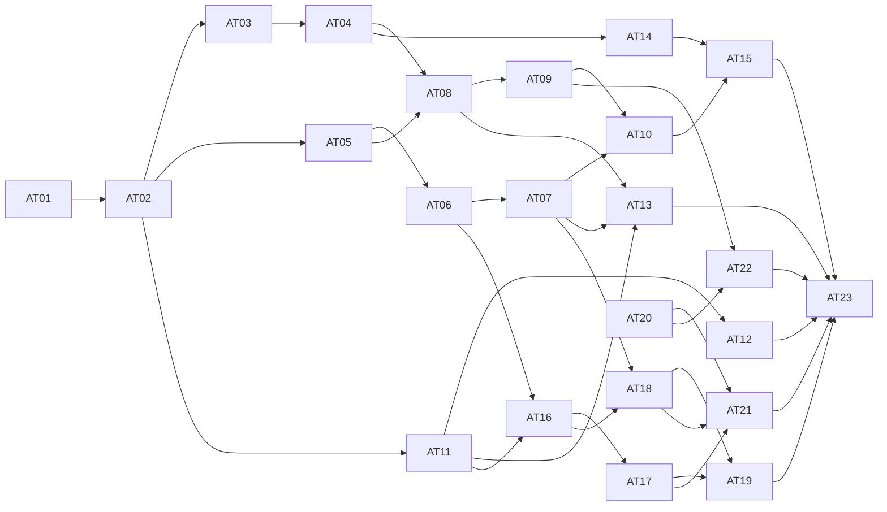

# Agent Teams 重构任务拆分

日期：2026-11-02  
状态：测试边界与任务拆分已批准，23 个子 Issue 已发布并核验；用户已授权实施，当前推进 AT01 与 AT20。

[GitHub Spec #125](https://github.com/elecvoid243/AstrBot_for_spzx/issues/125) · 全部 Issue 使用 `ready-for-agent` 标签。

[完整 Spec](../../specs/2026-11-02-agent-teams-rebuild.md) · [原始需求与澄清](../../specs/agent%20teams优化项.md)

## 已确认的测试边界

以现有版本化资产／运行公共接口为主要业务测试入口。复用真实临时数据库、图调度、人工状态与恢复；只在现有资源目录和模型／工具边界使用可控替身。HTTP、聊天与 WebUI 做必要的接线和可见行为验证，恢复关键路径使用真实进程终止与独立外部调用记录。

这不要求为测试另建一个统一外壳或一批内部 seam。相关现有公共服务、TeamPorts、FastAPI HTTP、主执行管线、进程恢复及 Vue 组件先例已核对。用户已于 2026-11-02 批准这一测试方案、下面的任务粒度与阻塞关系。

## 交付与集成规则

- 每个功能票完成对应存储、公共接口、实际执行／读取、UI、必要测试和说明，不按技术层分拆。每票都可演示或通过公共行为验证。
- 不安排无产品结果的预重构票；必要的接口收敛在第一次使用它的完整切片中完成，继续复用已有执行与测试边界。
- AT01–AT09 是新格式整体替换中的纵向切片，在同一隔离集成分支推进。它们可作局部验证，但不承诺各自可独立发布；AT10 是全部新格式通路完成后的集成检查门槛。
- 不为保持中间 CI 绿色添加槽位兼容层、双格式解析、旧数据转换或功能模式开关。新系统不迁移旧 Agent Teams 数据，也不自动清空用户数据。
- AT11 之后的功能可以在所列直接前置完成后开展，若新格式尚未集成则也基于同一隔离集成分支；正式发布必须通过 AT10。AT23 是最终跨功能与 UI 联验，不承接前面各票欠下的实现、测试或文档。
- AT20 可独立使用当前聊天授权边界实现；当前真正无阻塞的前沿为 AT01 与 AT20。排列是便于阅读的拓扑序，不要求把无依赖任务串行化。
- 仅列直接、真实的阻塞关系；同文件可能冲突是集成协调问题，不自动成为功能依赖。普通 ChatUI 会话协作和内置工具迁入的历史 Issue 不作为新阻塞。
- 不把 HTML 中的三种布局变成产品配置。正式 UI 落实已确认的信息结构和能力，视觉在该范围内收敛。

## 实施契约与调度

2026-11-02 启动实施。协调者负责共享契约、复杂恢复设计、集成与验收；具体任务由独立 GPT-6.1 Terra / xhigh 会话实现并向协调者汇报。起点为 `all` 的 `98c6742ee140e8c2a804a8c87898415928c420b2`，集成分支 `codex/agent-teams-rebuild`。实施使用独立工作树，不在正在用于其他功能的 `all` 工作区写入。工作区原有闪烁修复、文档删除和原型不自动纳入提交。

### 共享资源契约（协调者确定，AT01 首次落地）

- 继续由 `RoleAssetService` 的保存、读取、预览和解析接口承载角色配置，不增加第二个资源解析模块。`RoleDefinition` 直接保存 `provider_id`、`persona_id`、`tools`、`skills`、`knowledge_bases`；三类列表元素都是目录返回的真实资源 ID。不同资源类别可有相同 ID，不再要求跨类别别名唯一；每个列表内拒绝重复 ID。
- 删除角色定义中的 `model_slot`、`persona_slot` 与 `migration`；`RoleInstallation` 只保留 `profile_id`，不保留 `bindings`。沿用现有定义和安装记录的存储位置，不为去槽位增加无必要的数据库重建；记录内容必须是新格式。旧字段在写入／预览时产生定位错误，读取旧格式明确不可用，不能悄悄转为新默认配置。
- `profile_id` 是执行器与资源可用范围，不是资源别名。执行器、资源权限、文件工具模式和人格允许范围继续校验；不能因使用真实 ID 而放宽权限。知识库显式选择只按 ID 匹配，不按显示名称猜测。
- 未选人格即 `persona_id: null`，绝不读取配置档案或发起聊天的默认人格。人格内容与角色职责分别保留；`prompt` 仍表示角色职责，不能把人格文本替换职责或把二者重复注入。预览明确列出二者来源；执行时与任务内容共同进入现有管线。
- 角色可保存未完成的定义，读取给出未就绪原因。单独角色预览在本机执行器下缺少 `provider_id` 时未就绪；AT02 为工作流提供明确默认模型，解析顺序为 Agent 显式模型、资产显式默认模型，禁止回退到聊天模型。远端执行器按既有能力校验，不虚构本机模型或本机工具支持。
- 三类列表的 `null` 表示沿用已有默认来源，`[]` 表示禁用，非空列表表示完整选择；角色模板本身保留人格／配置档案默认来源的可见预览。AT03 的实例覆盖中，省略字段（或三类列表的 `null`）表示继承固定模板；自定义列表整体替换。人格覆盖必须区分省略（继承模板）与显式 `null`（清空），模型显式清空回到资产默认模型，职责用空文本清空。持久化和读回不能把省略字段自动补成显式清空值。
- 运行冻结配置只含实际资源身份、有效配置、来源和必要资源契约，不通过旧槽位表二次解析。恢复检查验证冻结身份与当前权限，不重新继承最新模板、人格或聊天默认值。AT09 导入时的跨实例选择是一次性的实际资源重定位，结果直接写入新定义，不留下运行期映射表。
- AT01 只承担完整角色通路及必要的共享类型调整。工作流／自主团队消费者由 AT02–AT09 接齐；不能为让中间旧测试通过而恢复旧字段。现有模块必须仍可导入，针对角色的公共行为测试必须通过；不把旧槽位用例的失败误报为整库通过。AT10 必须完成所有旧消费者与相应测试的替换并整体验证。

### 派发与验收规则

- 每个会话仅在分配的工作树和分支内修改；先读取实际 Issue 正文与评论，按该票验收标准实现完整通路。共享契约有冲突先向协调者报告，不能各自引入另一套格式。
- 完成后提交本票代码，汇报 SHA、变更范围、实际验证命令与结果、剩余问题。协调者审查提交、复测关键行为，再集成并解锁真正的后续依赖；仅有完成声明不视为已验收。
- 不自动 push、关闭 Issue 或合入 `all`；最终发布以 AT10 和 AT23 的集成验收为准。代码注释和日志使用英语，不新增发布 changelog。
- 首批 AT01 负责直接资源角色通路，AT20 负责完整聊天身份与现有授权通路。两者采用不同工作树；后续票从已验收的集成提交建立分支，不从落后的 `all` 复制旧格式。

## 任务清单

| Ticket | GitHub Issue | 被以下阻塞 | 可演示的交付内容 |
| --- | --- | --- | --- |
| [AT01 · 直接配置并保存新版角色模板](01-direct-role-resources.md) | [#126](https://github.com/elecvoid243/AstrBot_for_spzx/issues/126) | 无 | 用户在角色页面直接选择五类实际资源，预览有效配置，并保存、重新读取一个固定角色版本。 |
| [AT02 · 从一个直接配置的 Agent 创建并运行工作流](02-single-agent-workflow.md) | [#127](https://github.com/elecvoid243/AstrBot_for_spzx/issues/127) | [AT01 · #126](https://github.com/elecvoid243/AstrBot_for_spzx/issues/126) | 用户从统一工作流入口进入单 Agent 画布，配置职责、任务和资源，保存固定版本并完成一次真实管线运行。 |
| [AT03 · 引用固定角色版本并保留本地覆盖](03-pinned-role-overrides.md) | [#128](https://github.com/elecvoid243/AstrBot_for_spzx/issues/128) | [AT02 · #127](https://github.com/elecvoid243/AstrBot_for_spzx/issues/127) | 用户在工作流 Agent 中选择角色模板、覆盖少量配置、主动升级版本，并将直接配置的 Agent 保存为模板复用。 |
| [AT04 · 用预设角色创建并运行自主团队](04-autonomous-preset-members.md) | [#129](https://github.com/elecvoid243/AstrBot_for_spzx/issues/129) | [AT03 · #128](https://github.com/elecvoid243/AstrBot_for_spzx/issues/128) | 用户配置目标、协调者和预设成员后启动自主团队，由协调者在允许角色中动态分配任务并交付结果。 |
| [AT05 · 通过字段选择串联 Agent 与结构化输出](05-explicit-data-bindings.md) | [#130](https://github.com/elecvoid243/AstrBot_for_spzx/issues/130) | [AT02 · #127](https://github.com/elecvoid243/AstrBot_for_spzx/issues/127) | 用户把两个 Agent 串联，通过可视化选择器让下游读取指定上游字段，并按需定义结构化输出。 |
| [AT06 · 执行条件分支、并行汇合和局部失败](06-branches-and-all-join.md) | [#131](https://github.com/elecvoid243/AstrBot_for_spzx/issues/131) | [AT05 · #130](https://github.com/elecvoid243/AstrBot_for_spzx/issues/130) | 用户在画布配置条件与并行分支，运行只等待实际进入的所有成功分支，并清楚看到局部失败及受影响路径。 |
| [AT07 · 在画布编排有界循环并查看每轮结果](07-bounded-loop.md) | [#132](https://github.com/elecvoid243/AstrBot_for_spzx/issues/132) | [AT06 · #131](https://github.com/elecvoid243/AstrBot_for_spzx/issues/131) | 用户可见地配置循环范围、反馈关系、退出条件和轮数上限，并在运行中进入某一轮查看任务及产物。 |
| [AT08 · 调用固定版本的子工作流与自主团队](08-nested-asset-calls.md) | [#133](https://github.com/elecvoid243/AstrBot_for_spzx/issues/133) | [AT04 · #129](https://github.com/elecvoid243/AstrBot_for_spzx/issues/129)、[AT05 · #130](https://github.com/elecvoid243/AstrBot_for_spzx/issues/130) | 用户把已有工作流或自主团队作为一个调用节点复用，并进入其独立作用域查看执行和返回结果。 |
| [AT09 · 通过实际资源匹配导入导出新版资产包](09-new-package-import-export.md) | [#134](https://github.com/elecvoid243/AstrBot_for_spzx/issues/134) | [AT08 · #133](https://github.com/elecvoid243/AstrBot_for_spzx/issues/133) | 用户导出包含角色和嵌套资产的新版包，在另一套资源标识下选择本机资源并导入可运行资产。 |
| [AT10 · 完成新格式整体替换并移除旧兼容通路](10-new-format-integration.md) | [#135](https://github.com/elecvoid243/AstrBot_for_spzx/issues/135) | [AT07 · #132](https://github.com/elecvoid243/AstrBot_for_spzx/issues/132)、[AT09 · #134](https://github.com/elecvoid243/AstrBot_for_spzx/issues/134) | 新版角色、单 Agent／多节点工作流、自主团队及资产包在同一基线可运行，旧槽位与迁移入口不再可用。 |
| [AT11 · 在运行工作台流式阅读 Agent 的真实过程](11-readable-live-process.md) | [#136](https://github.com/elecvoid243/AstrBot_for_spzx/issues/136) | [AT02 · #127](https://github.com/elecvoid243/AstrBot_for_spzx/issues/127) | 用户启动一个 Agent 后，在正式运行工作台持续看到真实回复、思考及工具卡片，并重新打开同一运行读取已保存过程。 |
| [AT12 · 按模型调用查看真实上下文及注入来源](12-actual-context-sources.md) | [#137](https://github.com/elecvoid243/AstrBot_for_spzx/issues/137) | [AT11 · #136](https://github.com/elecvoid243/AstrBot_for_spzx/issues/136) | 用户从选中 Agent 的一次模型调用进入上下文详情，核对它实际看到的人格、职责、任务、上游内容、知识和 Skills。 |
| [AT13 · 切换多成员过程并在断线后连续回看](13-concurrent-stream-recovery.md) | [#138](https://github.com/elecvoid243/AstrBot_for_spzx/issues/138) | [AT07 · #132](https://github.com/elecvoid243/AstrBot_for_spzx/issues/132)、[AT08 · #133](https://github.com/elecvoid243/AstrBot_for_spzx/issues/133)、[AT11 · #136](https://github.com/elecvoid243/AstrBot_for_spzx/issues/136) | 用户可在并行 Agent、子作用域和循环轮次之间切换，刷新或断线后继续读取同一过程而不丢失、重复或串流。 |
| [AT14 · 自动保存草稿并手动生成固定版本](14-drafts-and-fixed-versions.md) | [#139](https://github.com/elecvoid243/AstrBot_for_spzx/issues/139) | [AT04 · #129](https://github.com/elecvoid243/AstrBot_for_spzx/issues/129) | 用户编辑角色、工作流或自主团队时自动保存草稿，刷新可继续；只有主动保存版本才改变可供引用的定义。 |
| [AT15 · 对草稿执行单节点、局部与完整试运行](15-draft-trial-runs.md) | [#140](https://github.com/elecvoid243/AstrBot_for_spzx/issues/140) | [AT10 · #135](https://github.com/elecvoid243/AstrBot_for_spzx/issues/135)、[AT14 · #139](https://github.com/elecvoid243/AstrBot_for_spzx/issues/139) | 用户选择草稿试运行范围和上游测试数据，真实执行所选步骤，并在独立测试记录中检查结果。 |
| [AT16 · 在统一待办中回答画布预设人工问题](16-persistent-human-inbox.md) | [#141](https://github.com/elecvoid243/AstrBot_for_spzx/issues/141) | [AT06 · #131](https://github.com/elecvoid243/AstrBot_for_spzx/issues/131)、[AT11 · #136](https://github.com/elecvoid243/AstrBot_for_spzx/issues/136) | 用户在画布配置人工问答及推荐来源，运行到该步骤后从全局待办或运行详情阅读依据并回答，相关路径继续。 |
| [AT17 · 把动态 ask_user_choice 接入持久等待与原调用接续](17-dynamic-choice-resumption.md) | [#142](https://github.com/elecvoid243/AstrBot_for_spzx/issues/142) | [AT16 · #141](https://github.com/elecvoid243/AstrBot_for_spzx/issues/141) | Agent 在执行中调用 ask_user_choice 后，用户能从同一待办入口回答；服务重启后仍接续原工具调用与运行。 |
| [AT18 · 审批精确产物版本并沿画布路径返工](18-artifact-approval-and-rework.md) | [#143](https://github.com/elecvoid243/AstrBot_for_spzx/issues/143) | [AT07 · #132](https://github.com/elecvoid243/AstrBot_for_spzx/issues/132)、[AT16 · #141](https://github.com/elecvoid243/AstrBot_for_spzx/issues/141) | 用户查看待审产物的固定版本和显式评审意见，选择通过或退回，让流程沿配置的交付或有界返工路径继续。 |
| [AT19 · 按已展示推荐处理可配置的人工超时](19-human-deadline-policies.md) | [#144](https://github.com/elecvoid243/AstrBot_for_spzx/issues/144) | [AT17 · #142](https://github.com/elecvoid243/AstrBot_for_spzx/issues/142)、[AT18 · #143](https://github.com/elecvoid243/AstrBot_for_spzx/issues/143) | 用户为预设问答、动态选择或产物审批设置期限，决定超时后继续等人还是采用创建时已展示的推荐。 |
| [AT20 · 粘贴完整聊天身份并绑定固定资产版本](20-paste-chat-identity.md) | [#145](https://github.com/elecvoid243/AstrBot_for_spzx/issues/145) | 无 | 用户把完整 /asset whoami 返回内容粘贴到聊天访问弹窗，核对自动解析结果后为固定资产版本配置授权。 |
| [AT21 · 在原聊天和 Dashboard 处理同一人工请求](21-chat-dashboard-shared-decisions.md) | [#146](https://github.com/elecvoid243/AstrBot_for_spzx/issues/146) | [AT17 · #142](https://github.com/elecvoid243/AstrBot_for_spzx/issues/142)、[AT18 · #143](https://github.com/elecvoid243/AstrBot_for_spzx/issues/143)、[AT20 · #145](https://github.com/elecvoid243/AstrBot_for_spzx/issues/145) | 聊天发起者在原聊天收到问题、推荐和可访问依据，或切到 Dashboard 回答，两处结果一致且只推进一次。 |
| [AT22 · 删除资产并保留已有固定引用与运行历史](22-asset-logical-deletion.md) | [#147](https://github.com/elecvoid243/AstrBot_for_spzx/issues/147) | [AT09 · #134](https://github.com/elecvoid243/AstrBot_for_spzx/issues/134)、[AT20 · #145](https://github.com/elecvoid243/AstrBot_for_spzx/issues/145) | 用户从角色、自主团队或工作流列表删除整个资产，新的直接使用被阻止，既有固定调用、运行和历史继续可用。 |
| [AT23 · 联验完整协作流程并交付稳定的响应式界面](23-integrated-ux-delivery.md) | [#148](https://github.com/elecvoid243/AstrBot_for_spzx/issues/148) | [AT12 · #137](https://github.com/elecvoid243/AstrBot_for_spzx/issues/137)、[AT13 · #138](https://github.com/elecvoid243/AstrBot_for_spzx/issues/138)、[AT15 · #140](https://github.com/elecvoid243/AstrBot_for_spzx/issues/140)、[AT19 · #144](https://github.com/elecvoid243/AstrBot_for_spzx/issues/144)、[AT21 · #146](https://github.com/elecvoid243/AstrBot_for_spzx/issues/146)、[AT22 · #147](https://github.com/elecvoid243/AstrBot_for_spzx/issues/147) | 用户在正式 Dashboard 从设计到运行、人工返工、恢复及资产整理完成整条流程，桌面与窄屏均有清晰、稳定、美观的使用体验。 |

## 阻塞关系

## 发布记录

已在 GitHub 的 elecvoid243/AstrBot_for_spzx 发布 Spec #125 和 23 个子 Issue，统一使用 ready-for-agent 标签。已逐项核验正文、标签、23 条原生父子关系和 37 条原生阻塞关系；各票正文使用实际 GitHub Issue 链接。历史父 Issue 未关闭或改写。

本目录保留已发布规范的本地对应文件和任务索引，GitHub 继续作为 Issue 跟踪器。无前置阻塞的任务为 AT01 与 AT20；其余任务按原生阻塞关系领取。此次授权完成规范和任务发布，不直接开始产品实现、清理旧数据或创建代码提交。

## 用户故事覆盖

编号对应 Spec 的 60 条用户故事。一个故事跨多个行为时可以由多票共同交付，不要求单票实现整个功能域。

| 用户故事 | 覆盖 Ticket |
| --- | --- |
| 1 | AT01、AT09、AT10 |
| 2 | AT01、AT09 |
| 3 | AT02、AT04 |
| 4 | AT02、AT04 |
| 5 | AT01、AT02、AT04、AT12 |
| 6 | AT01、AT14 |
| 7 | AT03、AT14 |
| 8 | AT03 |
| 9 | AT03 |
| 10 | AT01、AT03 |
| 11 | AT03 |
| 12 | AT02、AT10 |
| 13 | AT02 |
| 14 | AT02、AT03 |
| 15 | AT02、AT23 |
| 16 | AT05 |
| 17 | AT05、AT12 |
| 18 | AT05 |
| 19 | AT06 |
| 20 | AT06 |
| 21 | AT06 |
| 22 | AT07 |
| 23 | AT08、AT13 |
| 24 | AT04 |
| 25 | AT01、AT02、AT04、AT08、AT10、AT15、AT23 |
| 26 | AT14 |
| 27 | AT14 |
| 28 | AT15 |
| 29 | AT15 |
| 30 | AT15 |
| 31 | AT11、AT23 |
| 32 | AT07、AT08、AT13 |
| 33 | AT11 |
| 34 | AT11 |
| 35 | AT12 |
| 36 | AT11、AT13 |
| 37 | AT06、AT11、AT16、AT23 |
| 38 | AT17 |
| 39 | AT16、AT17、AT21 |
| 40 | AT18 |
| 41 | AT16、AT17 |
| 42 | AT16、AT17 |
| 43 | AT16、AT17 |
| 44 | AT21 |
| 45 | AT16、AT17、AT19、AT21 |
| 46 | AT16、AT17、AT19 |
| 47 | AT19 |
| 48 | AT19 |
| 49 | AT16、AT17、AT18 |
| 50 | AT18 |
| 51 | AT20 |
| 52 | AT20、AT21 |
| 53 | AT22 |
| 54 | AT22 |
| 55 | AT22 |
| 56 | AT09、AT10 |
| 57 | AT02、AT11、AT13、AT23 |
| 58 | AT13、AT23 |
| 59 | AT11、AT12、AT13 |
| 60 | AT23 |
