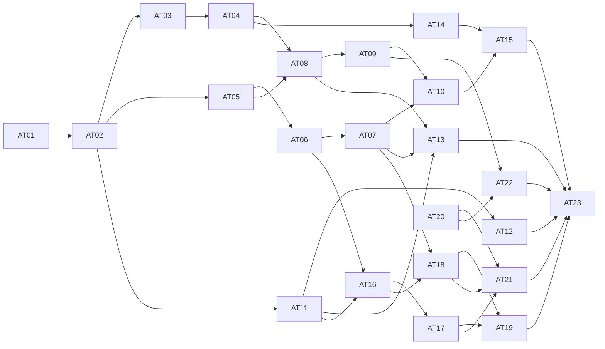

# Agent Teams 重构任务拆分

日期：2026-11-02  
状态：测试边界与任务拆分已批准，23 个子 Issue 已发布并核验；用户已授权实施。AT01、AT02、AT20 已集成并通过复测，AT03、AT05、AT11 已解除前置阻塞。

[GitHub Spec #125](https://github.com/elecvoid243/AstrBot_for_spzx/issues/125) · 全部 Issue 使用 `ready-for-agent` 标签。

[完整 Spec](../../specs/2026-11-02-agent-teams-rebuild.md) · [原始需求与澄清](../../specs/agent%20teams优化项.md)

## 已确认的测试边界

以现有版本化资产／运行公共接口为主要业务测试入口。复用真实临时数据库、图调度、人工状态与恢复；只在现有资源目录和模型／工具边界使用可控替身。HTTP、聊天与 WebUI 做必要的接线和可见行为验证，恢复关键路径使用真实进程终止与独立外部调用记录。

这不要求为测试另建一个统一外壳或一批内部 seam。相关现有公共服务、TeamPorts、FastAPI HTTP、主执行管线、进程恢复及 Vue 组件先例已核对。用户已于 2026-11-02 批准这一测试方案、下面的任务粒度与阻塞关系。

## 交付与集成规则

- 每个功能票完成对应存储、公共接口、实际执行／读取、UI、必要测试和说明，不按技术层分拆。每票都可演示或通过公共行为验证。
- 不安排无产品结果的预重构票；必要的接口收敛在第一次使用它的完整切片中完成，继续复用已有执行与测试边界。
- AT01–AT09 是新格式整体替换中的纵向切片，在同一隔离集成分支推进。它们可作局部验证，但不承诺各自可独立发布；AT10 是全部新格式通路完成后的集成检查门槛。
- 不为保持中间 CI 绿色添加槽位兼容层、双格式解析、旧数据转换或功能模式开关。新系统不迁移旧 Agent Teams 数据，也不自动清空用户数据。
- AT11 之后的功能可以在所列直接前置完成后开展，若新格式尚未集成则也基于同一隔离集成分支；正式发布必须通过 AT10。AT23 是最终跨功能与 UI 联验，不承接前面各票欠下的实现、测试或文档。
- AT20 可独立使用当前聊天授权边界实现；初始无阻塞前沿为 AT01 与 AT20，后续按已验收进度解锁。排列是便于阅读的拓扑序，不要求把无依赖任务串行化。
- 仅列直接、真实的阻塞关系；同文件可能冲突是集成协调问题，不自动成为功能依赖。普通 ChatUI 会话协作和内置工具迁入的历史 Issue 不作为新阻塞。
- 不把 HTML 中的三种布局变成产品配置。正式 UI 落实已确认的信息结构和能力，视觉在该范围内收敛。

## 实施契约与调度

2026-11-02 启动实施。协调者负责共享契约、复杂恢复设计、集成与验收；具体任务由独立 GPT-6.1 Terra / xhigh 会话实现并向协调者汇报。起点为 `all` 的 `98c6742ee140e8c2a804a8c87898415928c420b2`，集成分支 `codex/agent-teams-rebuild`。实施使用独立工作树，不在正在用于其他功能的 `all` 工作区写入。工作区原有闪烁修复、文档删除和原型不自动纳入提交。

### 共享资源契约（协调者确定，AT01 首次落地）

- 继续由 `RoleAssetService` 的保存、读取、预览和解析接口承载角色配置，不增加第二个资源解析模块。`RoleDefinition` 直接保存 `provider_id`、`persona_id`、`tools`、`skills`、`knowledge_bases`；三类列表元素都是目录返回的真实资源 ID。不同资源类别可有相同 ID，不再要求跨类别别名唯一；每个列表内拒绝重复 ID。
- 删除角色定义中的 `model_slot`、`persona_slot` 与 `migration`；`RoleInstallation` 只保留 `profile_id`，不保留 `bindings`。沿用现有定义和安装记录的存储位置，不为去槽位增加无必要的数据库重建；记录内容必须是新格式。旧字段在写入／预览时产生定位错误，读取旧格式明确不可用，不能悄悄转为新默认配置。
- `profile_id` 是执行器与资源可用范围，不是资源别名。执行器、资源权限、文件工具模式和人格允许范围继续校验；不能因使用真实 ID 而放宽权限。知识库显式选择只按 ID 匹配，不按显示名称猜测。
- 未选人格即 `persona_id: null`，绝不读取配置档案或发起聊天的默认人格。人格内容与角色职责分别保留；`prompt` 仍表示角色职责，不能把人格文本替换职责或把二者重复注入。预览明确列出二者来源；执行时与任务内容共同进入现有管线。
- 角色可保存未完成的定义，读取给出未就绪原因。单独角色预览在本机执行器下缺少 `provider_id` 时未就绪；AT02 为工作流提供明确默认模型，解析顺序为 Agent 显式模型、资产显式默认模型，禁止回退到聊天模型。远端执行器按既有能力校验，不虚构本机模型或本机工具支持。
- 三类列表的 `null` 表示沿用已有默认来源，`[]` 表示禁用，非空列表表示完整选择；角色模板本身保留人格／配置档案默认来源的可见预览。AT03 的实例覆盖中，省略字段（或三类列表的 `null`）表示继承固定模板；自定义列表整体替换。人格覆盖必须区分省略（继承模板）与显式 `null`（清空），模型显式清空回到资产默认模型，职责用空文本清空。持久化和读回不能把省略字段自动补成显式清空值。
- 运行冻结配置只含实际资源身份、有效配置、来源和必要资源契约，不通过旧槽位表二次解析。恢复检查验证冻结身份与当前权限，不重新继承最新模板、人格或聊天默认值。AT09 导入时的跨实例选择是一次性的实际资源重定位，结果直接写入新定义，不留下运行期映射表。
- AT01 只承担完整角色通路及必要的共享类型调整。工作流／自主团队消费者由 AT02–AT09 接齐；不能为让中间旧测试通过而恢复旧字段。现有模块必须仍可导入，针对角色的公共行为测试必须通过；不把旧槽位用例的失败误报为整库通过。AT10 必须完成所有旧消费者与相应测试的替换并整体验证。

### 派发与验收规则

- 每个会话仅在分配的工作树和分支内修改；先读取实际 Issue 正文与评论，按该票验收标准实现完整通路。共享契约有冲突先向协调者报告，不能各自引入另一套格式。
- 完成后提交本票代码，汇报 SHA、变更范围、实际验证命令与结果、剩余问题。协调者审查提交、复测关键行为，再集成并解锁真正的后续依赖；仅有完成声明不视为已验收。
- 不自动 push、关闭 Issue 或合入 `all`；最终发布以 AT10 和 AT23 的集成验收为准。代码注释和日志使用英语，不新增发布 changelog。
- 首批 AT01 负责直接资源角色通路，AT20 负责完整聊天身份与现有授权通路。两者采用不同工作树；后续票从已验收的集成提交建立分支，不从落后的 `all` 复制旧格式。

### 过程记录与人工恢复的实施约束（协调者负责）

代码核对发现两处不能仅改 UI 解决的问题：现有 `AgentWorkflowTodo.task_run_id` 有唯一约束，只支持每个任务一个预设问题；普通 `ask_user_choice` 依赖内存 Future、WebChat 回队列及通用工具超时。过程记录与执行检查点目前已分开，必须保留这个分工。

- AT11／AT13 继续使用 `AgentWorkflowProcess` 表达观察记录，使用已持久化事件的单调游标续读；不以进程内 token 序号冒充跨重启游标。一个记录可由多个文本增量补齐，但每个增量有稳定身份和确定顺序。快照返回其读取事务对应的高水位，后续事件严格从该水位之后补齐；展示归并不能修改执行检查点。
- 所有过程归属必须来自可信执行绑定，至少保留根运行、作用域、成员、任务运行、尝试及模型／工具调用身份；不得通过当前 UI 选中项反推归属。查询先做运行权限校验，游标只表示位置、不授予访问权。AT12 记录模型调用实际输入及来源，不能仅记录配置预览。
- AT16 建立统一人工请求接口时必须支持同一任务／尝试内多个请求。预设请求按节点执行身份固定；动态请求按原工具调用记录身份固定。不能继续把任务运行 ID 同时用作所有问题 ID，也不能只删除 ORM 中的 `unique=True` 就声称已有数据库约束已更新。存储结构变更走现有数据库初始化／升级机制，保留其他数据，不执行旧 Agent Teams 数据迁移或清库。
- 协调者已核对当前 ORM 生成的 SQLite DDL：上述唯一性来自显式唯一索引 `ix_agent_workflow_todos_task_run_id`，并非表级匿名约束。AT16 应检查实际 `PRAGMA index_list`，将这一已知旧唯一索引改为普通任务查询索引；新库直接生成非唯一索引。初始化更新保持事务性、可重复，保留已有行和其他表；不因移除一个索引而重建或清空整个团队数据库。若实际库出现另一约束形态，报告具体结构，不猜测或自动删数据。
- 人工请求具有持久 pending、answered、consumed、cancelled 事实，并保存请求类型、证据引用、允许动作、推荐、期限、决定来源和原调用身份。答案先唯一提交，执行消费再单独受当前执行权控制；全局暂停可以记录答案但不能消费，取消关闭未决请求并阻止迟到恢复。重复相同决定返回已有结果，不同决定产生明确冲突。
- AT17 由协调者亲自实现动态调用接续：复用 `current_team_execution` 与 `current_tool_invocation` 确认可信调用，先保存原调用／问题再展示。请求已经存在就读取同一请求，不再创建问题；恢复后将已保存答案送入原工具结果位置，不重跑前面的模型或已完成工具。未作答时持久挂起并释放执行容量，不能长期占住普通工具超时或内存 Future。
- 团队内的人工挂起必须成为执行器可识别的等待状态，不能被普通工具异常处理转成失败文本、被通用超时取消，或被重启扫描误判为未知外部副作用。只对具备相应恢复能力的执行器启用该能力；真正未知的外部工具效果仍保留现有显式处置规则。普通 ChatUI 保持原注册表、超时和回退行为。
- AT19 的超时决定与人工回答、取消竞争同一持久请求状态。只使用请求创建时保存且已展示的推荐动作及理由；无有效推荐仍 pending。截止时间不因重启重置，不在截止时发起新模型调用。时钟与并发测试使用可控触发和持久结果断言。
- 关键恢复验证由协调者验收：请求保存后、答案保存后、答案消费前后真实终止进程并重建；外部调用账本证明已完成工具不重复；多个请求、独立分支继续、暂停后回答、取消与回答竞争均穿过真实公共接口。不能以重载 Python 对象或只验证页面标签代替这些场景。

协调者直接负责 AT10 的新格式集成门槛、AT17 的原调用恢复、AT19 的超时竞争及 AT23 的最终联验；其余已细化切片在前置验收后派发。共享架构变化由协调者审查后更新本节，实施会话不自行扩展公共协议。

### 单 Agent 工作流接入契约（协调者确定，AT02 落地）

- 新工作流沿用 `GraphDefinition`、`GraphTask` 和现有图调度，不再经由旧单任务 `WorkflowDefinition` 创建入口，也不把新图转换回旧单任务格式执行。新建入口与旧编辑器入口合并后，已有其他模块的旧格式消费者由指定后续票替换；禁止增加自动转换器维持旧创建路径。
- 图内直接配置与固定角色引用是两种配置来源。直接配置使用现有 `RoleDefinition` 的资源与职责字段，并明确本机 `profile_id`；固定引用必须同时有角色 ID 与版本。每个 Agent 恰好选择一种来源，不能两个都填或只填半个引用，也不能为直接配置偷偷创建一个角色模板记录。AT03 再完善模板选择、升级及本地覆盖交互。
- 公共解析继续进入 `RoleAssetService`。图的默认模型字段定为 `default_provider_id`，Agent 的 `provider_id` 覆盖它；本机执行前必须得到合法实际模型。资产可保存未完成配置；若所有本机 Agent 已各自显式选好模型，不额外要求一个不会被使用的图默认值。没有单独选择的 Agent 必须采用合法的显式图默认值，两者均缺失则阻止启动。给预览提供图默认值时使用临时有效配置，不回写覆盖 Agent 原定义，不用空字符串或资源别名表示继承，不从发起聊天取得缺省模型。人格 `null` 始终表示无人格。
- 内联 Agent 没有角色资产身份。实例／并发记账必须按作用域中的成员配置身份区分，不能将所有 `role_id=None` 的 Agent 合为同一角色，也不能伪造可用于资产查询的角色 ID。固定模板实例仍按既有角色及版本限制；两种来源都保留真实成员、任务、尝试、执行权与资源快照。
- 默认画布的输入与输出是实际工作流输入／结果接口的视图，不是额外模型任务。输入节点编辑声明输入，Agent 显式读取；输出节点固定选择唯一 Agent 的文本结果，运行详情保留原任务结果与产物身份。输出不可伪造一次独立 Agent 执行或重复提交产物。多节点数据字段与结构化输出选择由 AT05 扩展。
- 正式 UI 继续使用版本化工作区中的 `WorkflowGraphCanvas` 与 Vue Flow；现有旧团队编辑器 `WorkflowEditor` 不作为新格式执行入口。节点侧栏直接配置职责、人格、模型及资源，图外显示默认模型；拖动、定位、撤销／重做和错误定位沿用当前实现。资源选择与角色表单可在确实复用时共用编辑逻辑，不复制第二套默认值／权限规则。
- 冻结时保留人格内容、职责及任务的独立来源；主执行管线使用冻结人格快照与职责，不重新读取聊天默认人格。必须用真实主 Agent 管线的受控外部模型场景，验证三部分各出现一次、所选模型和资源实际送达、无人格时没有默认人格泄入。只断言 TeamPorts 收到字典不能证明这项接线完成。
- 知识库 ID 必须一直保留到检索执行。协调者已复现 `get_kb_by_name` 优先匹配名称时会把所选库 ID 误认成另一个库的名称；新版执行绑定使用明确的 `kb_ids`，检索按 `get_kb(id)` 定位并将原 ID 及对应实例送入既有检索管理器。普通 ChatUI 的名称入口保留原义，同一检索调用不混用名称与 ID；不把 ID 转成名称后再次猜测。用名称与 ID 碰撞、库重命名及显式空选择场景验证实际知识检索，空选择不能回退到聊天／配置默认。
- 角色预览测试不能替代工作流验收。AT02 自身新增／修改的工作流服务、图校验、HTTP、组件及实际管线用例必须通过，更新本票内旧假设；独立的包格式与嵌套资产测试可等待 AT09，但逐项列明。完成实际新建、保存版本、重开、启动、结果读取及刷新不丢失编辑选择的闭环后，再解锁 AT03／AT05／AT11。

### 模板覆盖与显式数据的并行边界（协调者确定，AT03／AT05 落地）

- AT03 负责 Agent 的配置来源、固定模板版本、覆盖编辑与升级；AT05 负责图输入、输出契约、数据引用、结果出口及上下文隔离。两票可同时修改 `GraphTask`／`WorkflowGraphCanvas`，但不得整文件重写或复制画布；共享差异由协调者集成。AT11 只扩展运行过程和阅读工作台，不重做设计画布。
- AT03 沿用 `RoleOverrides` 和 `RoleAssetService.preview_role`，不建立第二套模板合并器。需要继承的字段保留省略；显式清空人格／模型必须保留 `null`。保存、图校验、成员配置比较和冻结路径中的 `model_dump(exclude_none=True)`／无差别补默认值需要逐处核对，避免清空在往返后变成继承，或不同覆盖被认为同一成员配置。源定义的版本、覆盖与生效预览分别保存其语义。
- AT03 的“保存为模板”通过现有角色创建接口保存直接配置的职责和资源，不把本次任务、输入引用、输出契约、运行状态或图默认模型偷偷复制成角色职责／显式模型。模板可保留未指定模型并由使用它的资产提供默认值。是否改为引用新模板应由明确 UI 操作决定，不能后台改动其他节点。
- AT05 沿用 `TaskInput`、`field_schema`、现有输出契约验证和产物身份。默认输出仍是文本；结构化字段表单生成既有 JSON Schema，不新增独立类型系统。第一步覆盖已有可保证存在的标量字段类型与嵌套对象路径，非必填、数组或复杂 Schema 中不能安全引用的字段说明原因，不猜测或静默改写。
- 图输出首先选择一个明确任务的完整已验证结果，用 `GraphDefinition.result_task_id` 保存选择，输出节点展示所选结果契约。它不是额外执行任务，也不重新提交相同产物：公共 `result`／`result_ref` 指向选定任务当前轮次的原结果／原产物。单 Agent 初始画布显式选择该 Agent；多节点不能默认汇总全部任务结果或猜最后执行的节点。缺失／无效选择阻止启动，保存未完成编辑时给出定位诊断；只修改显示名称不改变稳定任务 ID，删除被选任务必须显示失效引用。AT08 的子工作流再复用这个公开结果出口。
- 控制依赖不自动共享模型上下文。现有同名 `member` 在多个任务间复用 `conversation_id` 会让未选择的数据经历史泄入下游；AT05 为图任务分配独立的持久对话与投递会话，成员身份、并发和作用域仍沿用现有规则。同一任务的恢复继续原对话与检查点，不能每次重试新建；`_advance_loops` 创建新一轮任务时也在同一调度事务内创建新对话，并保留反馈选择的字段路径。不能以临时禁止所有循环代替这项必要接线，AT07 再验证完整循环交互与轮次展示。静态图根成员只表达身份和配置，不暴露未创建的占位对话；实际会话属于任务。自主团队显式成员通信与协调者会话由 AT04 单独处理，不全局改变普通 ChatUI。
- 数据引用固定上游产物版本，但只把明确选中的字段注入任务。测试必须包括相同成员配置的两个连续图任务：第一步的未选秘密文本、工具过程及聊天历史均不进入第二步实际模型请求；不能只检查模板替换字符串。读取完整产物的工具权限不能因一个标量字段引用而无条件扩大：图任务的 `read_task_artifact` 仅返回已选字段投影，不能凭相同成员身份读取其他任务的完整结果；任务管理／通信工具也不能绕过这一边界。Dashboard 所有者读取完整产物的既有权限不变，自主团队的明确通信另按其授权处理。

### 逐段过程记录接入契约（协调者确定，AT11 首次落地）

现有 `ToolLoopAgentRunner` 在完整回复时调用 `record_process`，正文／思考片段则直接向聊天显示链路输出；`TeamPorts.collect` 的内存事件没有完整调用归属，不能充当新版持久过程来源。现有 `get_events` 每次有变化都读取完整历史快照，需要调整为有界增量读取。

- 复用 `NodeExecutionBinding.record_process`、`WorkflowService.record_process`、`AgentWorkflowProcess` 和 `AgentWorkflowEvent`；不再添加第二套运行事件总线或另一个持久过程模块。原始片段在执行器已知调用身份的位置进入记录接口，不能从最终拼接文本倒推片段，也不能从聊天队列按显示名称猜调用。
- 新版团队的本机执行在可信执行绑定和持久过程接口存在时局部启用模型流式，不由普通聊天的 `streaming_response: false` 静默关闭；不修改共享 stage 配置或普通 ChatUI 行为。聊天 Provider 基类的 `text_chat_stream` 未实现，不能误用 TTS 的 `support_stream`。确实没有实现流式的提供商保留一次非流式调用并明确仅有终态的观察范围；不能拆分完整文本冒充流，也不能在实际请求已交付后为获取流式而重新发送。
- 过程片段与对应事件在同一事务提交；跨重连游标始终使用已提交的 `AgentWorkflowEvent.id`。片段是不可变观察事实，完整回复是同一次交付的终态事实，读取与展示按关联身份归并。相同记录身份及内容重送幂等，不同内容复用身份报冲突；原有执行权与尝试检查仍适用于片段写入。
- 完整响应与实际交付的对应关系作为执行来源身份保存于既有 response checkpoint（例如 `response_receipt_id`），与响应同次提交，恢复重用原响应时复用该关系；新请求清空旧关联，新交付使用新 receipt。参数解析／修复及父响应重用不能借用上一请求身份。该字段不包含观察片段、游标或 UI 状态；无需额外的过程读取回调或映射表。
- 区分逻辑模型调用与一次实际交付。恢复未完成请求时可能保留 `invocation_id`，但重新交付已有独立的用量 `receipt_id`；片段身份不能只使用 `invocation_id + 从零开始的内存序号`。复用实际交付身份作为分段范围，并将其与逻辑调用关联；中断交付的部分输出不得与重试／备用模型的新输出无标记地拼接。正常终态只替换同一交付的临时展示，不把完整正文再次追加。
- 根运行、作用域、任务运行、成员和尝试从当前持久运行及可信绑定取得；模型交付从执行器确定的调用／用量身份取得；工具过程关联原持久工具调用记录及结果序号。缺少某种远端过程身份时显示能力范围，不能制造假的本机调用、思考或工具进度。
- 文本按有界时间及大小批量提交；首段及时可见，回复结束、工具开始／结束、错误和正常挂起前刷出待存内容。缓冲量和定时任务必须有界且有明确收尾；异常退出只能丢失尚未提交的缓冲，不得返回未提交游标。进程终止后已保存的部分文本仍可读，并能区分未完成交付。
- 扩展既有公开事件读取为按游标查询的有界批次，返回该批实际过程记录及必要状态事实。不能每个 token 触发一份包含全部历史的 `get_run`；初次读取、明确重置或需要重新同步状态时才读取一致快照。流式 HTTP 入口复用同一授权与持久读取接口；断开只停止观察，不取消运行，不建立第二套只在内存存在的事实。
- 前端按运行／任务／尝试／交付身份维护稳定阅读项，复用 ChatUI 的 Markdown、思考折叠、工具与文件展示组件。运行事实、选择状态、编辑输入和滚动意图分开更新；新增内容只在用户仍跟随末尾时滚动。完整响应、重复事件和重新取快照都不能新增一份相同消息，执行状态以服务端事实为准。
- AT11 验收必须让可控模型在输出首段后等待：最终回复尚未产生时，另一个公共读取客户端已能获取并展示首段；随后终态只出现一次。另验相同投递重送、写入事务失败、终态前重开、旧执行权写入被拒以及普通 ChatUI 不受影响。AT13 扩展并行／嵌套／循环恢复矩阵，不承接这些单 Agent 基础保证。

### 自主团队预设配置契约（协调者确定，AT04 落地）

- `TeamRole` 表达资产内的预设配置，增加稳定的 `id`；配置来源与图 Agent 一致，二选一为 `role` + `installation` 的直接配置，或 `role_id` + `role_version` + `overrides` 的固定模板引用。复用现有角色解析／冻结方法，不额外保存匿名角色资产。覆盖序列化保留省略与显式空值；资产定义提供 `default_provider_id`，解析时使用，不能回退发起聊天默认。
- 预设 ID、模板 ID 和运行成员 ID 是不同身份。允许同一模板在多个预设中以不同覆盖重复使用；`allowed_roles` 的唯一性按预设 ID 验证，冻结白名单以预设 ID 为键。协调者的 `create_member` 请求使用 `preset_id`，只能从冻结白名单实例化，不接受模型提交资源或角色定义。不保留旧 `role_id` 请求别名，也不引入数据迁移。协调者本身也有固定预设身份，但不会自动加入可创建成员的白名单。
- 模板的实例／并发上限仍按原模板及版本累计，不能通过多个预设绕过；直接配置按资产内稳定预设身份计量，不能因每次新建成员 ID 获得独立配额。运行成员、任务、尝试仍使用现有持久 ID，并保留预设来源，显示名称不参与身份或结果匹配。
- 自主成员沿用其明确的持续对话与消息通信；AT05 的静态图任务隔离不全局改变自主成员行为。协调者只可用既有管理、通信、结果工具操纵本运行范围的成员。实际主管线验证两种配置来源、至少两名预设成员、资源权限与无默认人格泄入，以及同名成员／重复模板仍有正确归属。
- `AutonomousTeamDialog` 沿用既有创建与固定版本入口，提供默认模型、协调者及可添加／删除的预设配置卡片；局部覆盖使用相同资源编辑器与角色解析接口，不复制另一套合并算法。目标属于启动输入，不将每次目标固化为角色职责。保存、重开、就绪检查、启动、恢复与运行读取须闭环通过；包格式消费者留给 AT09，但不以新增兼容路径隐藏缺口。

### 条件与 ALL 汇合执行契约（协调者确定，AT06 落地）

- 沿用 `GraphTask`／`AgentWorkflowRun`，增加非 Agent 的 `control` 配置，类型为 `condition` 或 `join`；与 Agent、人工节点、子资产调用互斥。控制节点不创建成员、对话、模型调用或执行器任务，不占 Agent 并发配额。既有根调度事务直接持久化其求值与完成事实，不新增调度器。
- 条件节点通过已有 `inputs` 字段选择器声明唯一的 `value` 输入，`control` 保存比较运算和值；后端复用 `field_schema`／`matches_condition` 做字段及类型检查，按原生标量比较而不是比较格式化字符串。上游必填标量及工作流字符串输入是首批可用来源。求值持久化为该节点的 `matched` 布尔结果；两条可辨识出口复用 `GraphEdge.condition` 的 `matched == true/false` 表示，界面显示明确名称。控制节点结果是调度事实，不生成虚构的模型产物；不能选作最终结果或作为普通数据产物引用。
- `join` 只表示 ALL，没有可配置的 ANY／竞速模式。保留现有入边归并规则：先等所有仍未确定的前驱；已跳过及条件未选中路径不计入，已进入的前驱必须全部成功，失败阻塞下游。全部入边都未进入时汇合本身跳过，不能凭空启动后续步骤。并行由多条控制连线表示，不增设独立后台工作器。
- 调度沿用根锁／事务与当前轮次任务映射。控制节点的完成与继任认领按同一事务推进，并发通知不得二次执行。明确返回并展示未开始、等待前驱、等待执行配额、条件跳过、失败及依赖失败；展示等候的节点与原因，不将其混入需要人类回答的待办。
- 完成节点目录、条件／汇合卡片、命名出口、侧栏、删除及撤销／重做的必要接线；复用画布、字段选择器和现有状态组件。受控屏障用例覆盖选中／未选中分支、慢分支、局部失败、重复调度以及汇合后的最终输入，不能仅验证静态卡片。循环控制节点接线不可破坏已有轮次路径，AT07 再完成有界循环完整体验与恢复矩阵。

### 已验收进度

- AT05（2026-11-03）：实施提交 `84c8f8142`，集成提交 `a2146577b`。显式结果出口、字段选择与产物投影、静态图任务及循环新轮次独立会话已落地；子团队调用只获得所选字段值。协调者复测后端组合 89 项通过，另修正 AT03 测试数据的显式结果出口并复测 1 项通过；81 项合并后的画布／工作区／角色覆盖组件测试与全库 Ruff 通过。实施会话已验证真实模型请求的数据隔离、子团队读取边界及进程终止后的同一任务会话恢复。中英文实际组件隔离样例截图、文档、OpenAPI 和前端类型已同步。类型检查仅余 AT09 的 3 处旧包 `bindings` 错误；完整后端浏览器联验仍属 AT23。AT06 可从此集成基线开展。
- AT03（2026-11-03）：实施提交 `7502260b3`，集成提交 `3c417297c`。固定模板引用、主动升级、局部覆盖、有效配置及来源预览、直接配置保存为模板已落地；覆盖在图定义往返与冻结中保留显式空值。协调者复测 6 项后端测试与 79 项组件测试通过，全库 Ruff 与 diff 检查通过；实施会话另完成 17 项服务／HTTP 及 35 项图调度测试。正式组件的隔离样例浏览器验证升级保留清空人格与禁用工具，保存 4 张中英文截图；完整后端浏览器联验仍在 AT23。AT09 的 3 处旧包 `bindings` 类型错误仍存在。AT04 可从此集成基线开展。

- AT02（2026-11-03）：实施提交 `2be083940`，集成提交 `4ba3f6c32`。统一单 Agent 画布、直接配置、固定版本启动、原任务结果出口及实际知识库 ID 检索已落地；协调者复测集成分支 26 项角色／工作流 HTTP／实际主管线测试和 83 项组件测试通过，全库 Ruff 与 diff 检查通过。实施会话另完成 123 项相关后端回归、新版主管线 10 项和用量 11 项。协调者使用实际组件与隔离示例数据验证中英文页面，修正画布溢出和小地图遮挡，保存 4 张文档截图；这不等于完成整个 Dashboard 与实际后端的浏览器联验。类型检查和构建仍有 AT09 资产包界面的 3 处旧 `bindings` 错误，旧资产包／嵌套／迁移消费者按原票继续替换；不新增兼容层。AT03、AT05、AT11 可从本集成基线并行开展。
- AT01（2026-11-03）：实施提交 `e9977a823`、`8c47cdc65`，集成提交 `c84c39c1f`、`8e694064a`。角色配置直接保存实际资源，移除槽位及绑定字段，明确无人格与默认／禁用资源语义；已补齐模型、人格配置档案范围校验及中英文实际组件截图。协调者在集成分支复跑完整角色公共服务及 HTTP 测试 19 项、角色及聊天身份组件测试 10 项，全部通过；全库 Ruff 及三份角色测试文件的显式检查通过。工作流与包的旧格式消费者仍由 AT02–AT09 接齐，整体类型检查中已知的包绑定字段错误不视为已修复；AT10 之前不声明新版可发布。
- AT20：实施提交 `bf112d9aa`，集成提交 `8746a1f8e`。完整身份粘贴、只读核对、错误保留、固定版本授权与中英文说明已落地；协调者复测 19 项真实聊天／权限测试及 2 项组件测试通过。实施会话完成类型检查与构建；真实浏览器与服务联合操作留给 AT23 总体验收，不将其报告为本票已验证。
- 集成起点角色服务、角色 HTTP、预设人工节点基线：21 项通过。新格式尚未完成 AT10 整体验收，不能将 AT20 的局部通过理解为整个重构可发布。

## 任务清单

| Ticket | GitHub Issue | 被以下阻塞 | 可演示的交付内容 |
| --- | --- | --- | --- |
| [AT01 · 直接配置并保存新版角色模板](01-direct-role-resources.md) | [#126](https://github.com/elecvoid243/AstrBot_for_spzx/issues/126) | 无 | 用户在角色页面直接选择五类实际资源，预览有效配置，并保存、重新读取一个固定角色版本。 |
| [AT02 · 从一个直接配置的 Agent 创建并运行工作流](02-single-agent-workflow.md) | [#127](https://github.com/elecvoid243/AstrBot_for_spzx/issues/127) | [AT01 · #126](https://github.com/elecvoid243/AstrBot_for_spzx/issues/126) | 用户从统一工作流入口进入单 Agent 画布，配置职责、任务和资源，保存固定版本并完成一次真实管线运行。 |
| [AT03 · 引用固定角色版本并保留本地覆盖](03-pinned-role-overrides.md) | [#128](https://github.com/elecvoid243/AstrBot_for_spzx/issues/128) | [AT02 · #127](https://github.com/elecvoid243/AstrBot_for_spzx/issues/127) | 用户在工作流 Agent 中选择角色模板、覆盖少量配置、主动升级版本，并将直接配置的 Agent 保存为模板复用。 |
| [AT04 · 用预设角色创建并运行自主团队](04-autonomous-preset-members.md) | [#129](https://github.com/elecvoid243/AstrBot_for_spzx/issues/129) | [AT03 · #128](https://github.com/elecvoid243/AstrBot_for_spzx/issues/128) | 用户配置目标、协调者和预设成员后启动自主团队，由协调者在允许角色中动态分配任务并交付结果。 |
| [AT05 · 通过字段选择串联 Agent 与结构化输出](05-explicit-data-bindings.md) | [#130](https://github.com/elecvoid243/AstrBot_for_spzx/issues/130) | [AT02 · #127](https://github.com/elecvoid243/AstrBot_for_spzx/issues/127) | 用户把两个 Agent 串联，通过可视化选择器让下游读取指定上游字段，并按需定义结构化输出。 |
| [AT06 · 执行条件分支、并行汇合和局部失败](06-branches-and-all-join.md) | [#131](https://github.com/elecvoid243/AstrBot_for_spzx/issues/131) | [AT05 · #130](https://github.com/elecvoid243/AstrBot_for_spzx/issues/130) | 用户在画布配置条件与并行分支，运行只等待实际进入的所有成功分支，并清楚看到局部失败及受影响路径。 |
| [AT07 · 在画布编排有界循环并查看每轮结果](07-bounded-loop.md) | [#132](https://github.com/elecvoid243/AstrBot_for_spzx/issues/132) | [AT06 · #131](https://github.com/elecvoid243/AstrBot_for_spzx/issues/131) | 用户可见地配置循环范围、反馈关系、退出条件和轮数上限，并在运行中进入某一轮查看任务及产物。 |
| [AT08 · 调用固定版本的子工作流与自主团队](08-nested-asset-calls.md) | [#133](https://github.com/elecvoid243/AstrBot_for_spzx/issues/133) | [AT04 · #129](https://github.com/elecvoid243/AstrBot_for_spzx/issues/129)、[AT05 · #130](https://github.com/elecvoid243/AstrBot_for_spzx/issues/130) | 用户把已有工作流或自主团队作为一个调用节点复用，并进入其独立作用域查看执行和返回结果。 |
| [AT09 · 通过实际资源匹配导入导出新版资产包](09-new-package-import-export.md) | [#134](https://github.com/elecvoid243/AstrBot_for_spzx/issues/134) | [AT08 · #133](https://github.com/elecvoid243/AstrBot_for_spzx/issues/133) | 用户导出包含角色和嵌套资产的新版包，在另一套资源标识下选择本机资源并导入可运行资产。 |
| [AT10 · 完成新格式整体替换并移除旧兼容通路](10-new-format-integration.md) | [#135](https://github.com/elecvoid243/AstrBot_for_spzx/issues/135) | [AT07 · #132](https://github.com/elecvoid243/AstrBot_for_spzx/issues/132)、[AT09 · #134](https://github.com/elecvoid243/AstrBot_for_spzx/issues/134) | 新版角色、单 Agent／多节点工作流、自主团队及资产包在同一基线可运行，旧槽位与迁移入口不再可用。 |
| [AT11 · 在运行工作台流式阅读 Agent 的真实过程](11-readable-live-process.md) | [#136](https://github.com/elecvoid243/AstrBot_for_spzx/issues/136) | [AT02 · #127](https://github.com/elecvoid243/AstrBot_for_spzx/issues/127) | 用户启动一个 Agent 后，在正式运行工作台持续看到真实回复、思考及工具卡片，并重新打开同一运行读取已保存过程。 |
| [AT12 · 按模型调用查看真实上下文及注入来源](12-actual-context-sources.md) | [#137](https://github.com/elecvoid243/AstrBot_for_spzx/issues/137) | [AT11 · #136](https://github.com/elecvoid243/AstrBot_for_spzx/issues/136) | 用户从选中 Agent 的一次模型调用进入上下文详情，核对它实际看到的人格、职责、任务、上游内容、知识和 Skills。 |
| [AT13 · 切换多成员过程并在断线后连续回看](13-concurrent-stream-recovery.md) | [#138](https://github.com/elecvoid243/AstrBot_for_spzx/issues/138) | [AT07 · #132](https://github.com/elecvoid243/AstrBot_for_spzx/issues/132)、[AT08 · #133](https://github.com/elecvoid243/AstrBot_for_spzx/issues/133)、[AT11 · #136](https://github.com/elecvoid243/AstrBot_for_spzx/issues/136) | 用户可在并行 Agent、子作用域和循环轮次之间切换，刷新或断线后继续读取同一过程而不丢失、重复或串流。 |
| [AT14 · 自动保存草稿并手动生成固定版本](14-drafts-and-fixed-versions.md) | [#139](https://github.com/elecvoid243/AstrBot_for_spzx/issues/139) | [AT04 · #129](https://github.com/elecvoid243/AstrBot_for_spzx/issues/129) | 用户编辑角色、工作流或自主团队时自动保存草稿，刷新可继续；只有主动保存版本才改变可供引用的定义。 |
| [AT15 · 对草稿执行单节点、局部与完整试运行](15-draft-trial-runs.md) | [#140](https://github.com/elecvoid243/AstrBot_for_spzx/issues/140) | [AT10 · #135](https://github.com/elecvoid243/AstrBot_for_spzx/issues/135)、[AT14 · #139](https://github.com/elecvoid243/AstrBot_for_spzx/issues/139) | 用户选择草稿试运行范围和上游测试数据，真实执行所选步骤，并在独立测试记录中检查结果。 |
| [AT16 · 在统一待办中回答画布预设人工问题](16-persistent-human-inbox.md) | [#141](https://github.com/elecvoid243/AstrBot_for_spzx/issues/141) | [AT06 · #131](https://github.com/elecvoid243/AstrBot_for_spzx/issues/131)、[AT11 · #136](https://github.com/elecvoid243/AstrBot_for_spzx/issues/136) | 用户在画布配置人工问答及推荐来源，运行到该步骤后从全局待办或运行详情阅读依据并回答，相关路径继续。 |
| [AT17 · 把动态 ask_user_choice 接入持久等待与原调用接续](17-dynamic-choice-resumption.md) | [#142](https://github.com/elecvoid243/AstrBot_for_spzx/issues/142) | [AT16 · #141](https://github.com/elecvoid243/AstrBot_for_spzx/issues/141) | Agent 在执行中调用 ask_user_choice 后，用户能从同一待办入口回答；服务重启后仍接续原工具调用与运行。 |
| [AT18 · 审批精确产物版本并沿画布路径返工](18-artifact-approval-and-rework.md) | [#143](https://github.com/elecvoid243/AstrBot_for_spzx/issues/143) | [AT07 · #132](https://github.com/elecvoid243/AstrBot_for_spzx/issues/132)、[AT16 · #141](https://github.com/elecvoid243/AstrBot_for_spzx/issues/141) | 用户查看待审产物的固定版本和显式评审意见，选择通过或退回，让流程沿配置的交付或有界返工路径继续。 |
| [AT19 · 按已展示推荐处理可配置的人工超时](19-human-deadline-policies.md) | [#144](https://github.com/elecvoid243/AstrBot_for_spzx/issues/144) | [AT17 · #142](https://github.com/elecvoid243/AstrBot_for_spzx/issues/142)、[AT18 · #143](https://github.com/elecvoid243/AstrBot_for_spzx/issues/143) | 用户为预设问答、动态选择或产物审批设置期限，决定超时后继续等人还是采用创建时已展示的推荐。 |
| [AT20 · 粘贴完整聊天身份并绑定固定资产版本](20-paste-chat-identity.md) | [#145](https://github.com/elecvoid243/AstrBot_for_spzx/issues/145) | 无 | 用户把完整 /asset whoami 返回内容粘贴到聊天访问弹窗，核对自动解析结果后为固定资产版本配置授权。 |
| [AT21 · 在原聊天和 Dashboard 处理同一人工请求](21-chat-dashboard-shared-decisions.md) | [#146](https://github.com/elecvoid243/AstrBot_for_spzx/issues/146) | [AT17 · #142](https://github.com/elecvoid243/AstrBot_for_spzx/issues/142)、[AT18 · #143](https://github.com/elecvoid243/AstrBot_for_spzx/issues/143)、[AT20 · #145](https://github.com/elecvoid243/AstrBot_for_spzx/issues/145) | 聊天发起者在原聊天收到问题、推荐和可访问依据，或切到 Dashboard 回答，两处结果一致且只推进一次。 |
| [AT22 · 删除资产并保留已有固定引用与运行历史](22-asset-logical-deletion.md) | [#147](https://github.com/elecvoid243/AstrBot_for_spzx/issues/147) | [AT09 · #134](https://github.com/elecvoid243/AstrBot_for_spzx/issues/134)、[AT20 · #145](https://github.com/elecvoid243/AstrBot_for_spzx/issues/145) | 用户从角色、自主团队或工作流列表删除整个资产，新的直接使用被阻止，既有固定调用、运行和历史继续可用。 |
| [AT23 · 联验完整协作流程并交付稳定的响应式界面](23-integrated-ux-delivery.md) | [#148](https://github.com/elecvoid243/AstrBot_for_spzx/issues/148) | [AT12 · #137](https://github.com/elecvoid243/AstrBot_for_spzx/issues/137)、[AT13 · #138](https://github.com/elecvoid243/AstrBot_for_spzx/issues/138)、[AT15 · #140](https://github.com/elecvoid243/AstrBot_for_spzx/issues/140)、[AT19 · #144](https://github.com/elecvoid243/AstrBot_for_spzx/issues/144)、[AT21 · #146](https://github.com/elecvoid243/AstrBot_for_spzx/issues/146)、[AT22 · #147](https://github.com/elecvoid243/AstrBot_for_spzx/issues/147) | 用户在正式 Dashboard 从设计到运行、人工返工、恢复及资产整理完成整条流程，桌面与窄屏均有清晰、稳定、美观的使用体验。 |

## 阻塞关系

## 发布记录

已在 GitHub 的 elecvoid243/AstrBot_for_spzx 发布 Spec #125 和 23 个子 Issue，统一使用 ready-for-agent 标签。已逐项核验正文、标签、23 条原生父子关系和 37 条原生阻塞关系；各票正文使用实际 GitHub Issue 链接。历史父 Issue 未关闭或改写。

本目录保留已发布规范的本地对应文件和任务索引，GitHub 继续作为 Issue 跟踪器。原始无前置阻塞任务为 AT01 与 AT20；其余任务按原生阻塞关系领取。规范发布后用户已追加授权实施和分会话派发；实际进度见上方记录。仍不执行旧数据清理。

## 用户故事覆盖

编号对应 Spec 的 60 条用户故事。一个故事跨多个行为时可以由多票共同交付，不要求单票实现整个功能域。

| 用户故事 | 覆盖 Ticket |
| --- | --- |
| 1 | AT01、AT09、AT10 |
| 2 | AT01、AT09 |
| 3 | AT02、AT04 |
| 4 | AT02、AT04 |
| 5 | AT01、AT02、AT04、AT12 |
| 6 | AT01、AT14 |
| 7 | AT03、AT14 |
| 8 | AT03 |
| 9 | AT03 |
| 10 | AT01、AT03 |
| 11 | AT03 |
| 12 | AT02、AT10 |
| 13 | AT02 |
| 14 | AT02、AT03 |
| 15 | AT02、AT23 |
| 16 | AT05 |
| 17 | AT05、AT12 |
| 18 | AT05 |
| 19 | AT06 |
| 20 | AT06 |
| 21 | AT06 |
| 22 | AT07 |
| 23 | AT08、AT13 |
| 24 | AT04 |
| 25 | AT01、AT02、AT04、AT08、AT10、AT15、AT23 |
| 26 | AT14 |
| 27 | AT14 |
| 28 | AT15 |
| 29 | AT15 |
| 30 | AT15 |
| 31 | AT11、AT23 |
| 32 | AT07、AT08、AT13 |
| 33 | AT11 |
| 34 | AT11 |
| 35 | AT12 |
| 36 | AT11、AT13 |
| 37 | AT06、AT11、AT16、AT23 |
| 38 | AT17 |
| 39 | AT16、AT17、AT21 |
| 40 | AT18 |
| 41 | AT16、AT17 |
| 42 | AT16、AT17 |
| 43 | AT16、AT17 |
| 44 | AT21 |
| 45 | AT16、AT17、AT19、AT21 |
| 46 | AT16、AT17、AT19 |
| 47 | AT19 |
| 48 | AT19 |
| 49 | AT16、AT17、AT18 |
| 50 | AT18 |
| 51 | AT20 |
| 52 | AT20、AT21 |
| 53 | AT22 |
| 54 | AT22 |
| 55 | AT22 |
| 56 | AT09、AT10 |
| 57 | AT02、AT11、AT13、AT23 |
| 58 | AT13、AT23 |
| 59 | AT11、AT12、AT13 |
| 60 | AT23 |
