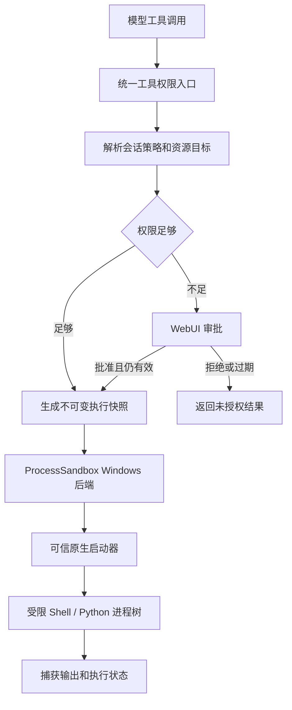

# AstrBot Windows 执行权限机制 — 设计基线

- 日期：2026-10-24
- 状态：Approved — 用户已于 2026-10-24 认可整份设计基线；尚未实施
- 代码核对基线：AstrBot `cc2ae7227`，以当前工作区源码为准
- 适用范围：原生 Windows 上模型可调用的执行工具，以及参与同一权限体系的文件、插件与 MCP 工具
- 设计目标：保留 Shell/Python 的读取、计算和编程能力，同时用操作系统强制实施授权资源边界

## 1. 已确认的产品决策

| 项目 | 已确认决策 |
| --- | --- |
| 威胁模型 | 模型生成的任意代码不可信，包括主动越权的代码、子进程和后台进程；AstrBot 主程序与已安装插件的实现属于可信部分 |
| 只读含义 | 用户工作区和其他持久化业务数据不可写；允许写专属、可丢弃的临时空间 |
| 默认读取范围 | 当前会话工作区、明确授权的附加目录，以及必要运行依赖；其他用户目录和 AstrBot 内部敏感数据默认不可读 |
| 默认网络 | 执行器禁止直接联网，包括 localhost；联网需求单独授权 |
| Windows 部署 | 接受首次启用和必要修复时，由用户授权管理员初始化助手；执行代码本身不获得管理员权限 |
| 单次授权 | 允许人工批准本次执行的额外文件或网络权限，覆盖其子进程生命周期，结束后失效 |
| 审批入口 | 首版仅 WebUI，由已认证且有审批权限的管理者操作 |
| 无沙箱模式 | 不保留；所有模型代码始终在沙箱内运行，失败不得退回宿主执行 |
| 默认模式 | 新会话和旧 `full` 会话采用工作区读写；已有 readonly/workspace 选择保留 |
| 收紧权限 | 终止权限超出新策略的整个进程树，确认终止后新策略才显示为生效；不自动回滚已有修改 |
| 工作区访问 | 直接访问原工作区，不以复制整个项目和写回作为默认架构 |
| 第三方工具 | 未适配权限机制的插件/MCP 工具默认不可调用 |
| 重启恢复 | 保存会话模式和明确配置的目录授权；单次授权、待审批请求全部失效，执行任务不自动恢复 |

后续章节是这些决策的技术展开。底层 Windows 原语组合、辅助程序实现语言、确切 Windows 版本及文件系统支持矩阵尚未通过验证，不属于已经实施或已经测得的能力。

## 2. 保证与信任边界

权限应由可信控制端计算，由执行环境强制实施；模型不能通过工具参数、环境变量、命令行、修改项目配置或再次调用工具来扩大权限。

保护对象包括用户未授权数据、AstrBot 凭证与数据库、审批记录、沙箱配置、启动器及其依赖、其他会话的执行进程和私有状态。模型输入、工具参数、项目脚本、Shell 配置、工具输出和来自工作区的文件均不能作为授权依据。

允许工作区读写意味着模型可以修改甚至删除该授权范围内的普通项目数据；沙箱不保证授权范围内的操作符合用户意图。批准连接一个服务也不等于保证远端请求只读。语义上的高风险操作可以另加审批，但不能代替资源隔离。

可信插件必须遵守权限接口；首版不隔离恶意插件实现，也不声称抵御操作系统内核漏洞、恶意系统管理员或已经失陷的 AstrBot 主程序。单纯的提示注入不能成为越过资源边界的理由。

AstrBot 保存聊天、审计日志及管理状态属于控制端职责，不等于向模型代码开放相应文件的写权限。受控查询工具可以由宿主联网，但必须经过工具权限入口，不能成为模型任意请求网络的代理。

## 3. 权限模型

### 3.1 持久策略与执行快照

沿用会话的 readonly/workspace 概念，不再接受新的 `full` 授权。策略至少保存会话及所有者标识、模式、版本、工作区、附加读取目录和附加写入目录。

每次调用生成不可变执行快照，另带执行 ID、实际读取/写入资源、私有临时根、网络授权、资源上限和所用审批记录。共享 `LocalBooter` 不保存“当前会话模式”之类可被其他调用覆盖的全局状态。

有效资源权限由持久策略和已核验的单次授权合成，再受部署方上限及控制端保护规则约束。模式为 readonly 时，持久配置的可写目录不会继续赋予写权限；如需临时写入，必须取得本次执行的明确批准。

| 资源 | readonly | workspace |
| --- | --- | --- |
| 当前工作区 | 读 | 读写 |
| 明确配置的附加读取目录 | 读 | 读 |
| 明确配置的附加写入目录 | 读 | 读写 |
| 必要运行依赖 | 读/执行 | 读/执行 |
| 本次执行的私有临时空间 | 读写 | 读写 |
| 其他用户文件 | 拒绝 | 拒绝 |
| 默认网络 | 拒绝 | 拒绝 |
| 控制端保护资源 | 不授予模型访问凭证、修改控制逻辑等能力 | 同左 |

“读写”指所需的数据操作权限，不意味着授予修改 ACL、取得所有权、管理账户或更改系统安全策略的权限。附加读取目录的持久配置由用户操作；模型申请新增读取范围也必须走单次审批。

### 3.2 临时空间

每次独立执行拥有私有临时根；同一进程树共享，其他会话不能访问。将 `TEMP`、`TMP`、必要的 HOME/缓存目录指向隔离状态，环境变量从白名单构造，避免复制宿主全部环境。

执行结果需要保留时，由可信结果处理代码复制到会话附件存储；复制不授予执行器该存储的写权限，也不自动把结果应用回工作区。导出文件需要尺寸、类型和重解析点检查，不能借导出流程读取任意宿主路径。临时脚本和配置不能被高权限宿主自动加载执行。

### 3.3 控制端与工作区重叠

正在运行的 AstrBot 安装、插件代码、解释器环境、启动器、审批数据库和服务配置必须受到保护。若授权工作区包含这些资源，不能无条件给整个父目录写权限；需要安全地排除受保护对象，无法证明时拒绝该授权范围。

开发 AstrBot 本身时，建议使用独立工作副本和独立的宿主运行安装。允许模型修改宿主下一次会加载的代码，会形成跨越信任边界的持久执行通道。不能用“修改发生在工作区内”解释为安全。

项目自己的开发环境可以按项目权限处理，但不能与 AstrBot 控制端的运行依赖混用。

## 4. 架构与现有代码落点

复用 `ProcessSandbox`、`SandboxSpec` 和现有 Shell 会话管理，不另建一套平行的计算机工具系统。以下是拟改动位置，不是已经做出的代码修改：

| 位置 | 拟承担的职责 |
| --- | --- |
| `astrbot/core/tools/fs_access.py` | 解析和持久化模式、目录授权、策略版本；移除回落到 full 的路径 |
| `astrbot/core/astr_agent_tool_exec.py` | 主 agent、子 agent、插件与 MCP 的统一调用检查；拒绝未适配工具 |
| `astrbot/core/agent/tool.py` | 表达工具所需的访问类别及受信任的资源解析契约 |
| `astrbot/core/computer/process_sandbox/base.py` | 扩展执行策略、网络目标和后端能力表示，避免只有 `allow_network` 布尔值 |
| `astrbot/core/computer/process_sandbox/__init__.py` | 选择和探测 Windows 后端；不可用时明确失败 |
| `astrbot/core/computer/booters/local.py` | Shell/Python 启动统一经过沙箱；现有轮询、输出和生命周期管理接入后端 |
| `astrbot/core/tools/computer_tools/shell.py`、`python.py` | 传递服务端生成的策略；readonly 不再整体禁用计算工具 |
| `astrbot/core/tools/computer_tools/fs.py`、`patch_tool.py` | 复用同一策略；实际文件操作处继续执行权限检查 |
| `astrbot/dashboard/api/chat.py`、认证和聊天服务 | 审批 API、会话归属校验、模式迁移、撤销与状态推送 |
| `dashboard/src` | 模式、临时授权、待审批、收紧中、沙箱故障及第三方工具禁用状态 |

工具入口提供授权和清晰错误，执行层提供资源边界。不能只在模型工具列表中过滤，也不能只检查命令字符串。Python 仍在子进程中运行，不能把模型代码放进 AstrBot 进程的 `exec()`。

现有 `sandboxed` 布尔值只能作为后端确认后的结果信息，不能由调用方自行设置后就视为已隔离。已有 `filesystem_scope="host"` 语义不得进入受限 Windows 执行路径。可信助手在创建缺失目录、准备日志或授予 ACL 前也必须先验证授权，避免在模型进程启动前就发生越权副作用。

## 5. Windows 技术方案：建议与验证门槛

### 5.1 不能只复制 WRITE_RESTRICTED

本地 Codex 的一个 Windows Token 路径使用 `DISABLE_MAX_PRIVILEGE | LUA_TOKEN | WRITE_RESTRICTED`。微软定义中，`WRITE_RESTRICTED` 的限制 SID 只参与写访问检查，因此该标志本身不能证明“未授权目录不可读”。专用普通账户、Low Integrity、Job Object 或隐藏窗口也各自不能单独提供完整文件与网络边界。[CreateRestrictedToken 文档](https://learn.microsoft.com/en-us/windows/win32/api/securitybaseapi/nf-securitybaseapi-createrestrictedtoken)

### 5.2 优先验证的原生方案

建议以专用非管理员运行身份、独立 AppContainer/LPAC 执行身份、资源 ACL、Job Object 和受控网络出口组成后端；优先验证 LPAC 的兼容性。微软提供原生 Win32 程序的 AppContainer/LPAC 启动方式，LPAC 对常规 AppContainer 隐含可访问资源作进一步限制，但实际开放的运行能力仍须逐项评估。[启动 AppContainer/LPAC](https://learn.microsoft.com/en-us/windows/win32/secauthz/implementing-an-appcontainer)

这是待验证的技术建议，不是宣称当前 AstrBot 或 Codex 的所有 Windows 路径都采用 LPAC。仅凭创建成功不能验收；必须验证全部有效 SID、能力、预存 ACL 和运行依赖共同形成的实际读取范围。普通受限 Token 作为替代候选时，也必须满足完全相同的验收标准，不允许降低保证。

初始化助手只处理受控的安装、身份准备、安全规则和修复操作，不能成为模型可调用的管理员 Shell。原生启动器负责 Windows 身份、进程和对象访问边界；Python 控制端负责会话业务策略和审批。优先评估复用已维护的原生实现，或采用小型 Rust/Win32 辅助程序；在验证前不锁定库或语言。

首次初始化需要用户授权提升权限；后续添加资源所需的系统权限不足时，返回需要修复或管理员操作，不能静默放开路径。是否需要常驻特权服务、如何保存运行身份及凭证属于可行性阶段必须说明的部署问题，不能默认引入一个提供任意命令执行的服务。

### 5.3 启动与对象隔离要求

- 每次独立执行使用隔离的权限身份；不同会话、不同策略版本、只读任务与读写任务不能因共用账户或能力 SID 合并数据访问权限。
- 已验证的系统运行依赖可以共享只读授权；工作区数据、临时状态、控制管道和进程句柄不得因此共享。
- 创建进程时即绑定 Job，或挂起创建、完成约束后再恢复；不得先运行用户代码再补限制。
- Job 禁止 breakaway，配置关闭时终止进程树，并限制资源；根进程退出不代表整个执行结束。[Job Objects 文档](https://learn.microsoft.com/en-us/windows/win32/procthread/job-objects)
- 只继承必要的输入输出句柄，不泄漏宿主 Token、可写文件句柄、Job 管理句柄或审批管道。
- 限制宿主进程访问、注册表、COM/RPC、命名管道、设备对象和桌面交互，防止通过外部高权限服务间接执行。私有桌面及对象 DACL 是否充分必须用目标工具链验证。
- 不允许通过 WSL、计划任务、服务管理、桌面自动化或其他代理进程离开执行边界；不能仅靠禁止这些命令的名字实现。
- 使用独立的临时配置和最小环境，禁止继承宿主令牌、云密钥、API key、代理认证信息及无关 Python/Shell 启动配置。

### 5.4 原目录访问和 ACL 生命周期

授予当前执行身份必要的数据权限，不给 Everyone、Users 或其他会话扩大权限。不要递归替换整个目录的 DACL，也不要剥夺原有用户的权限。

每次 ACL 变更记录对象身份、执行身份和本机制添加的条目；清理仅移除自己管理的条目，并保留用户并发修改。只读运行依赖与动态工作区授权分别管理。崩溃后残留的身份不得复用；恢复程序验证并清理遗留授权。

授权对象必须处理大小写、卷路径、短路径、UNC、设备路径、重解析点、junction、符号链接和 hard link 等别名。受信任的 ACL 设置必须对经过验证的对象生效，不能只用字符串前缀或一次 `Path.resolve()` 防御竞态。

尤其需要验证：父目录删除子对象的权限、已有文件的非继承 ACL、文件所有权带来的权限、跨授权范围 hard link，以及用户代码在运行中替换链接。无法证明边界的目标必须拒绝授权；扫描一次目录不是对运行中竞态的完整防护。

原地访问与严格路径隔离能否同时成立，是首个验证关口。候选后端不能满足时，应回到设计讨论，不能自行改为无沙箱，也不能把隔离副本当成用户已经接受的默认方案。

### 5.5 网络与本机服务

默认禁止执行器的入站和出站网络，包括 IPv4/IPv6、UDP、DNS、loopback、LAN、UNC/SMB 及经其他进程代理的访问。对必须开放的本机通信，只允许本次执行必需、具有明确协议与身份验证的通道。

建议通过内核网络隔离配合受控出口实施授权，不能仅设置 HTTP_PROXY 环境变量。WFP 的 ALE 层可用于连接及 socket 操作的策略实施；实现必须覆盖双栈和子进程，不能仅按 `python.exe` 文件名设置防火墙规则。[WFP ALE 文档](https://learn.microsoft.com/en-us/windows/win32/fwp/application-layer-enforcement--ale-)

域名授权需要由可信出口检查目标主机、端口和协议，并处理解析地址变化、重定向和私网目标。必要的 DNS 解析由可信出口处理；不能把“批准一个域名”扩成任意 DNS 或整个互联网访问。原始 TCP 授权与 HTTP 查询授权必须如实区分；网络可达不保证远端操作只读。

代理和审批接口分离。不能通过放行 localhost 一并暴露 AstrBot 管理 API、数据库、Docker/容器控制端或其他会话的服务。控制端保护规则优先于普通单次网络授权。

网络规则或出口故障时不能恢复直连。控制端崩溃时应终止相关 Job；规则及身份清理的顺序不得出现仍存活进程短暂获得更宽权限的窗口。具体身份绑定、静态拒绝基线与动态授权机制必须经过故障测试才能通过验收。

## 6. 审批与执行协议

### 6.1 请求与批准

模型可以请求资源，不能批准资源。请求至少绑定：会话所有者、会话 ID、执行 ID、策略版本、工具及实际参数摘要、程序/命令/代码、cwd、有效环境摘要、申请资源、理由和有效期。批准结果只存于可信控制端。

WebUI 展示可审阅的命令或代码、当前模式、申请的额外读取/写入/联网范围和执行期限。用户批准的是本次执行获得这些资源权限，并不是保证程序只做理由中描述的一件事。

审批 API 必须验证 WebUI 登录身份、审批权限、会话归属、请求状态和防跨站请求措施。现有聊天 API scope 或插件页面 token 不能自动变成审批权限；不能仅凭客户端提供的 UMO 定位并批准任意会话。

### 6.2 授权的消费

批准后在启动前重新检查策略版本、会话身份、资源对象及请求内容，并原子地消费一次授权。参数、脚本内容或目标变化需要新请求；不能缓存“允许 python.exe”或“允许某命令前缀”来替代资源授权。

命令摘要只能防止审批记录被用于另一项请求，不证明项目内全部依赖都不可变；系统保证仍是批准的资源边界。待审批时不启动相应代码。拒绝、过期或状态不明都不执行。

若程序已在原权限下部分执行并失败，不能在批准额外权限后盲目自动重跑整段程序；重跑可能重复已发生的写入或外部操作，应作为新的可审阅执行处理。

### 6.3 运行期限与交互输入

单次授权持续到整个执行树结束，受经批准的有限期限约束；工具提前返回后台 session ID 不代表授权失效，反之父进程退出也不能让后台子进程继续无限持有授权。超时、撤销或会话终止应终止相关 Job。

现有 Shell session 的 `poll` 继续按所有者隔离；`write`/`write_line` 必须核验会话仍受有效策略约束。临时扩权执行不应默认允许模型持续向交互解释器注入新命令；首版建议关闭其自由 stdin，交互扩展需明确纳入审批。普通基线权限内的交互会话可保留，始终受同一资源边界限制。

## 7. 收紧、撤销和崩溃恢复

收紧操作首先冻结该会话的新启动与敏感 stdin，增加策略版本，使旧待审批请求失效。终止拥有超额权限的进程树并确认完成，撤销其出口和动态资源授权，再发布新策略已生效的状态。

终止失败时显示“权限收紧失败/处理中”，保持新调用阻塞，不能显示已经只读。已经符合新策略的执行可以继续，但策略与授权关联必须重新核验。终止不回滚先前修改，也不声称撤销已发送的网络请求。

重启时先恢复持久模式和明确目录配置，再核验身份、ACL、网络规则、临时空间和残留进程。未确认清理的旧执行不得重新使用；不得自动继续旧任务或恢复单次授权。

审批、启动、策略变更、授权消费、终止、异常清理和拒绝应保留审计关联 ID。日志位于受保护存储，输出应限量；不能为审计而把宿主全部环境或凭证写入日志。

## 8. 文件工具、插件与 MCP

内置文件工具也使用同一读取和写入策略；目前对写操作的检查不足以实现新的读取白名单。对宿主侧实际文件操作使用经过授权且能抵抗路径竞态的访问方式，或交给同样受限的文件操作 worker，不能仅在调度层检查一次路径。

插件适配至少包含可信的操作分类、从实际参数解析资源、执行前校验，以及经统一启动器执行外部程序的约束。插件再调用工具或生成后台任务时仍传递会话策略，不能“转一手”后丢失权限。

未适配工具在暴露列表中隐藏，并在调用层明确拒绝。MCP 的 `readOnlyHint` 等注解只是元数据；远端工具需要可信适配器和服务端受限凭证/权限范围，无法确认副作用边界的工具保持禁用。不能从工具名称或描述自动认定安全。

此设计不赋予 AstrBot 控制任意远端 MCP 服务内部行为的能力。安装插件属于用户信任决定；本机制限制模型如何调用已安装插件，不替代插件安全审查。

## 9. 迁移与用户体验

- 持久保存会话模式及明确目录配置；显式 readonly/workspace 保持原选择。
- `full` 迁移为 workspace，新的默认配置也为 workspace；unknown/损坏策略应报错，不能回落到 full。
- readonly 模式恢复写入时只恢复 workspace，不再通过 `_last_writable` 恢复 full。
- 旧的可写根需要核验真实路径和控制端重叠；共享宿主 temp 目录、插件动态扩大目录不得不经校验直接继承。
- 模式切换、目录授权和审批入口必须验证身份与目标会话归属；主 agent、子 agent 和第三方调用路径一致。
- WebUI 显示基础模式和本次额外授权，例如“只读 · 本次允许写入指定输出目录”，不能只留下一个只读标识。
- 沙箱未安装、不支持或故障时，模型执行工具显示不可用原因；安全的独立读取工具可按实际能力继续服务。
- 禁用未适配工具是显著兼容性变化，应在迁移预览和更新说明中列明。
- 隔离权限不等于访问其他人的聊天权限；所有会话 API 继续执行身份与归属检查。

## 10. 验收标准

必须使用真实 Windows 后端运行集成测试，不能仅 mock `ProcessSandbox` 或检查工具返回值。最低测试集合如下：

| 类别 | 必须证明的行为 |
| --- | --- |
| 正常读取/计算 | Python、Git Bash、PowerShell、cmd 在各自支持矩阵内可以读取授权数据、计算和输出 |
| 只读文件 | Shell 重定向、Python/原生扩展、子进程写入、mmap、删除、重命名、替换文件均不能修改受保护数据 |
| 工作区读写 | 普通项目文件可创建、修改、删除；工作区外和控制端资源仍受保护 |
| 读取边界 | 当前用户原本可读、但执行器未获授权的数据不能读取；不只测其他用户的私有目录 |
| 路径及 ACL | 验证 junction、符号链接、hard link、重解析竞态、父目录删除权限、所有权、大小写/短路径/设备别名 |
| 会话隔离 | 两个会话及同一会话不同权限的并发执行不共享动态文件权限、临时空间、进程或控制句柄 |
| 网络 | IPv4/IPv6、UDP/DNS、loopback、LAN、UNC、复制/更名的程序和子进程不能绕过；单服务授权不放开其他目标 |
| 审批 | 伪造 confirm、错误身份/会话、旧版本、重复消费、参数变化、API key 和过期批准全部拒绝 |
| 生命周期 | 根进程退出后的后代、后台任务、stdin、撤销、超时、宿主/启动器崩溃均不留下越权执行 |
| 间接越权 | 管理 API、命名管道、COM/RPC、计划任务、WMI、WSL、桌面操作和外部代理不能绕过边界 |
| 第三方工具 | 未适配调用被拒绝，适配工具和子 agent 的实际资源访问受到同一策略限制 |
| 恢复与迁移 | readonly 不因重启扩大权限；full 正确迁移；临时批准失效；遗留 ACL/规则清理不破坏用户权限 |

应测试每种 Shell 到 Python、Python 到 Shell、后台子进程及原生 Win32 调用等组合。资源限制需覆盖进程数、内存、执行期限和输出量；临时文件容量限制的实施方式也要单独验证，不能把 Job Object 误当成磁盘配额机制。

## 11. 建议实施顺序与未决技术项

1. **先验证 Windows 边界。** 在专用测试目录中验证目标工具链、默认读取拒绝、原地文件授权、对象隔离、离线执行、进程树终止及崩溃行为。比较 LPAC 和其他候选后端的实际能力，记录准确 Windows build/版本、架构、文件系统及工具版本。
2. **接入统一执行路径。** Shell/Python、文件操作、子 agent 和会话管理携带同一策略快照，完全移除受限模式的裸执行分支。
3. **接入审批和撤销。** 实现服务端请求状态、WebUI 鉴权和归属校验、一次消费、执行期限、策略版本与原子收紧。
4. **接入工具适配和迁移。** 默认拒绝未知工具，完成模式持久化、full 迁移、兼容性说明、审计及安装/修复/卸载流程。
5. **按支持矩阵发布。** 全部安全验收通过后才宣称提供对应保证；不支持的机器或路径明确拒绝，不能静默改用更弱后端。

可行性阶段尚须解决：原生后端最终选型、是否需要常驻系统组件、运行身份凭证管理、Windows/NTFS 等支持矩阵、ACL 变更成本、各工具链所需能力、域名授权出口、重解析点与 hard link 边界、临时存储配额。上述问题不能通过放宽已确认的信任边界处理；若候选机制无法满足要求，回到设计讨论。

## 12. 来源与旧设计的关系

当前源码显示：Shell 在 readonly 下整体拒绝；本地 Python 使用普通子进程；本地沙箱工厂仅选择 Linux/macOS；现有模式默认 full，会话模式保存在内存中。已有 `ProcessSandbox` 抽象是复用入口，但这些事实不意味着 Windows 边界已经实现。

本设计明确取代旧文件访问模式方案中的三个取舍：workspace 下 Shell 不限制路径、会话模式不持久化、MCP 仅依赖隐藏列表。对应旧方案见 [2026-08-20 文件访问模式设计](./2026-08-20-file-access-mode-design.md)。保留已有 [Windows Shell 选择机制](./2026-09-28-git-bash-local-shell-runtime-design.md) 的用户意图，实际可用性以新沙箱支持矩阵为准。

参考本地 Codex 的 `codex-rs/core/src/tools/orchestrator.rs`、`codex-rs/sandboxing/src/manager.rs`、`codex-rs/windows-sandbox-rs/src/token.rs`、`process.rs` 及 `setup.rs`：借鉴策略、审批、执行边界和生命周期分层，不把某一条 Token 路径当成完整安全保证。

本文为用户已认可的设计基线。认可范围包括产品决策、技术验证门槛及建议实施顺序，不表示候选后端已通过安全或兼容性验证。功能尚未实施；所有兼容性和隔离结论须以后续实测为准。
