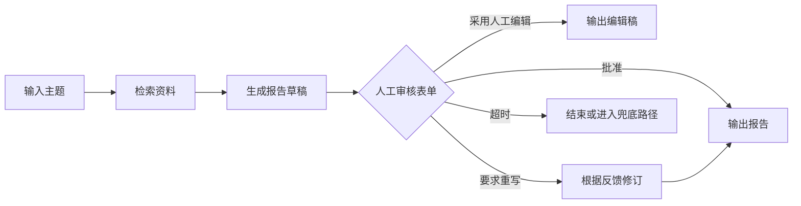
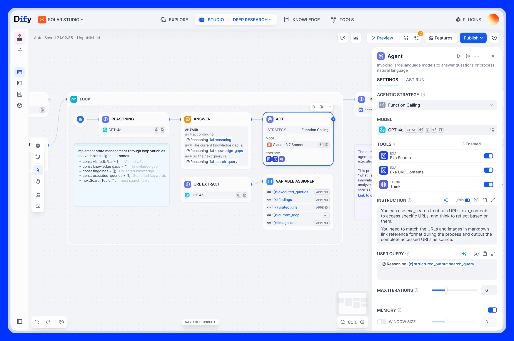
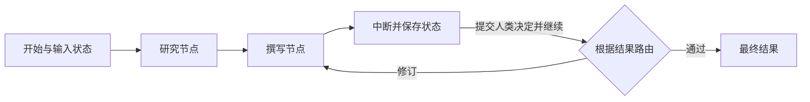
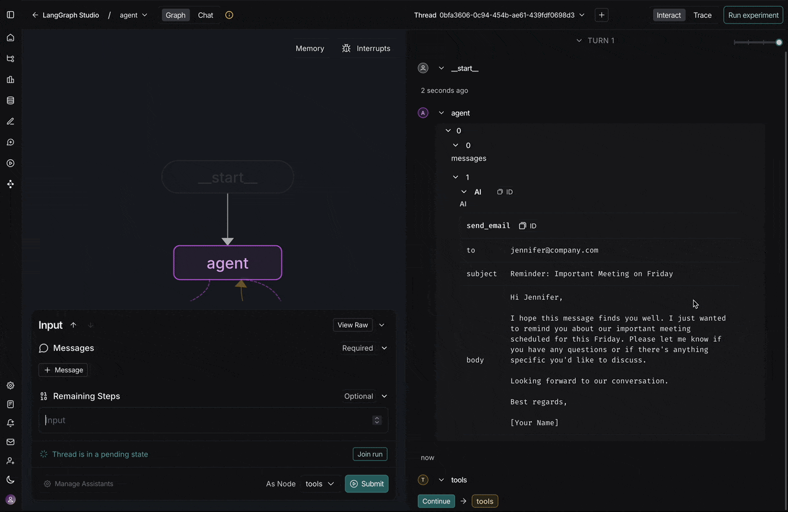
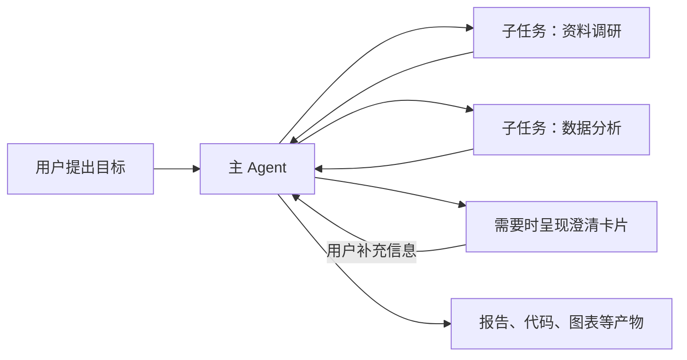
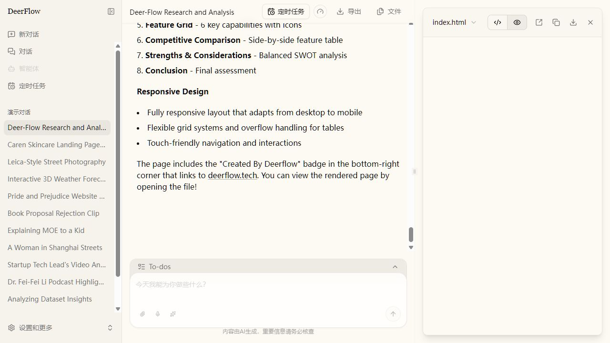
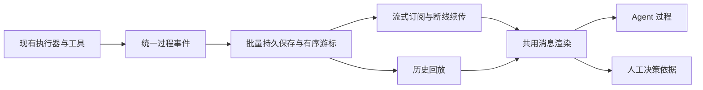

# Agent Teams 优化项

日期：2026-11-02。状态：重构 Spec 的测试边界与 23 个任务拆分已获批准，已发布至 [GitHub #125](https://github.com/elecvoid243/AstrBot_for_spzx/issues/125) 及其子 Issue；本次重构的产品实现尚未开始。

本文记录 Agent Teams 的资源配置、画布编排、运行观察、人工交互和资产管理需求，并附 Dify、LangGraph、DeerFlow 的系统介绍与重构建议。已确认要求与逐项澄清记录表达本次范围，未确认的调研建议不自动纳入实现。

本轮已按用户确认归并原第 1–7 项并重排要求编号，33 轮问答编号保持不变。后续实施范围集中整理在 [Agent Teams 重构 Spec](2026-11-02-agent-teams-rebuild.md)，[任务拆分与逐票验收](../plans/agent-teams-rebuild/README.md)已回填实际 Issue 与阻塞关系；本文保留需求来源和调研依据。

## 已确认的要求

1. 角色模板、工作流 Agent 和自主团队成员直接选择实际人格、模型、工具、Skills 和知识库。界面、接口、持久化、运行快照与资产包同步移除资源槽位及其别名映射；工具、Skills、知识库的局部覆盖直接保存实际资源列表，继承与覆盖规则见下文。
2. 团队和工作流的聊天访问配置改为粘贴完整的 `/asset whoami` 返回内容，自动解析身份字段，不再要求逐项复制填写。
3. 探索 Dify、LangGraph、DeerFlow 的官方代码与文档，可以参考其思想和功能，提出全面改进乃至重构建议；补充适合不熟悉这些项目的系统介绍、示意图和官方界面参考。
4. 本轮不修改产品实现、接口、数据库或测试，不执行数据转换。下文调研形成的建议不自动视为用户已确认的全部实施范围。
5. 创建入口收敛为“自主团队”和“工作流”两种：自主团队由协调者动态安排成员和任务；工作流由用户明确设计执行步骤。普通工作流并入工作流，作为只有一个 Agent 节点的简单形式，不再单列为第三种类型。两者共用运行查看和人工处理界面。
6. 工作流中的 Agent 允许在节点内直接配置人格、模型、工具等资源，不强制先创建角色模板；也可以使用已有角色模板，需要复用时可将节点配置保存为角色模板。
7. 工作流使用角色模板时固定引用所选版本；模板修改后不自动改变已有工作流的配置。界面提示存在新版本，由用户主动决定是否更新。
8. 使用角色模板的工作流节点允许局部调整配置：未修改字段沿用所选模板版本，单独修改的字段仅对该节点生效；手动升级模板版本时保留局部调整。界面明确标识字段来自模板还是节点自身的修改。
9. 工具、Skills、知识库的局部覆盖采用整组替换：每类资源分别选择沿用模板或自定义完整列表；自定义列表不与模板作增减项合并，手动升级模板时保持不变。
10. 直接配置且不使用角色模板的 Agent 可以不选择人格；此时按配置的职责和任务执行，不自动继承聊天或配置档案的默认人格。
11. 团队和工作流设置明确的默认模型，直接配置的 Agent 可以沿用该模型，也可以单独选择其他模型；启动前必须能够确定实际使用的模型，不因未单独选择而自动改用发起聊天的模型。
12. 新建工作流直接进入画布，预置一个 Agent 节点，通过节点侧栏配置职责和资源；单 Agent 任务与后续扩展的多步骤流程沿用同一编辑方式，不先进入独立的简易表单。
13. 本次画布改造聚焦 Agent 编排，覆盖 Agent、输入／输出、条件分支、并行与汇合、循环、人工问答／审批、子工作流和自主团队调用；独立工具调用、HTTP 请求、代码执行、知识库检索和数据转换等通用自动化节点纳入后续工作考虑，不列入本次实施范围。
14. 画布连线表达执行顺序或分支，节点输入的数据来源在侧栏通过可视化选择器配置；按上游节点及输出字段选择，不要求手写字段路径，不以逐字段端口连线作为主要配置方式。
15. 工作流的下游 Agent 只接收显式选择的上游数据；连接执行顺序不自动注入其他上游输出、对话或工具调用过程。用户在运行页面查看各 Agent 执行过程的能力与模型获得的上下文分别处理。
16. Agent 等待人工回答或审批时，仅阻塞该 Agent 及依赖其结果的下游任务；没有依赖关系的其他分支继续执行，不因局部人工等待而暂停整个运行的后续调度。
17. 人工问题、关联上下文和已提交答案须持久保存；AstrBot 在人工等待期间重启后，恢复原请求的等待或已作答状态，回答后可接续原运行，不重复执行重启前已确认完成的步骤。
18. 人工请求默认不设置回答期限，允许单独配置超时。设置超时时提供两种可选策略：保持相关任务停止推进，直到人工给出选择；或让模型按照推荐方案继续执行。
19. 普通问答、选项选择及产物版本批准等审批均允许配置超时后自动继续，只有明确启用该策略的请求才自动处理；记录中区分人工决定和模型自动决定。
20. 用于超时自动继续的推荐方案在创建人工请求时确定并展示，同时给出推荐选择和理由；超时后采用这份已展示的推荐，不到超时后才重新作出决定。
21. 已配置超时自动继续的人工请求若没有有效推荐，继续等待人工并显示无法自动继续的原因；不在超时后重新请求模型生成选择。
22. 在 Agent Teams 运行区提供统一的“需我处理”列表，汇总用户有权处理的所有运行中的问答和审批；画布预设人工节点及执行中动态调用的 `ask_user_choice` 均须接入。点击可查看对应 Agent 的执行依据并作答，具体运行详情中也提供同一请求的处理入口；答案回传对应等待调用并接续相关执行，不通过重新启动整个运行代替回答。
23. 通过聊天发起的运行支持在原聊天和 Dashboard 两处处理人工问答与审批：将问题、选项及推荐理由发回原聊天，原发起者可以直接回答；两处共享同一请求和处理结果，避免重复生效。
24. 自主团队和工作流的运行详情均默认以 Agent 执行过程为主：左侧任务／Agent 树，中间为类似 ChatUI 的实时输出，右侧为人工待办与产物；执行图作为可切换的总览。允许切换查看每个 Agent 实际返回的思考、工具调用及结果、回复和实际上下文注入信息，以易读内容流式呈现，不以原始 JSON 为主要阅读方式；未提供的信息明确标识，不虚构思考或注入记录。
25. 角色、自主团队和工作流的资产列表均提供明确可见的删除入口。删除采用移出可用列表、保留已有依赖的方式：新配置不能再选择已删除资产，已有固定版本引用仍可使用，进行中的运行、历史和产物保留；底层保留必要的版本数据。
26. 团队或工作流删除后，聊天和 Dashboard 均不再接受对该资产的新的直接启动，原聊天绑定不能继续直接发起运行；已经开始的运行继续，已有父工作流对其固定版本的调用仍保留。
27. 本次只支持删除整个角色、团队或工作流资产，不提供单个版本的删除操作；删除后该资产所有版本退出新配置的可选范围，已有引用所需的版本数据按已确认规则保留。
28. 角色、团队和工作流的编辑过程自动保存草稿，用户手动执行“保存新版本”后才形成可供引用或绑定聊天的固定版本；草稿修改不改变已有版本。
29. 本次支持工作流草稿的单节点、局部流程和完整流程试运行；局部运行可选择已有上游结果或填写测试输入，测试记录独立保存。试运行真实调用所选步骤的模型和工具，测试输入只替代相应的上游数据。
30. 本次并行分支汇合只支持等待本次应执行的分支全部成功完成后继续；条件判断未选中的分支不参与等待，不提供“任一分支成功即可继续”的汇合模式。
31. 节点明确执行失败时，仅停止失败路径及依赖其结果的下游，独立分支继续执行并保留成果；依赖失败分支结果的汇合节点在问题解决前不能继续，不因局部失败自动停止整个运行的后续调度。
32. 画布中的产物审批使用明确的动作出口，“通过”“退回修改”等动作连接到用户配置的后续步骤；返工时由画布指定修改和复审路径，需要反复审核时使用可见且有次数上限的循环，不自动交回原生成 Agent。
33. Agent 默认输出普通文本，按需启用结构化字段；需要评分、是否通过、报告正文等明确字段时，通过表单定义字段及类型，不要求所有 Agent 预先声明结构，也不要求手写 JSON Schema。
34. 人格提示词、Agent 职责和本次任务组合使用：人格提供通用设定，职责说明分工，任务说明本次目标；上下文详情分别展示这些来源，不因选择人格而取消独立职责配置。
35. 人工请求的推荐由流程中的 Agent 提供：运行时提问由提问 Agent 给出，画布预设问答／审批从用户指定的上游 Agent 输出读取推荐及理由；需要独立评审时显式添加评审 Agent，不由系统隐式额外调用默认模型生成推荐。
36. 当前 Agent Teams 系统尚未投入使用，本次改造只支持新格式，不提供旧资产、槽位配置、旧资产包或旧运行的迁移与兼容逻辑；旧配置按新格式重新创建。此项是改造策略，本轮不执行数据清理。
37. 自主团队预先配置可用角色，支持直接配置或引用角色模板；运行时协调者从这些角色中选择成员并动态安排任务。本次不由协调者自由创建新的角色及资源配置。

## 需求澄清记录

本节记录逐项询问后得到的明确决定；未确认的调研建议仍保留为建议。在用户确认达成共识前，不开始产品实现。

### 第 1 问：创建入口如何组织

用户选择 A：保留“自主团队”和“工作流”两种创建入口。

- 自主团队表达“由协调者动态分工”的使用意图。
- 工作流表达“由用户规定执行步骤”的使用意图；单 Agent 的普通工作流与多节点画布工作流属于同一种资产。
- 不再将“普通工作流”和“画布工作流”作为并列的两种创建类型。
- 两者共用运行查看和人工处理界面。
- 角色模板是否必需已由第 2 问明确，新建工作流的编辑交互已由第 8 问明确。不据此推断数据转换或删除已有资产的授权。

### 第 2 问：配置 Agent 是否必须先创建角色模板

用户选择 A：允许直接配置，角色模板可选。

- 工作流节点内可以直接选择人格、模型、工具等资源，无需先切换到角色页面创建角色。
- 仍可使用已有角色模板，供多个 Agent 复用配置。
- 需要复用时，可将节点配置保存为角色模板。
- 模板关联与更新方式已由第 3 问明确为固定版本引用、手动更新。

### 第 3 问：模板更新如何影响已有工作流

用户选择 A：保持原配置，手动更新。

- 工作流使用角色模板时，保留所选模板版本的引用。
- 修改模板不自动改变已有工作流所用的角色配置。
- 有新版本时提示用户，由用户主动决定是否采用。
- 不采用仅在初次填充时复制、此后完全断开关联的方式，也不自动跟随最新模板。
- 节点局部调整及升级时的保留规则已由第 4 问明确。

### 第 4 问：模板节点是否允许局部调整

用户选择 A：允许局部调整，手动升级模板时保留这些调整。

- 未修改的字段沿用节点所选的模板版本。
- 单独修改的字段仅对当前节点生效，不回写角色模板或影响其他节点。
- 手动升级模板版本时，保留节点自身的局部调整；未修改字段采用新选定版本的配置。
- 界面清楚标明哪些字段来自模板，哪些字段已在节点中单独修改。
- 工具、Skills、知识库多选列表的覆盖规则已由第 5 问明确为整组替换。

### 第 5 问：多选资源列表如何局部覆盖

用户选择 A：整组替换。

- 工具、Skills、知识库分别选择“沿用模板”或“自定义”，各类资源独立生效。
- 自定义时，所选内容是该节点对应类别的完整资源列表，不保存相对模板的新增项和排除项。
- 手动升级模板时，沿用模板的类别采用新版本配置，自定义类别保留原列表。
- 模板新增资源不会自动加入已自定义的列表。

### 第 6 问：直接配置 Agent 未选择人格时如何处理

用户选择 A：允许不使用人格。

- 本项适用于不使用角色模板、直接配置 Agent 的情况；不改变模板节点已确认的继承规则。
- 未选择人格时，按该 Agent 填写的职责和任务执行，不自动套用聊天或配置档案的默认人格。
- 不因缺少人格选择而阻止运行；其他必要配置和执行条件仍需校验。
- 选择人格后，其提示词与 Agent 职责、任务的组合方式已由第 30 问明确为组合使用。

### 第 7 问：直接配置 Agent 时如何选择模型

用户选择 A：设置团队／工作流默认模型，Agent 可单独覆盖。

- 团队和工作流提供默认模型配置，供未单独指定模型的直接配置 Agent 使用。
- Agent 可以明确选择其他模型，满足不同任务的需求，无需为每个 Agent 重复选择同一模型。
- 启动前必须能够确定实际模型；未配置 Agent 模型时，不自动继承发起聊天的模型。
- 此决定不改变已确认的角色模板固定版本和节点局部覆盖规则，也不要求不支持本机模型选择的远端执行器新增该能力。

### 第 8 问：新建工作流默认进入什么界面

用户选择 A：直接进入画布，预置一个 Agent 节点。

- 选中节点后，在侧栏填写职责并选择资源；补齐必要配置后即可运行简单任务。
- 需要更多步骤时，在同一画布中继续添加节点，不必先从简易表单转换编辑模式。
- 单 Agent 与复杂工作流沿用同一种编辑方式。
- 节点范围已由第 9 问明确；开始与输出的具体表达、数据传递交互和画布排版仍需细化。

### 第 9 问：本次画布改造的节点范围

用户选择 A，并要求将 B 纳入后续工作考虑。

- 本次聚焦 Agent 编排，支持 Agent、输入／输出、条件分支、并行与汇合、循环、人工问答／审批、子工作流和自主团队调用。
- 本次工具与知识库主要通过 Agent 使用，优先完成多 Agent 协作、人工决策和运行过程展示。
- 后续工作考虑增加独立工具调用、HTTP 请求、代码执行、独立知识库检索和数据转换等节点，使这些步骤能够不经过 Agent、按预设参数直接执行。
- 上述通用自动化能力属于已记录的后续方向，不是永久排除项；具体优先级、范围及实施时机尚未确定，也不要求本次提前实现通用扩展框架。

### 第 10 问：节点之间的数据传递如何配置

用户选择 A：连线表示执行顺序，在侧栏选择数据。

- 画布上的连接表达执行顺序或分支；输入数据绑定在节点侧栏配置。
- 例如撰写员可以在输入选择器中选择“研究员 → 报告正文”，无需手写字段路径。
- 侧栏清楚展示各输入的数据来源，不要求用户为每个字段在画布上单独连接端口。
- 上游内容的自动注入规则已由第 11 问明确：只传递显式选择的上游数据。

### 第 11 问：下游 Agent 默认收到哪些上游内容

用户选择 A：只收到明确选中的数据。

- 用户显式选择下游输入，例如只选择“研究报告正文”。
- 不因存在执行连线而自动附加其他上游节点的最终输出、对话、工具调用或结果。
- 本项规定上游数据传递，不替代 Agent 自身职责、人格、当前任务等必要上下文配置。
- 模型实际收到的上游内容与用户在运行页面查看执行过程是两种用途；保持已确认的各 Agent 过程查看要求。

### 第 12 问：人工等待如何影响其他任务

用户选择 A：只阻塞相关路径。

- 提出人工问题或等待审批的 Agent／任务进入等待状态。
- 依赖该结果的下游任务继续等待，不提前执行。
- 没有依赖关系的其他分支可以继续执行。
- 局部人工等待不自动触发整个运行的调度暂停；服务重启后的恢复要求已由第 13 问明确，默认等待期限及可选超时策略已由第 14 问明确。

### 第 13 问：人工等待期间服务重启如何处理

用户选择 A：保留问题并恢复等待，回答后接续原运行。

- 人工问题、关联上下文及已提交的答案均持久保存，不只依赖进程内存。
- AstrBot 重启后，未回答的请求恢复等待；已经提交的答案保留其处理状态，不要求用户重新作答。
- 回答后接续原运行，重启前已确认完成的步骤不重复执行。
- 本项确认恢复能力的目标，具体等待记录、答案消费和执行恢复协议仍需设计；不能据此将当前内存 Future 描述为已具备该能力。

### 第 14 问：人工请求的回答期限及超时策略

用户选择 A：默认不设期限，允许单独配置超时；并明确要求提供两种可配置的超时处理方式。

- 人工请求默认不设置回答期限，有时效要求时再单独配置等待时长。
- 超时策略一：相关任务保持停止推进，直到人工给出选择；超时不使该请求失去人工回答入口。
- 超时策略二：让模型按照推荐方案继续执行。
- 停止推进的范围沿用第 12 问的相关路径原则，不据此扩大为暂停所有无关分支；这里也不将“停止任务”解释为不可恢复的取消。
- 自动继续对问答和审批的适用范围已由第 15 问明确，推荐方案的确定时机已由第 16 问明确，无有效推荐时的处理已由第 17 问明确；推荐来源已由第 31 问明确为流程中的 Agent。

### 第 15 问：自动继续是否适用于产物审批

用户选择 A：问答和审批都可以配置。

- 普通问答、选项选择和产物版本批准等审批请求均可配置超时后的自动继续策略。
- 仅明确启用该策略的请求才会在超时后自动处理；未启用时仍等待人工。
- 记录中清楚区分人工决定和模型自动决定，不能将自动处理记录为用户亲自批准或回答。
- 各节点通过配置表达是否必须等待人工；此决定不授权当前会话执行任何实际审批或任务。

### 第 16 问：自动继续的推荐方案何时确定

用户选择 A：创建人工请求时就确定并展示。

- 用于超时自动继续的推荐方案在创建人工请求时确定，同时展示推荐选择及其理由。
- 用户在等待期间可以查看这份建议，了解无人回答时将采用的处理方式。
- 超时后采用已展示的推荐，不到超时后才另行生成一份新决定。
- 推荐缺失或不可用时的处理方式已由第 17 问明确；推荐来源已由第 31 问明确。

### 第 17 问：没有有效推荐时如何处理自动继续

用户选择 A：继续等待人工，并显示原因。

- 对已配置超时自动继续的请求，如果模型未给出推荐，或推荐不属于可选项等原因导致推荐无效，则保持人工等待。
- 界面显示无法自动继续的原因，并保留人工回答入口。
- 不在超时后重新请求模型生成一份新推荐，也不自动选择其他选项。
- 等待仍仅阻塞相关路径，遵循第 12 问的调度范围。

### 第 18 问：人工待办入口放在哪里

用户选择 A：集中列表＋运行详情。

- Agent Teams 运行区提供统一的“需我处理”列表，汇总用户有权处理的所有运行中的问答和审批。
- 点击待办能够定位提出请求的 Agent，查看对应执行过程并作答。
- 具体运行详情内也可以处理同一请求，两处入口关联同一待办及处理状态。
- 此决定明确集中入口与运行内入口，不将仅有查看权限的用户自动视为可以作答；原聊天的处理入口已由第 19 问明确。

### 第 19 问：是否支持在发起聊天中回答人工请求

用户选择 A：聊天与 Dashboard 都支持。

- 对通过聊天发起的运行，将人工问题、选项和推荐理由发送到原聊天，原发起者可以直接回答或完成审批。
- Dashboard 保留已确认的集中待办和运行详情入口；聊天与 Dashboard 对应同一个请求及处理结果，不重复生效。
- 用户需要详细依据时，可以查看运行页面中相应 Agent 的过程。
- 本项明确目标交互；不同聊天平台的回答方式、请求定位和身份校验需在设计中落实，不因发送到群聊而将作答权限扩大为所有群成员。

### 第 20 问：运行详情默认以什么为主

用户选择 A：以 Agent 执行过程为主。

- 自主团队和工作流均采用相同的默认视图：左侧任务／Agent 树，中间为类似 ChatUI 的实时输出，右侧为人工待办和产物。
- 切换 Agent 后查看对应执行过程，满足已确认的详细流式阅读和人工决策要求。
- 执行图保留为可切换的总览，不作为固定工作流的另一套默认主视图。
- 窄屏下的具体布局与面板折叠交互仍需在界面设计中细化。

### 第 21 问：删除资产如何处理已有引用和运行记录

用户选择 A：移出可用列表，保留已有依赖。

- 删除角色、团队或工作流后，将其从可用资产列表和新配置的选择范围中移除。
- 已有固定版本引用仍可使用，为此保留必要的底层版本数据，不因删除入口而物理清空所有版本。
- 保留进行中的运行、历史运行及产物，不将删除资产等同于取消运行或清空历史。
- 不要求用户先解除所有资产引用或结束相关运行后才能整理资产列表。
- 已有聊天绑定的直接启动规则已由第 22 问明确；第 23 问已确认本次仅支持整个资产的删除。

### 第 22 问：删除资产后旧聊天绑定能否直接启动

用户选择 A：不能再直接启动。

- 团队或工作流删除后，聊天和 Dashboard 均不再接受对该资产的新的直接启动。
- 原聊天绑定也不能继续直接发起该资产的运行，不要求用户再单独撤销授权才能停止直接提供该资产。
- 已经开始的运行继续，已有父工作流对该资产的固定版本调用仍按第 21 问保留。
- 区分资产的直接启动入口与其他已有工作流的固定版本依赖，不能将禁止直接启动误实现为所有调用均不可用。

### 第 23 问：删除功能支持整个资产还是单个版本

用户选择 A：本次只支持删除整个资产。

- 角色、团队和工作流列表中的删除操作针对整个资产，本次不提供单独删除某个版本的入口。
- 删除后，该资产所有版本退出新配置的可选范围。
- 继续遵循第 21、22 问：保留已有固定版本依赖、进行中运行和历史产物，禁止新的直接启动。
- 退出可选范围不等于物理清空所有版本，已有引用所需的数据继续保留。

### 第 24 问：编辑修改如何保存

用户选择 A：自动保存草稿，手动保存新版本。

- 角色、团队和工作流编辑过程中，自动持久保存未完成的草稿修改。
- 用户点击“保存新版本”后，才形成可供引用或绑定聊天的固定版本。
- 草稿与已保存版本明确区分，草稿编辑不改变已有版本及其固定引用。
- 该决定确认保存方式，不自动增加独立的发布审批流程；工作流草稿的试运行范围已由第 25 问明确。

### 第 25 问：本次支持哪些试运行能力

用户选择 A：单节点、局部流程和完整流程试运行。

- 支持测试当前工作流草稿，无需先保存为供其他资产引用或聊天绑定的固定版本。
- 可以仅试运行一个节点、局部流程，或完整流程。
- 局部运行时，可以选择已有上游结果或填写测试输入；测试输入只替代相应的上游数据。
- 测试记录独立保存，不改写既有运行记录。
- 所选步骤仍真实调用模型和工具，不将“试运行”描述为自动模拟所有工具或撤销外部操作。

### 第 26 问：并行分支汇合支持哪些规则

用户选择 A：本次只支持等待全部完成。

- 汇合节点等待本次应执行的分支全部成功完成后，再进入下游步骤。
- 条件判断未选中的分支不参与等待，不能因其未执行而永久阻塞汇合。
- 本次不提供多个 Agent 竞速、任一分支成功即可继续的汇合模式。
- 已参与的分支失败时，不能将其视为成功完成；失败对其他分支的影响已由第 27 问明确。

### 第 27 问：节点执行失败如何影响其他分支

用户选择 A：仅停止失败路径及其下游。

- 节点明确执行失败时，相关失败路径及依赖其结果的下游停止推进。
- 没有依赖关系的独立分支继续执行，并保留已完成的成果。
- 需要失败分支结果的汇合节点不能继续，直到问题解决；不将失败或缺失结果视为成功完成。
- 局部失败不自动触发整个运行的后续调度停止。该决定明确影响范围，未授权不加区分地自动重放失败节点的所有工具调用。

### 第 28 问：产物审批退回后的返工路径如何决定

用户最终确认 A：在画布中明确配置。

- 产物审批的“通过”“退回修改”等动作对应不同的明确出口。
- 用户将退回出口连接到指定的修改步骤，并明确后续复审路径。
- 需要反复修改和审核时，使用可见的循环并设置次数上限。
- 不由系统隐式将产物自动交回原生成 Agent，实际执行路径须与画布配置一致。

### 第 29 问：Agent 输出如何配置

用户选择 A：默认普通文本，按需启用结构化字段。

- 简单任务可以直接输出普通回复，不强制先配置输出字段和类型。
- 需要精确传递字段或进行分支判断时，可启用结构化输出，例如评分、是否通过和报告正文。
- 结构化输出通过表单定义字段及类型，不要求用户手写 JSON Schema。
- 显式上游输入选择仍遵循第 10、11 问；普通文本输出不等于自动将其他上游内容全部注入下游。

### 第 30 问：人格提示词与 Agent 职责如何配合

用户选择 A：组合使用。

- 人格提供通用设定，Agent 职责说明该执行者的分工，本次任务说明具体目标。
- 选择人格后仍可配置独立职责，不用人格提示词替代职责提示词。
- 上下文详情分别展示人格、职责与任务的来源，便于核对实际输入。
- 不选择人格时，继续遵循第 6 问，不自动套用聊天或配置档案的默认人格。

### 第 31 问：人工请求的推荐由谁提供

用户选择 A：由流程中的 Agent 提供。

- 运行时发起的问题，由提出问题的 Agent 给出推荐及理由。
- 画布中的预设问答或审批，从用户明确指定的上游 Agent 输出读取推荐及理由。
- 需要独立评审时，在流程中明确添加评审 Agent，使其职责、输入和过程可查看。
- 不由系统在预设人工节点内隐式额外调用团队／工作流默认模型生成推荐。
- 推荐的展示时机和缺失处理继续遵循第 16、17 问：创建请求时展示，超时采用既有有效推荐，没有有效推荐则等待人工。

### 第 32 问：是否转换现有槽位格式的资产和导出包

用户选择 A，并明确说明当前系统没有投入使用，不需要考虑兼容性问题。

- 本次仅支持新格式，不提供一次性旧数据转换，也不保留双格式读取、槽位别名或旧运行兼容路径。
- 旧格式角色、团队和工作流如需使用，应按新格式重新创建；旧格式资产包不能直接导入。
- 不将兼容旧格式或迁移已有运行列为本次设计、实现和验收要求。
- 第 21 至 23 问的引用保留、历史保留和删除规则约束新系统投入使用后的行为，不要求为改造前的数据保留旧执行引擎或旧格式支持。
- 当前仍处于需求确认阶段，仅更新文档，不执行数据库转换、数据清空或其他产品实现。

### 第 33 问：自主团队的可用成员如何确定

用户选择 A：预先配置可用角色，由协调者动态分工。

- 创建自主团队时先配置可用角色，角色可以直接配置，也可以引用已有模板。
- 运行时协调者从已配置角色中选择成员并安排任务，自主性集中在任务分工与执行组织。
- 用户同时确认运行时动态创建角色与交互有必要，但将其放入另一项功能：允许 Agent 主动创建 WebChat 会话并向这些会话发送消息。
- 上述 WebChat 会话创建与交互能力不属于本次 Agent Teams 优化范围，本轮只记录方向，不继续设计或实现。

## 后续方向（不纳入本次）

- **通用自动化节点**：独立工具调用、HTTP 请求、代码执行、独立知识库检索、数据转换等；按第 9 问纳入后续工作考虑，具体优先级和实施时机未确定。
- **Agent 主动创建 WebChat 会话并交互**：通过创建会话和发送消息实现动态角色与交互；按第 33 问作为另一项独立功能，本次不做设计或实现。

## 直接选择资源

### 目标配置体验

| 资源 | 目标交互 |
| --- | --- |
| 人格 | 从已有本机人格中直接选择 |
| 模型 | 从已有本机模型中直接选择 |
| 工具 | 局部覆盖时，直接多选实际工具 |
| Skills | 局部覆盖时，直接多选实际技能 |
| 知识库 | 局部覆盖时，直接多选实际知识库 |

用户无需为上述资源创建、命名或维护别名。选择结果按实际资源身份保存，显示名称仅用于展示，不作为资源匹配的唯一依据。

### 可行性结论

可行。现有执行阶段已经将槽位解析为模型、人格及工具、Skills、知识库的实际资源标识。直接配置可以省去这一层用户命名和解析过程。

但完整移除涉及配置格式和资产包协议，不能只删除表单输入框。角色定义、本机配置、任务覆盖、运行快照和导入导出都需要同步评估。

### 已发现的影响

- **角色编辑**：目前人格、模型使用 `persona_slot`、`model_slot`，工具、Skills、知识库的局部覆盖保存槽位列表，再经 `installation.bindings` 取得实际资源。上述字段和映射均属于移除范围。
- **预览与校验**：资源缺失、权限、人格允许范围、模型与执行器能力等现有检查仍需保留；错误应定位到用户直接选择的资源字段。
- **任务覆盖**：单任务工作流、画布任务、自主团队协调者和允许角色共用角色覆盖格式，需要统一为实际资源引用，避免在其他入口重新要求填写槽位。
- **版本与快照**：新格式继续保留固定角色版本和运行冻结配置语义；第 32 问已明确不迁移或兼容改造前的版本和运行快照。
- **资产包**：目前依赖声明、资源匹配和复用使用 `slot`、`logical_slots` 等字段。新格式需以明确的资源类型、所属角色或任务及资源要求表达依赖，去掉槽位和别名映射。
- **跨实例使用**：本机资源标识不能直接视为另一实例上的同一资源。保留导入导出能力时，仍需让导入方选择兼容的实际资源，并保留能力与权限检查；具体新协议尚未定稿。
- **存储与接口**：角色定义和本机配置目前保存在 JSON 字段中，主要变化是 JSON 内容及其校验模型。新格式的具体字段与协议仍需设计，但按第 32 问不实现旧格式转换或兼容。涉及接口或 OpenAPI 定义时，应同步生成前端客户端并更新文档和截图。

### 已确认规则与保留建议

标明对应澄清问题的条目为已确认规则；其余条目为探索后的保留建议：

- 工具、Skills、知识库按第 5 问分别选择“继承模板”或“自定义完整列表”；自定义空列表表示该类资源全部禁用，不再额外保留第三种配置模式。
- 人格与职责提示词的组合已由第 30 问确认：人格、职责与任务共同使用并展示各自来源；第 6 问已确认直接配置 Agent 未选择人格时不自动套用默认人格。
- 远端执行器沿用其实际能力范围，不因改为直接选择而开放其不支持的本机模型、工具或知识库。
- 保存新角色版本、固定版本引用和已有运行的冻结配置继续保持明确的语义。
- 资源不存在、不可用或存在歧义时，明确显示待配置或错误，不静默换用其他资源。

### 新格式设计与范围

1. 第 32 问已明确当前系统未投入使用，不转换或兼容旧角色、工作流、资产包和运行数据；本轮不执行数据清理。
2. 直接资源引用在角色定义、本机配置和可移植资产包中的具体结构，以及资产包格式版本如何调整。
3. 未选择人格的行为已由第 6 问明确，选择人格后的提示词组合已由第 30 问明确；资源选择控件的具体呈现仍需在界面设计中落实。

### 后续实现时的核对点

- 五类资源均可直接配置，创建、编辑、预览和保存均不要求输入槽位名称。
- 所有相关编辑入口、请求和持久化格式遵循同一规则，不继续通过槽位别名查找实际资源。
- 继承与自定义列表可区分，自定义空列表正确禁用该类资源，选择后的有效配置与实际执行资源一致。
- 资源权限、能力限制及导入时的兼容性检查继续有效。
- 不保留旧格式转换、槽位映射或兼容执行路径；新格式中的角色版本、固定引用和运行快照遵循已确认的保存及删除规则。

## 聊天访问：粘贴完整身份信息

### 已确认的交互

1. 用户在准备授权的聊天中发送 `/asset whoami`，复制其返回的完整身份信息。
2. 在团队或工作流的“聊天访问”弹窗中，粘贴整段返回内容；使用一个文本输入区域代替平台实例、发送者 ID、UMO 和配置档案的逐项输入。
3. 系统自动解析并校验 `platform_id`、`sender_id`、`source`（UMO）和 `profile_id`，用户无需拆分或重复复制字段。
4. 返回内容格式错误或缺少必需字段时，显示明确提示，不保存不完整的授权。

目标是减少逐项复制粘贴、漏填和字段错配。资产版本仍由当前所选的团队或工作流版本确定。

### 探索结论与边界

- 当前 `/asset whoami` 已返回上述四个字段，可直接作为整段粘贴的数据来源。
- UMO 包含平台实例，但不保证包含发送者 ID：群聊会话可能仅以群号区分；会话隔离后的格式也因平台而异。因此仍应从完整返回内容读取发送者身份，不依靠拆分 UMO 猜测。
- 此项优化仅简化配置交互，保留对具体用户、聊天来源、配置档案和固定资产版本的授权检查，不自动扩大为整个群的所有成员均可调用。
- 实现时同步更新聊天访问弹窗、受影响的测试、说明文案及中英文使用文档；目前只记录需求。

### 后续实现时的核对点

- 粘贴完整 `/asset whoami` 返回内容后即可配置授权，不再逐项填写四个身份字段。
- 保存后的身份信息与原始返回内容一致，错误输入不会产生授权。
- 私聊和群聊均保持原有的授权范围与版本约束。

## 运行中的人工决策入口

### 已确认的目标

- Agent 在执行过程中调用 `ask_user_choice` 时，用户能够在运行页面发现并处理该请求，而不是只能看到运行停滞或工具调用记录。
- 提供明确的人工决策入口，呈现问题、选项及工具提供的说明，按请求支持的方式提交选择或补充回答。
- 决策入口关联提出请求的具体 Agent 和任务，可切换查看其执行过程，了解问题产生的背景后再回答。
- 回答传回对应的等待调用，使该 Agent 继续执行；不能仅把回答保存成一条无关消息，也不能通过重新启动整个工作流代替回传。
- 明确区分“等待人工决策”和“尚未开始／等待自动调度”，避免继续混用难以判断是否需要用户操作的状态提示。

这里的人工入口既服务于运行时的选择／问答，也要与已有的产物审批入口协调呈现；选择问题和批准产物仍按各自语义处理，不将所有选择都解释为批准。

### 现状与实现影响

- 现有 `ask_user_choice` 工具通过 WebChat 消息队列推送交互事件，并等待内存注册表中的 Future。普通 ChatUI 已有选择框、回答接口及重新获取待答请求的能力。
- 当前工作流页面已展示 `WorkflowHumanTodo`，用于工作流定义中的人工问题和产物版本批准；这种持久化待办并不等于已接通执行中动态产生的 `ask_user_choice` 请求。
- 共用的执行投递／收集代码能够识别交互选择事件；当前版本化工作流执行调用未传入相应的 `on_event` 回调，页面也未把工具产生的动态请求呈现为可回答的入口。需要核对事件如何关联到运行、Agent、任务和本次尝试，再衔接待处理展示与回答回传。
- 现有选择回答接口按 WebChat 会话归属校验权限。团队运行的新入口需要正确关联原调用及可回答的用户，不能直接假设任意运行观察者均拥有回答权限。

### 后续设计与核对点

- 多个 Agent 同时提问时，每个请求均能独立定位和处理，答案不能串到另一个 Agent、任务或尝试。
- 切换 Agent、关闭详情、刷新页面或短暂断线后，仍能找回尚未处理的请求；同一请求不能重复生效。
- 回答、取消、超时、全局暂停和运行取消之间的行为需要明确；页面应说明请求已结束或回答尚待消费，而不是留下不可操作的等待状态。
- 第 12 问已确认人工等待只阻塞相关路径，无依赖关系的其他分支继续推进。调度实现建议释放等待任务占用的活跃执行容量，具体接入方式尚未确定。
- 第 13 问已确认人工问题及答案须持久保存，服务重启后能够接续原运行。动态工具问题如何接入持久化待办、答案消费及执行恢复协议仍需设计；当前内存 Future 尚不具备这一能力。

## 各 Agent 的执行过程：对齐 ChatUI 的流式展示

### 已确认的目标

- 运行页面可以切换查看各个 Agent，包括自主团队协调者、动态成员及子团队／子工作流中的执行者，并明确当前查看的 Agent 和任务。
- 执行过程中持续展示新增输出，达到 ChatUI 的阅读体验；不能仅在模型回复或工具调用结束后刷新一段完整 JSON。
- 展示模型实际返回的思考内容、工具调用及结果、Agent 回复，以及上下文注入信息，保留其发生顺序和对应关系。
- 使用易读的消息、Markdown、思考折叠区、工具调用卡片和上下文注入详情等呈现方式，用户做决策时不必阅读整块原始 JSON。
- 人工问题能够与提出问题前后的执行过程联系起来，用户可以先查看相关输出与上下文，再提交判断。

### 现状与实现影响

- 当前 `WorkflowWorkspacePanel` 轮询运行和事件快照，`WorkflowRunProcess` 展示已保存的模型回复、工具结果及远端事件，多处直接使用 `JSON.stringify`。这不等同于每个 Agent 的详细实时输出。
- 普通 ChatUI 已有消息分段渲染、思考区、工具卡片、交互选择框，以及 `LlmRequestInjectionsPanel` 的注入来源与内容展示，可评估复用相同的数据表达和渲染组件，避免另做一套功能较少的展示。
- 当前过程持久化主要接收完整的 `model_response`、`tool_result` 和 `remote_event`。详细流式展示需要核对思考／回复增量、工具开始和进度、交互选择、上下文注入等事件在执行、投递、订阅和页面之间是否完整传递；仅调整 JSON 的排版不足以满足要求。
- 仓库中也有 `MemberTranscriptDialog` 和 `useMemberRunStream`，但它们不是当前版本化工作流页面的展示路径；后者仅处理交互选择和用户消息等少数事件，不能据此认定现有运行页面已具备完整 ChatUI 流式能力。
- 上下文注入应至少对齐 ChatUI 已有的来源、修改字段、内容预览和可展开详情，并关联实际模型调用。人格、任务、上游产物、知识库、Skills 等其他来源的采集范围需继续核对，以实际进入上下文的内容为准。
- 思考展示以模型／执行器实际返回的内容为准。未提供时明确缺失，不从工具 JSON、回复文本或任务状态推测、拼造思考过程。

### 后续设计与核对点

- Agent 切换只改变查看对象，不停止后台执行；并行输出不能互相覆盖或串流到其他 Agent。
- 实时增量与已保存的记录可以连续衔接；刷新、断线重连和切回 Agent 后不丢失、不重复、不打乱输出，已结束运行也可以回看过程。
- 重试、恢复和子作用域的输出需标明归属，避免把不同尝试或不同任务拼成同一次执行。
- 上下文注入详情对应具体轮次，能帮助用户理解 Agent 当时看到的内容；数据截断或执行器未提供的信息应明确标识。
- 建议将原始 JSON 保留为按需展开的调试详情，主要界面始终提供易读展示。远端执行器无法提供的内部事件需明确标识其实际可观察范围。
- 后续实现需同步评估运行接口、流式协议、前端客户端、权限和数据留存，并更新受影响的中英文说明与截图；当前不确定具体协议或组件拆分方案。

## 自主团队、工作流和角色的删除入口

### 已确认的目标

- 自主团队、工作流和角色均提供明确可见的删除按钮，不再只有新建、编辑、导出或运行入口。
- 工作流使用统一的资产入口，单 Agent 与多节点流程遵循同一删除规则。
- 删除成功后更新列表，刷新页面后仍保持删除结果；不能只在前端临时隐藏卡片。

### 现状与实现影响

- 当前 `WorkflowWorkspacePanel` 的自主团队和工作流卡片没有删除操作，`RoleTemplatesPanel` 的角色卡片仅提供编辑操作。
- 当前版本化资产对应的 `role_assets.py`、`workflow_assets.py` 及前端 API 封装均未提供角色／资产删除接口。旧团队接口中虽有删除操作，但管理对象不同，不能直接作为当前版本化资产的删除实现。
- 自主团队和两种工作流共用 `AgentWorkflowVersion`，角色定义和本机配置分别保存在 `AgentRoleVersion`、`AgentRoleInstallation`，均存在多个不可变版本。删除范围不能只按当前卡片显示的最新版本推断。
- 角色可能被团队或工作流固定版本引用，团队和工作流也可能被其他资产作为子流程引用。需明确这些引用对删除的影响，避免形成无法解释的失效配置。
- 运行具有冻结快照，但执行、恢复、聊天授权及资产导入导出仍可能读取关联定义；不能仅因存在快照就断言物理删除不会影响运行。
- 资产还有聊天访问授权、导入包身份映射及运行历史等关联记录。资产删除与运行／产物清理应明确区分，不自动扩大成级联清空。

### 已确认的删除规则与后续核对点

- 第 23 问已确认本次删除针对整个资产，其所有版本退出新配置的可选范围，不提供单独删除版本的入口；仍保留已有引用所需的数据。
- 第 21 问已确认从可用列表和新配置选择范围移除资产，同时保留已有固定引用所需的版本数据；本次删除入口不执行物理清空所有版本。
- 第 21 问已确认已有固定版本引用仍可使用，进行中运行继续保留，不要求先解除所有引用或结束运行；第 22 问已确认删除后旧聊天绑定及 Dashboard 均不可再直接启动该资产，已有父工作流的固定版本调用保留。
- 第 21 问已确认保留历史运行和产物；删除资产不等同于取消运行或删除历史。执行过程的历史查看要求继续适用。
- 删除范围和影响应在界面上说明；建议在最终删除前确认具体对象，并对失败、重复操作和并发修改给出明确结果。
- 后端校验资产归属，删除行为与列表、版本读取、引用选择、聊天入口及导入导出保持一致；后续新增接口时同步生成前端 API 客户端，并更新受影响的中英文说明和截图。

## 参考项目介绍与画布重构建议

### 调研范围与结论

调研日期：2026-11-02。AstrBot 分析基于当前工作区，提交基线为 `9c608a2a2d9d4ef6b977116f1aa8941e864d0764`；包含本会话尚未提交的运行页面轮询修复。外部项目固定到当日读取的提交，避免将不同年代的介绍混为当前能力：

| 项目 | 本次读取的提交 | 调研重点 |
| --- | --- | --- |
| Dify | `e59087762fc1dc3418dd7df7133c4e8d26f0f0d0` | 画布交互、变量检查、过程事件、人工表单分支 |
| LangGraph | `ee3c043bddcc514012885167dd5916b15d6e4731` | 图定义、检查点、动态中断、分层事件流 |
| DeerFlow | `3f86f071f3d26cb3fcf91841523f6f7be2796914` | 当前 2.0 工作区、子任务卡、澄清交互、子 Agent 过程回放 |

本次为针对相关模块的静态源码阅读、官方文档核对与官方只读演示查看，没有在本机部署这三个项目、执行真实模型任务或进行性能对比。官方文档及演示部署未必与上述源码提交同步，图片用于说明交互和布局，不能作为同版本功能验收。

建议方向：借鉴 Dify 的可视化编排和变量体验，LangGraph 的状态、中断和调试模型，DeerFlow 的 Agent 过程与产物工作区；保留 AstrBot 的 Vue Flow 基础以及已有版本、产物、检查点和执行保障，按问题逐步重构。

### 先理解三种不同的“画布”

用“调研一个主题，写报告，请人审核”的共同例子理解它们：

| 比较项 | Dify | LangGraph 与 Studio | DeerFlow 当前 2.0 |
| --- | --- | --- | --- |
| 用户主要做什么 | 拖拽节点、配置输入输出和分支，搭建可运行应用 | 开发者用代码定义图，利用 Studio 观察、交互和调试 | 提出目标，让主 Agent 调用工具、分派子任务并交付产物 |
| 图主要表达什么 | 预先设计的执行步骤和数据关系 | 代码定义的控制逻辑及其实际执行状态 | 主 Agent 动态工作过程；日常工作区以对话、任务、文件为中心 |
| 是否以拖拽编排为主 | 是 | 否，Studio 是 Agent IDE，不是 Dify 式无代码建图工具 | 本次读取的核心工作区不是通用拖拽工作流编辑器 |
| 人类介入 | 预设 Human Input 节点，表单动作决定分支 | 代码中的动态中断、断点和带状态的继续执行 | 对话中的结构化澄清卡片，以及后续消息交互 |
| 观察执行 | 节点状态、输入输出、运行追踪和变量检查 | 执行路径、状态、检查点、工具调用、历史分叉 | 消息流、思考区、工具步骤、子任务卡、产物预览 |
| 最适合借鉴的部分 | 流程怎么搭、数据怎么选、人工分支怎么连 | 执行如何暂停、恢复、回放和区分状态 | 多 Agent 如何让人看懂、如何围绕成果工作 |

这些定位分别来自 [Dify Workflow Studio](https://www.dify.ai/workflows)、[Studio 官方介绍](https://docs.langchain.com/langsmith/studio) 和 [DeerFlow 工作区说明](https://deerflow.tech/en/docs/application/workspace-usage)。

### Dify：把步骤、变量和人工分支直接画出来

可以将 Dify 理解为面向 AI 应用的流程搭建工具。常见操作是添加模型、知识检索、工具或条件节点，连接执行路径，再为下游选择上游输出。Workflow 适合一次任务从输入到结果；Chatflow 面向逐条消息交互，两者共用节点和执行能力。[产品说明](https://www.dify.ai/workflows)

下图是为解释思想绘制的简化示意，不是从 Dify 导出的完整流程配置：



值得注意的功能：

- **变量选择与检查**：查看各节点产生的数据，展开实际值；调试时可以修改缓存变量后测试下游，不改写原节点上一次运行记录。[Variable Inspector](https://docs.dify.ai/en/cloud/use-dify/debug/variable-inspect)
- **单节点测试**：提供测试输入，单独执行节点，查看输入、输出、耗时和错误，再逐步连接验证整个流程。[Single Node](https://docs.dify.ai/en/cloud/use-dify/debug/step-run)
- **人工表单与分支**：表单可呈现上游内容、收集字段；不同操作按钮对应不同执行出口，还可配置超时路径。它表达的是“人如何决定下一步”，不只是把执行暂停。[Human Input](https://docs.dify.ai/en/cloud/use-dify/nodes/human-input)
- **明确的节点与事件语义**：本次源码的人工节点为不同动作渲染独立连接点；前端也区分节点需要人工输入与整个工作流暂停，文本增量另有处理路径。[动作出口源码](https://github.com/langgenius/dify/blob/e59087762fc1dc3418dd7df7133c4e8d26f0f0d0/web/app/components/workflow/nodes/human-input/shared/node-branches.tsx)、[人工输入事件源码](https://github.com/langgenius/dify/blob/e59087762fc1dc3418dd7df7133c4e8d26f0f0d0/web/app/components/workflow/hooks/use-workflow-run-event/use-workflow-node-human-input-required.ts)

下图来自 Dify 官方仓库，展示画布、循环容器、节点配置以及变量引用的布局，是官方界面素材，不是本次在 AstrBot 中实现的页面。其模型名称仅为原图内容：



图片来源：[固定提交中的官方原图](https://github.com/langgenius/dify/blob/e59087762fc1dc3418dd7df7133c4e8d26f0f0d0/images/describe.png)。运行和调试界面可继续参照 [官方运行调试展示](https://www.dify.ai/workflows) 与 [单节点运行说明](https://docs.dify.ai/en/cloud/use-dify/debug/step-run)。

对 AstrBot 的启发：将输入、输出、分支和人工选择变成可见且可操作的画布元素，减少用户手写字段路径、猜测依赖关系和阅读 JSON 的负担。没有必要一次性复制 Dify 的整个节点库、协作系统或应用发布平台。

### LangGraph：图是执行程序，Studio 帮助理解和调试它

LangGraph 是执行框架。开发者以状态、节点和边定义程序：节点读取状态并返回更新，边决定下一步。Studio 将图可视化，并提供 Graph 与 Chat 两种观察和交互方式；日常建图仍主要发生在代码中。[Studio 定位](https://docs.langchain.com/langsmith/studio)



图中的循环是概念示例；业务仍需自行规定结束条件和执行上限。

与本项目关系最密切的能力：

- **检查点**：保存线程的图状态，用于恢复和查看执行历史；持久化位置由所用 checkpointer 决定，内存 saver 不等于进程重启后可恢复。[Persistence](https://docs.langchain.com/oss/python/langgraph/persistence)
- **动态中断**：执行到 `interrupt()` 时向用户暴露请求，带回答的 `Command(resume=...)` 恢复。但中断所在节点会从头重入，之前的外部副作用必须另行保证幂等；不能简单理解为恢复 Python 调用栈。[Interrupts](https://docs.langchain.com/oss/python/langgraph/interrupts)、[本次读取的实现](https://github.com/langchain-ai/langgraph/blob/ee3c043bddcc514012885167dd5916b15d6e4731/libs/langgraph/langgraph/types.py#L903)
- **不同观察数据分流**：状态更新、消息增量、自定义进度和子图可以分别消费。当前文档还区分原有 stream-mode 接口与较新的类型化 event-streaming 投影，不能仅按旧教程假定只有一种流格式。[Streaming](https://docs.langchain.com/oss/python/langgraph/streaming)、[Event streaming](https://docs.langchain.com/oss/python/langgraph/event-streaming)
- **断点与历史分叉**：Studio 可以查看节点中间状态、设置断点、从历史检查点创建分叉进行重跑。重跑会再次执行后续模型与工具调用，不会撤销现实世界已经发生的动作。[Studio 使用说明](https://docs.langchain.com/langsmith/use-studio)、[Time travel](https://docs.langchain.com/oss/python/langgraph/use-time-travel)

下图是 LangChain 官方文档仓库中的交互演示，展示图、工具调用和暂停后的继续操作。素材沿用 LangGraph Studio 名称，当前产品文档称 LangSmith Studio；不代表本次已登录或部署该产品：



图片来源：[官方文档中的演示 GIF](https://github.com/langchain-ai/docs/blob/7ebe911d96cbf6d2e2df5237fb47f47134610cfb/src/oss/images/studio_hitl.gif)。

对 AstrBot 的启发：把“定义是什么”“此刻在哪里”“从哪里继续”“重跑会再次执行什么”表达清楚，并让人工请求与持久状态关联。现有 AstrBot 已有细到模型和工具边界的检查点，不能为引入 LangGraph 而丢失这些行为保障。

### DeerFlow：围绕目标、Agent 活动与产物工作

本次关注当前 2.0，而不是旧版深度研究流程图。官方 README 明确说明 2.0 经过重写，旧研究框架在另一个维护分支；不能把旧版的固定协调者／研究者图，直接介绍成当前产品的拖拽编辑能力。[版本说明](https://github.com/bytedance/deer-flow/blob/3f86f071f3d26cb3fcf91841523f6f7be2796914/README.md)

DeerFlow 当前主要是任务工作区：给主 Agent 一个目标，观察其工具操作、子任务和产物；子 Agent 获得与任务相关的独立上下文。下面也是概念示意，不代表用户预先在 DeerFlow 画出了这张图：



值得借鉴的交互和实现：

- **消息和产物共同构成工作区**：对话中查看步骤与工具，产物区域阅读或下载成果；思考区与工具过程可折叠，复杂任务可显示任务清单。[Workspace Usage](https://deerflow.tech/en/docs/application/workspace-usage)
- **子 Agent 有自己的观察入口**：当前任务卡展开后显示步骤；历史记录缺少本地步骤时，通过运行事件接口补齐，而不是只留下最终一段汇总。[子任务卡源码](https://github.com/bytedance/deer-flow/blob/3f86f071f3d26cb3fcf91841523f6f7be2796914/frontend/src/components/workspace/messages/subtask-card.tsx)、[可观察性说明](https://github.com/bytedance/deer-flow/blob/3f86f071f3d26cb3fcf91841523f6f7be2796914/frontend/src/content/en/harness/subagents/observability.mdx)
- **结构化身份和状态**：任务步骤按实际工具调用标识关联，状态和用量依赖结构化信息，不应由回复文案推断。[步骤事件源码](https://github.com/bytedance/deer-flow/blob/3f86f071f3d26cb3fcf91841523f6f7be2796914/backend/packages/harness/deerflow/subagents/step_events.py)
- **澄清是可阅读的交互内容**：当前 middleware 把澄清工具调用转换为带结构化 `human_input` 的消息，并结束当前执行路径等待后续交互；这与把原 Python Future 永久挂起不是同一种恢复模型，也不应声称它直接使用了 `interrupt()`。[澄清 middleware 源码](https://github.com/bytedance/deer-flow/blob/3f86f071f3d26cb3fcf91841523f6f7be2796914/backend/packages/harness/deerflow/agents/middlewares/clarification_middleware.py#L507)

下面是本次实际打开官方只读演示后保存的工作区截图：左侧对话列表，中间过程／回复与任务清单，右侧产物区。该演示的 HTML 预览在本次浏览器中为空，不据此推断产物渲染已被验证；它也不是本地运行的截图。



可交互查看的来源：[官方调研演示](https://deerflow.tech/workspace/chats/fe3f7974-1bcb-4a01-a950-79673baafefd)。

对 AstrBot 的启发：自主团队的运行主视图应围绕“谁在做什么、需要我决定什么、产生了什么”组织，执行图作为辅助定位，不要求用户盯着复杂 DAG 才能理解任务。DeerFlow 子任务事件有按消息更新、截断和批量保存等具体边界，不能直接宣称它已经提供所有模型思考与工具内容的逐 token 完整回放；AstrBot 应按自己的详细流式要求设计。

### AstrBot 当前问题：已有能力未转化为顺畅的使用体验

以下为代码分析，不把“界面难用”等同于底层完全没有相关能力：

| 当前情况 | 实际影响 | 建议方向 |
| --- | --- | --- |
| `TeamsFlowCanvas` 强制所有节点使用成员卡片渲染 | 人工节点、流程调用和普通 Agent 任务缺少直观类型差异 | 按节点语义渲染卡片、端口和状态 |
| 连线只转发 source／target，`GraphEdge` 也只含节点和可选条件 | 画布难以直接表达批准／拒绝等多个命名出口 | 增加动作出口与明确的控制流语义 |
| 输入来源可选，但字段路径仍主要手填，契约主要通过 JSON 编辑 | 用户需记住结果结构，错误反馈较晚 | 复用现有 schema 校验，增加字段选择与可视化契约编辑 |
| 循环已支持，但通过平面任务分组、外置表单配置 | 循环范围、退出条件和反馈关系不够直观 | 画布容器化、循环摘要、按轮次查看 |
| 图编辑、运行操作和配置表单集中在较大的 Vue 文件；`workflows.py` 同时承载资产包、调度、过程、审批和恢复 | 一类体验改动容易跨越多种职责，难以独立验证 | 按真实行为变化拆出少量深度模块 |
| 运行过程主要读取完整持久记录并输出多块 JSON | 难以跟随某个 Agent 的即时执行，也不利于决策 | 共用类型化过程流和 ChatUI 渲染能力 |
| 已有人工待办与动态选择工具使用不同等待机制 | `ask_user_choice` 可能停在那里，运行页面没有对应处理入口 | 将不同人工来源接入一致的持久请求与页面 |
| 资源槽位、资产版本、任务标识等同时暴露在配置主路径 | 初次使用需要理解过多内部概念 | 资源直接选择，版本和低层标识按需展开 |

当前已经具备 Vue Flow 的缩放、拖动、缩略图，完整定义的撤销／重做、自动布局，以及后端 DAG 校验、有界循环、固定版本产物、人工节点、恢复与用量约束。建议保留并改善这些能力，不将其重新列为“从零新增”。

### 建议一：让编辑与运行各有清晰工作区

**编辑工作区**采用足够大的独立页面或全屏编辑器：顶部显示名称、保存状态和运行入口；左侧按用途选择节点；中间专注画布；右侧查看选中节点配置；底部按需展开校验问题、试运行和数据检查。避免在普通弹窗里堆叠画布、循环表单、配置、运行详情与产物。

节点目录按用途分组为 Agent、流程控制、人工交互、子流程。角色模板是 Agent 节点的可复用配置来源，不必继续占据整个节点目录的中心。第 9 问已确认本次聚焦 Agent 编排；独立工具调用、HTTP、代码、知识库检索和数据转换等节点保留为后续工作方向，具体优先级和范围另行确定。

**运行工作区**的默认布局已由第 20 问确认如下，示意图表达目标设计而非已实现截图：

```text
运行目标、状态、耗时／用量、暂停／继续／取消
┌────────────────┬──────────────────────────┬───────────────────┐
│ Agent／任务树   │ 选中 Agent 的实时过程     │ 人工待办／产物    │
│ 协调者          │ 回复、模型思考、工具卡片  │ 问题与选项        │
│ ├─研究员        │ 上下文注入详情            │ 精确版本预览      │
│ └─撰写员        │ 按任务／尝试／轮次切换    │ 选择与批准操作    │
└────────────────┴──────────────────────────┴───────────────────┘
执行图作为可切换的总览，与任务树、过程、待办相互定位
```

较窄屏幕建议改用任务、过程、待办、产物的页签，避免强行挤压三列，具体交互仍需细化。自主团队和固定工作流均默认展示 Agent 执行过程，执行图作为可切换的总览，共用同一运行数据和过程显示规则。

### 建议二：把画布从“角色卡连线”改为有明确输入输出的流程

- 提供可理解的开始／输入与结果／输出入口，声明工作流需要什么、最终交付什么；已有 `required_inputs`、契约和返回任务语义可逐步映射，不能仅加两个没有执行含义的装饰节点。
- Agent 任务、人工问答、产物审核、条件分支、子团队／子工作流使用不同图标和卡片摘要。Agent 卡显示职责和资源摘要，人工卡显示等待事项，子流程卡显示名称、版本和进入入口。
- 控制连线表示执行顺序／命名分支；输入绑定表示“读取哪个节点的哪个字段”。两者在数据模型和界面上明确区分；默认不为每个字段画一条线，以免图变成线团。
- 第 28 问已确认产物审批提供“通过”“退回修改”等明确动作出口，返工与复审路径由用户在画布配置，反复审核使用可见且有次数上限的循环；超时按第 14 至 17 问的已确认策略处理。条件节点建议提供真／假或多个具名分支及默认路径。第 26 问已确认本次汇合只等待本次应执行的分支全部成功完成，未选中的条件分支不参与等待，不提供任一路径到达即可继续的模式。
- 输入选择器读取上游输出 schema，按节点名、字段名、类型展示可选项；显示实际值示例、缺失引用和类型不匹配。字段重命名、节点复制和删除时检查引用，不静默保留悬空关系。
- 第 29 问已确认 Agent 默认输出普通文本，按需启用结构化字段并通过表单配置字段和类型，不要求手写 JSON Schema。JSON Schema 可作为高级编辑方式的建议保留；已经存在的类型、路径和契约验证继续复用，不在前端重新维护一套相互矛盾的规则。
- 循环用可折叠容器表示，显示最大轮次、退出条件、反馈字段；运行时可进入某一轮的具体任务和产物。仍采用有界执行，不为了画任意回边放弃终止约束。
- 子流程使用面包屑或层级导航，画布显示一张调用卡，展开后进入独立作用域；自主团队从预设角色产生运行时成员，无需将其回写成设计时的固定工作流节点。

### 建议三：把人工交互做成可持久恢复的运行能力

建议为预设人工问答、产物审核和运行时选择提供一致的人工请求接口，内部按请求种类保存不同内容。未知工具副作用的确认／恢复仍保留独立语义，不能冒充产物批准。

动态 `ask_user_choice` 接入点应靠近已有工具执行与 `NodeExecutionBinding`，在团队运行中关联根运行、作用域、Agent、任务、尝试与原工具调用。普通 ChatUI 可以继续使用其现有展示路径；不要求把所有普通聊天都转换成工作流。

目标流程是：保存问题与允许动作 → 发出待处理事件 → 用户查看相关过程并作答 → 保存唯一决定 → 向原调用补入对应结果 → 在执行许可下继续。不能仅保存一段聊天文本、继续等待不可恢复的内存 Future，或重新执行整个节点来碰运气。全局暂停时回答可先保存；取消后不可再释放下游。

LangGraph 的重入机制和 DeerFlow 的结束当前路径后继续对话，适合借鉴“将等待变成可表示的状态”这一思想；不能不加区分地移植为本项目的恢复实现。应保留 AstrBot 对原 Attempt、工具调用身份和未知外部效果的检查。[LangGraph 中断规则](https://docs.langchain.com/oss/python/langgraph/interrupts)

第 18 问已确认在运行区提供统一的“需我处理”列表，并在运行详情保留同一请求的处理入口。建议显示请求原因和数量，并能跳到对应 Agent 的上下文。自动等待依赖／容量／子任务、全局暂停、执行失败和已结束分别表达，避免继续用一个“待处理”暗示所有情况都需要人类审批。

### 建议四：为实时观看与历史回放建立同一套过程记录

建议后端产生类型化事件，页面按事件渲染消息，运行事实由后端决定。至少区分回复／思考增量、工具开始／参数／进度／结果、模型调用、上下文注入、人工请求与决定、节点和运行状态。

每条记录由内核补齐必要归属：根运行、作用域、节点／任务、成员、Attempt、调用或消息分段标识、序号；循环额外携带轮次。显示名称可以更改，归属标识不能由页面根据文案猜测，也不是已要求删除的资源槽位。



- 先读取快照和一致的游标，再从该位置续读，避免首次加载和订阅之间丢事件；断线后按序号去重和补齐，记录不可用时明确显示缺口。
- 不为每个 token 开一次数据库事务。可短时间批量保存连续文本块，状态改变、工具边界和人工决定及时提交；发布顺序与持久游标保持一致。最终完整记录与实时增量通过稳定标识归并，不能显示两份相同回复。
- 文字观看通道与执行控制分离，关闭页面或切换 Agent 只改变订阅，不终止后台运行。前端缓冲需要上限，长历史按需分页加载。
- 既有审计／恢复事实继续保存；工具“结果未知”不会因为画面出现了几段输出就被当成成功。用量、思考时长和总耗时按实际语义计算。
- 模型不提供思考、远端执行器不暴露内部步骤时明确说明范围。不得从回复或日志虚构模型思考。若内容存在截断，界面须提示并提供已保存完整内容的读取方式。

LangGraph 的多种事件投影和 DeerFlow 的实时步骤＋持久历史补齐分别提供了参考，但上述协议应服务 AstrBot 的当前要求，不要求前端直接依赖某个外部框架。[LangGraph 事件流](https://docs.langchain.com/oss/python/langgraph/event-streaming)、[DeerFlow 可观察性](https://github.com/bytedance/deer-flow/blob/3f86f071f3d26cb3fcf91841523f6f7be2796914/frontend/src/content/en/harness/subagents/observability.mdx)

### 建议五：复用 ChatUI 的阅读能力，增加可核对的上下文

复用 Markdown、思考折叠区、`ToolCallCard`、交互选择框、注入信息面板及文件预览等已有展示能力，而不是将整个含有会话列表、输入框和路由副作用的 `Chat.vue` 嵌入运行页。统一过程类型后，通过薄适配进入这些已有展示模块。

上下文详情按具体模型调用展示：任务与职责、人格／系统配置、实际输入产物引用、成员通信、知识或 Skill 内容，以及插件的追加、替换和裁剪等记录。实际采集不到的内容标为不可用，配置摘要不能冒充该轮实际发送上下文。优先接通已有 ChatUI 注入追踪，再按证据补齐其他来源。

工具参数按字段可读展示，结果根据内容显示文本、表格、文件或错误；超长输出提供展开或完整内容入口。原始 JSON 保留在调试详情，不再作为默认阅读路径。只向有权限的查看者提供相应过程和上下文，既有聊天发起者的受限视图不自动获得完整所有者配置。

### 建议六：补齐编辑、测试和资产生命周期

1. **编辑手感**：支持从连线上插入节点、右键菜单、搜索定位、复制／粘贴、批量选择、对齐和明确的删除反馈；复制应重写内部节点引用，不能复制出仍指向旧节点的半成品。保留现有撤销／重做，使一次拖动或一次连续输入成为合理的撤销单位。
2. **布局**：保留 Vue Flow；先改善节点尺寸、连接口、分组和布局算法。只有现有布局确实无法处理所需层级／端口时才评估 Dagre 或 ELK，不为了“看起来重构了”切换到 React Flow 或重写底层画布。
3. **草稿和版本**：第 24 问已确认角色、团队和工作流自动保存草稿，由用户手动保存新版本；编辑过程与已保存的不可变版本分开，保存状态清晰。继续沿用现有乐观并发检查和启动时冻结配置，不因移动节点就更新运行定义。本次已确认的保存方式不包含额外的发布审批流程。
4. **调试**：第 25 问已确认支持草稿的单节点、局部流程和完整流程试运行，可选择已有上游结果或填写测试输入，测试记录独立保存。所选步骤仍真实调用模型和工具，测试输入仅替代对应上游数据。实现建议沿用同一执行内核，清楚展示真实执行与测试输入，不能把缺失上游自动当作通过。
5. **历史分叉**：修改历史输入后创建新的测试运行或分支，原历史保留。清楚区分“继续原尝试”“重试产生新尝试”“从此处另开运行”，不把状态回放描述为撤销工具的外部效果。
6. **资产整理**：补上已确认的删除入口；名称搜索、复制和模板示例仍为建议。第 21 至 23 问已确认删除整个资产、从可用列表及新配置选择范围移除、禁止直接启动，同时保留既有固定引用及运行历史；本次不提供单版本删除，不扩大为永久清空数据。
7. **资源与导入**：完成已确认的五类资源直接选择。跨实例导入时显式选择目标实际资源，将源引用改写为目标引用；不要以新的名字重新引入运行期槽位表。已存在的版本、依赖校验、权限及导入事务仍需维持。

### 建议七：按真实职责重构，暂不整体更换执行引擎

建议优先选择“现有内核上改进协议与工作区”，而不是直接将 LangGraph 加成第二套执行器。现有角色、资源权限、产物版本、用量、工具未知结果、恢复与跨平台入口，仍需要 AstrBot 自己实现和约束；更换框架不会自动解决这些产品问题。

以深度模块组织改动：每个模块以小接口承载完整行为，让调用者无需学习内部事务和多种状态拼接。以下是建议的少量职责，不是立刻生成一批透传文件或通用插件框架：

| 模块职责 | 对外提供的行为 | 应隐藏的复杂性 |
| --- | --- | --- |
| 流程定义 | 校验、解析固定引用、形成可执行定义 | schema、分支与汇合规则、循环和子流程约束 |
| 资产管理 | 保存版本、查询、导入导出、处理删除 | 归属、版本冲突、资源匹配与依赖完整性 |
| 执行与恢复 | 启动、暂停、继续、取消、明确的重试／恢复 | 调度、执行权、容量、检查点、用量和外部效果 |
| 人工交互 | 创建请求、查询待办、接收唯一决定 | 作用域、调用关联、持久化和回答消费 |
| 过程观察 | 快照、增量订阅、历史分页 | 游标、重放去重、消息归并与读取权限 |

前端同样区分编辑状态、运行状态与消息展示；编辑器不直接操纵执行器内部状态，运行页不重复实现后端调度。优先利用现有 `graph.py`、执行投递 seam 和 ChatUI 展示模块；只在职责确实独立、需要共享或复杂度已过高时拆分。

如果未来考虑采用 LangGraph，应先做隔离验证，逐项证明不会退化：同一次尝试恢复、未知工具结果不重放、并发用量计费、人工请求恢复、嵌套作用域和远端执行器行为。验证结果出来前，不建议大规模替换。也不建议同时引入新的队列、事件平台和微服务部署拓扑；本机单进程与现有数据库仍是第一阶段的目标环境。

### 分阶段推进与验收

| 阶段 | 主要结果 | 依赖与验收 |
| --- | --- | --- |
| 1：运行可理解、问题可处理 | 动态人工入口、共用易读过程、Agent 切换、流式与历史连续性 | 固定运行／调用身份和过程协议；两个 Agent 同时提问可分别回答，刷新后仍可接续 |
| 2：画布能清楚表达流程 | 大画布、不同节点卡、字段选择、命名出口、直观循环／子流程 | 增量扩展并校验定义；图上的通过、退回、超时与真实执行完全一致 |
| 3：编辑与调试顺畅 | 草稿状态、编辑快捷操作、单节点／局部试运行、数据检查 | 使用同一执行内核；测试数据不污染原运行，历史分叉保留来源与副作用说明 |
| 4：收敛模型与资产管理 | 直接资源格式、删除及固定引用规则、按职责整理代码 | 仅支持新数据及资产包格式，不迁移旧数据；验证新格式的权限、版本和运行保留规则 |

这是按依赖排序的建议，不是工期承诺。已确认的直接资源选择、聊天身份整段粘贴和删除入口可在各阶段选择独立的小变更推进；不需要等待全面重构后才改善体验。

关键验收场景：

- 两个并行 Agent 的回复、思考和工具输出不串流，切换查看不停止执行。
- Agent 临时提问后可查看背景并回答；刷新、断线、暂停、取消及重复提交均有明确结果。
- 一个分支等待人工时，独立分支继续；需要其答案的下游不会提前执行。
- 批准产物 v1 不会批准 v2；退回修改走配置的路径，达到循环上限可解释地停止。
- 已保存历史与实时增量衔接，不重复消息、不丢工具结果；模型不返回思考时不会生成假思考。
- 从检查点恢复不重复执行未知外部效果；局部重跑和分叉不会覆盖原始证据。
- 删除或导入资产后，固定引用、聊天权限、历史和当前运行符合确定的策略。
- 编辑器中的字段类型错误、缺失资源、断开的引用和不可达分支能够定位到具体节点／字段；大图及长过程不会因轮询重绘而闪烁。

### 需求确认状态与后续设计

第 1 至 33 问的主要产品选择已逐项记录，用户已授权据此编写 Spec 和 tickets，并确认归并早期重复条目。用户要求新页面兼顾强大的编排能力、易用性和美观，并允许充分借鉴 Dify、LangGraph 的设计；现有 HTML 是设计探索，不代表某个视觉变体已被最终选定。测试边界、23 个任务的拆分粒度与阻塞关系已于 2026-11-02 获用户批准，并完成 GitHub 发布及原生关系核验。本轮不开始产品实现或清理数据。当前系统未投入使用，仅支持新格式，不做旧格式转换或兼容。通用自动化节点留待后续；Agent 主动创建 WebChat 会话并交互属于另一项独立功能，本次不考虑。

后续技术设计需要落实新数据格式与接口、流式事件和恢复协议、聊天平台请求定位与身份校验、并发处理及窄屏布局等细节。以本文前面的已确认要求和需求澄清记录为准，其余调研建议仍为候选，不自动增加本次范围。

参考思想、按本项目语义实现与直接搬运上游代码是不同的选择。Dify 当前采用带附加条件的许可，若实际复用代码需针对所选文件核对；本轮只阅读并提出设计建议。[Dify 许可原文](https://github.com/langgenius/dify/blob/e59087762fc1dc3418dd7df7133c4e8d26f0f0d0/LICENSE)

### HTML 设计预览

原型位于 [`dashboard/src/components/agent_teams/prototype/index.html`](../../../dashboard/src/components/agent_teams/prototype/index.html)，可直接用浏览器打开，无需安装依赖。也可以从仓库根目录运行 `python -m http.server 8769 --bind 127.0.0.1 --directory dashboard/src/components/agent_teams/prototype`，访问 `http://127.0.0.1:8769/`。

三种资产布局是待比较的设计方案，不是新增产品配置项。底部按钮或左右方向键切换方案；在输入框中使用方向键不会切换布局。

| 方案 | 入口布局 | 设计目的 |
| --- | --- | --- |
| A：清晰工作台 | 分类卡片、人工待办提示、独立运行导航 | 建议作为默认方向，适合首次使用和日常管理 |
| B：紧凑控制台 | 图标侧栏、资产目录、密集列表 | 比较大量资产下的扫描与管理效率 |
| C：资产与预览 | 左侧目录、右侧资产概览 | 比较先了解职责与结构、再进入编辑的体验 |

工作流编辑器使用大画布、节点目录和配置／输入／输出侧栏；上游数据通过字段选择，资源直接选择，复杂控制节点按需加入。运行视图采用任务与成员、可阅读的执行过程、人工待办与产物三栏，窄屏改为切换阅读和待办。自主团队独立配置目标、协调者和预设成员，并复用同一运行阅读方式。

原型可体验节点增删与撤销、资源选择、版本保存、试运行入口、角色及成员配置、Agent 切换、模拟流式输出、上下文来源、人工问答与指定产物版本审批、整段聊天身份解析和资产删除。交互状态只保存在当前页面内存中，刷新后复原。模型输出、思考、工具结果和产物均为示例；不连接后端，不调用模型或工具，不构成执行引擎、图校验、持久恢复或聊天授权的实现。部分资产共用示例流程，试运行范围用于验证入口和信息组织。

本次参考的是交互思想，没有搬运上游代码：Dify 的节点配置、字段选择与变量检查，以及 LangGraph Studio 的图和执行追踪组织。[Dify 变量检查](https://docs.dify.ai/en/cloud/use-dify/debug/variable-inspect)、[LangGraph Studio](https://docs.langchain.com/langsmith/use-studio)

## 探索依据

- `dashboard/src/components/agent_teams/RoleTemplatesPanel.vue`：槽位输入、本机资源选择及请求组装。
- `astrbot/core/agent_teams/assets.py`：角色字段、资源解析、继承、校验与版本保存。
- `astrbot/core/agent_teams/graph.py`、`astrbot/core/agent_teams/workflows.py`：任务覆盖、快照及资产包协议。
- `dashboard/src/components/agent_teams/WorkflowPackageDialog.vue`：资产包依赖展示和本机资源选择。
- `astrbot/core/db/po.py`：角色定义及本机配置的 JSON 存储。
- `dashboard/src/components/agent_teams/WorkflowChatAccessDialog.vue`：聊天访问配置表单及授权请求。
- `astrbot/builtin_stars/builtin_commands/main.py`：`/asset whoami` 返回的身份信息。
- `astrbot/core/agent_teams/chat.py`：聊天身份字段及授权匹配。
- `astrbot/core/platform/message_session.py`：UMO 的组成与解析。
- `astrbot/builtin_stars/ask_user_choice/ask_user_choice_tool.py`、`astrbot/core/tools/interactive_choice_registry.py`：交互选择的等待、事件推送及内存状态。
- `astrbot/dashboard/api/chat.py`：待答选择查询、回答与取消接口及会话归属校验。
- `astrbot/core/agent_team_execution.py`、`astrbot/dashboard/services/agent_team_ports.py`：执行投递、结果收集及交互事件回调。
- `dashboard/src/components/agent_teams/WorkflowWorkspacePanel.vue`、`WorkflowHumanTodo.vue`、`WorkflowRunProcess.vue`：当前运行页面、人工待办与过程展示。
- `dashboard/src/components/chat/ChatMessageList.vue`、`LlmRequestInjectionsPanel.vue`：ChatUI 的易读展示与上下文注入详情。
- `dashboard/src/composables/useMemberRunStream.ts`、`dashboard/src/components/agent_teams/MemberTranscriptDialog.vue`：其他成员查看路径中的局部流式支持。
- `astrbot/dashboard/api/role_assets.py`、`astrbot/dashboard/api/workflow_assets.py`、`dashboard/src/api/roleAssets.ts`、`dashboard/src/api/workflowAssets.ts`：当前版本化资产接口及缺失的删除能力。
