# WebUI

AstrBot 管理面板具有管理插件、查看日志、可视化配置、查看统计信息等功能。

## 保存与恢复自己的 Chat 会话

在会话菜单选择**导出**下载 ZIP，再通过 Chat 侧栏的**导入会话**上传、预览并确认。管理员和普通账户沿用原有入口，位置不变。只能导出本人的会话；知道其他账户的会话或导入标识也不能访问，管理员日常使用 Chat 时同样遵守这一规则。

导入预览属于上传账户，30 分钟内只能确认一次，服务重启后预览失效。切换账户会清空上传预览，并取消浏览器中未完成的请求和下载。需要在另一个账户恢复本地归档时，请重新上传。

导入会创建属于当前登录账户的新会话、消息、附件及侧边会话，包内引用指向恢复后的消息。打开恢复的会话后，可预览附件、在 ChatInput 选择管理员准备的配置并继续聊天。现有版本 1 格式包含历史、LLM 上下文、附件、侧边会话及 UMO 偏好，不包含项目归属或全局配置路由；配置请在 ChatInput 中重新选择。分支在归档外的来源不会重新连接到实例内的旧会话。

请查看导入警告：非 UMO 偏好、自定义服务器目录，以及 Dify、Coze、DashScope、DeerFlow 的外部会话身份会被忽略；缺少包内文件的附件和不属于本次对应消息流的引用也会跳过。导入历史中的文件变更及终端文字可继续展示，但不能作为读取或恢复服务器文件的授权来源，导出后重新导入或建立分支也不能改变这一限制。

## 菜单与旧入口对照

以下入口对应当前 WebUI 的默认侧边栏。若你调整过侧边栏，可在左下角 `设置 → 外观 → 自定义侧边栏` 中查看或恢复默认布局。

| 旧入口或称呼 | 当前入口 |
| --- | --- |
| 模型提供商 → 新增提供商 → Agent 执行器 | 配置文件 → 选择配置文件 → AI → AI 标题旁的 `…` → 更换执行方式 |
| 数据 / 数据统计 | 数据与日志 → 统计 |
| 对话管理 / 对话数据 | 数据与日志 → 对话 |
| 日志 / 平台日志 | 数据与日志 → 日志 |
| 追踪 | 数据与日志 → 追踪 |
| 配置 → 普通配置 | 配置文件 → 选择配置文件 |
| 配置文件 → 系统配置 | 左下角设置 → 常规、外观、网络或安全，按配置用途选择 |
| 指令管理 | 插件 → 管理行为 → 指令 |
| 独立 MCP / 技能入口 | 插件 → MCP / 技能 |
| 自定义规则 / 未来任务 / 子代理编排 | 更多功能 → 对应功能 |
| Agent 团队 → 成员 | 更多功能 → Agent 团队 → 资产 → 角色模板 |
| Agent 团队 → 工作流编排、运行监控 | 默认使用资产 → 工作流 → 启动运行；新建画布工作流打开版本化编辑器，运行展示冻结快照 |
| 工作流资产 → 导出工作流 JSON / 导入工作流包 | 资产 → 团队／工作流 → 导出资产 JSON / 导入资产包 → 校验并预览 → 确认安装；覆盖固定嵌套版本并集中配置依赖。编辑资产 / 启动运行保留；升级追加版本，待配置入口须依赖就绪后才能运行 |
| 旧历史标签页 | Agent 团队 → 运行 → 历史，仅显示资产运行记录 |
| 旧自主团队侧栏／运行监控 | 版本化自主资产使用 资产 → 团队 → 新建自主团队；运行 → 查看运行 展示动态成员、任务关系与完整产物 |
| 运行 → 查看运行 → 选择任务 → 继续同一尝试 | 支持查询的远端执行器显示 **查询原远端运行**；内置检查点恢复保留 **继续同一尝试**。操作仍位于所选任务详情。 |
| 新版运行只有等待原因 | Agent 团队 → 资产 → 工作流 → 编辑资产配置人工问题／版本批准；运行 → 查看运行 → 人工待办处理回答、预览、批准或拒绝与精确版本导出 |

旧日志、追踪、对话和统计页面地址仍会跳转到对应的新标签页。Agent 执行器现在随配置文件保存，不再通过新增模型提供商创建；操作步骤见 [Agent 执行器](./agent-runner.md)。

## 管理面板的访问

角色模板的配置、继承预览和版本保存步骤见 [Agent 团队角色模板](./agent-team-roles.md)。
新版工作流的保存、画布编排、启动和任务结果查询见 [资产与运行工作台](./agent-team-workflows.md)。

当启动 AstrBot 之后，你可以通过浏览器访问 `http://localhost:6185` 来访问管理面板。

> [!TIP]
> - 如果你正在云服务器上部署 AstrBot，需要将 `localhost` 替换为你的服务器 IP 地址。

## 登录

新用户首次登录时，AstrBot 会生成一个随机初始密码并写入启动日志。请先在启动日志中查找并使用该密码登录（用户名通常为 `astrbot`），登录后请立即修改密码。

## 多账户登录与基础聊天

原有单账户登录入口继续作为原管理员入口。管理员仍可在顶部切换 **Bot / Chat**，并在 Bot 侧栏的 **多用户管理 → 创建账户** 中设置普通用户的唯一登录名和初始密码。此处只创建普通账户，不提供注册、角色分配或跨账户共享。

| 原入口 | 当前入口 |
| --- | --- |
| 原 WebUI 管理员登录 | 同一登录页，管理员保留 Bot 与自己的 Chat |
| 共用管理员账户聊天 | 管理员先创建普通账户；各用户在同一登录页独立登录，直接进入自己的 Chat |

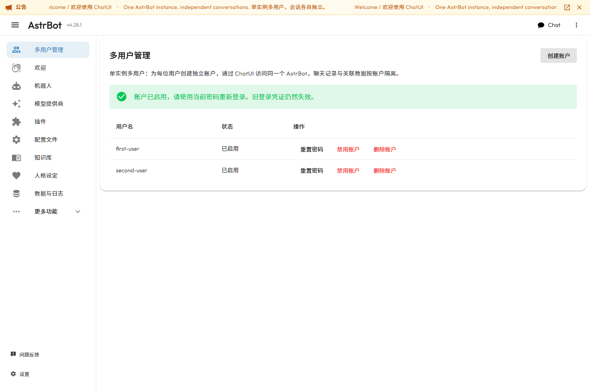

普通用户登录后只显示聊天入口。点击 **创建对话**，输入消息后点击 **发送**，即可使用所选配置接收流式回复；在侧栏点击本人会话可以重新打开历史。当前普通账户开放文本与多模态会话及下述配置和输入参数选择；普通账户还可以重命名、添加星标、归档、恢复和删除本人会话，批量整理、搜索消息、浏览更早历史及消息标记；最新一轮用户消息可以编辑并继续生成，最新回复可以重试，引用消息须属于同一个本人会话。编辑和重试沿用本人附件及当前选择的配置、模型和思考强度。项目、分支及侧边聊天可按下文使用；ZIP 会话归档可按[保存与恢复自己的 Chat 会话](#保存与恢复自己的-chat-会话)中的步骤导入导出。管理员维护共享配置，普通用户不编辑实例配置。

在输入框点击 **上传文件**（回形针），或拖入文件、粘贴图片，可发送图片、音频、视频和文件；麦克风按钮沿用现有录音上传操作。大文件保留分片上传、进度、重试及取消。发送前可以预览并移除暂存附件；发送后从本人历史预览媒体或点击 **下载** 获取原文件及模型生成的附件。旧管理员附件仍由原管理员使用。其他账户即使知道附件、上传任务、文件名或下载标识，也不能读取、引用或清理这些资源。

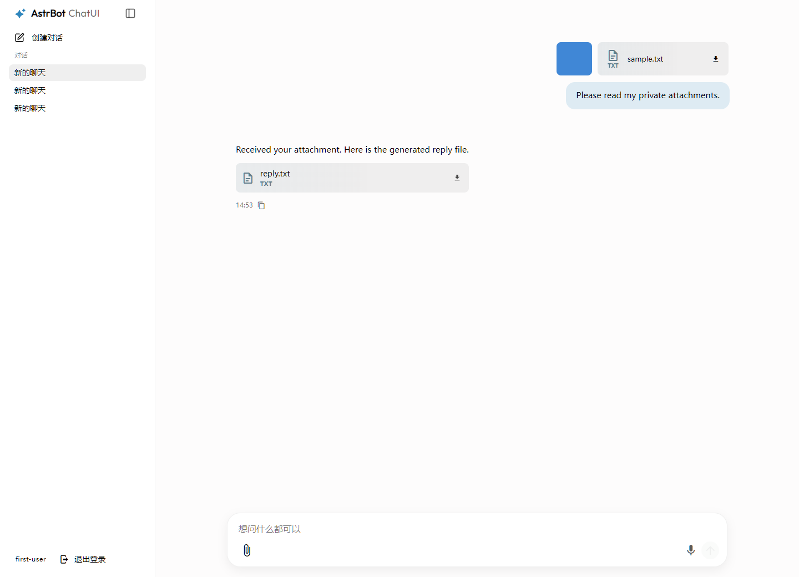

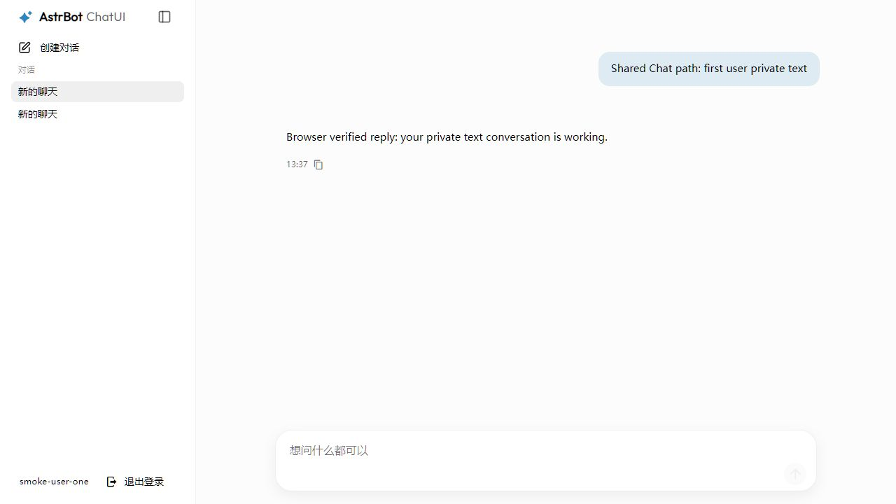

从原来的普通用户基础 Chat 入口，继续使用同一侧栏的 **批量管理**、**搜索消息**、会话的 **更多操作** 和页脚的 **查看归档**。这些入口只整理本人数据，管理员在日常 Chat 中也遵守同样的归属规则。批量操作会提示未成功的数量；失败项目不会被视为已经删除或归档。退出或切换账户会清理历史页、搜索、未读标记和批量选择。

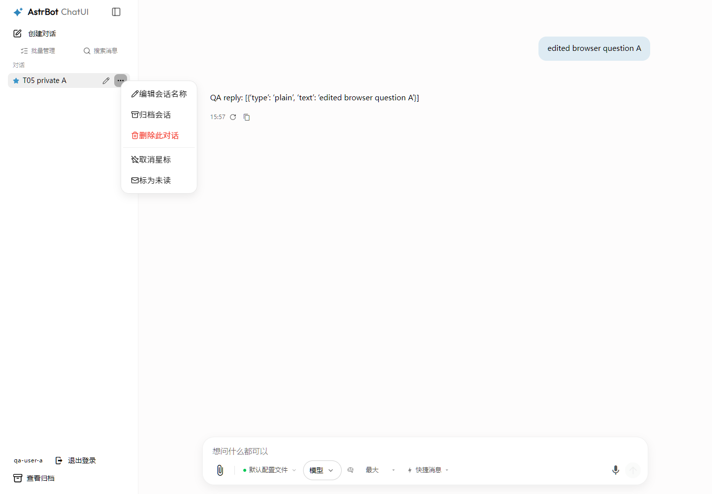

回复生成期间，输入框为空时发送按钮变为 **停止**。可将排队的文本后续消息追加到本人的运行中，或先中断再发送。重新打开或刷新本人会话会重新订阅正在生成的回复；即使知道运行或问题标识，其他账户也不能订阅、停止或回答其中的问题。交互选择卡片始终属于其真实会话。

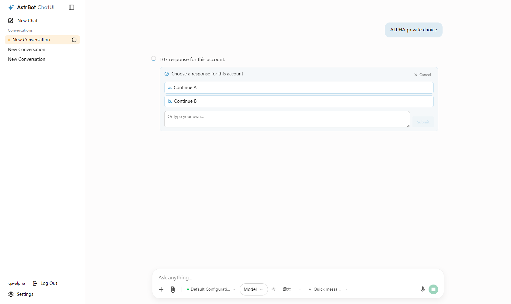

在现有输入框中通过 **+ → 设定目标** 设置会话目标，随后在原有目标侧栏暂停、继续或清除。目标语义保持原样，重新连接后仍可读取。此前仅管理员可见的这些运行控制现对应每个账户本人 Chat 中的原位置。退出时会清理待答卡片、排队文本、目标显示、浏览器提醒及订阅，再进入下一账户的 Chat。

也可发送 `/goal set <目标>`。新目标开始运行或暂停目标恢复时，若没有打开思考、工作区等侧栏，会自动展开目标侧栏；已有侧栏保持原状，手动关闭的目标侧栏不会在每轮更新时重新弹出。输入框菜单的“设定目标”只显示名称，不再附带说明小字。ChatUI 不再将每轮判定结果追加为聊天消息，最近评估仍可在目标侧栏查看。目标完成后，顶部工具栏中 **Bot** 按钮旁的目标按钮以绿色高亮并显示勾选图标，点击仍可打开目标侧栏。

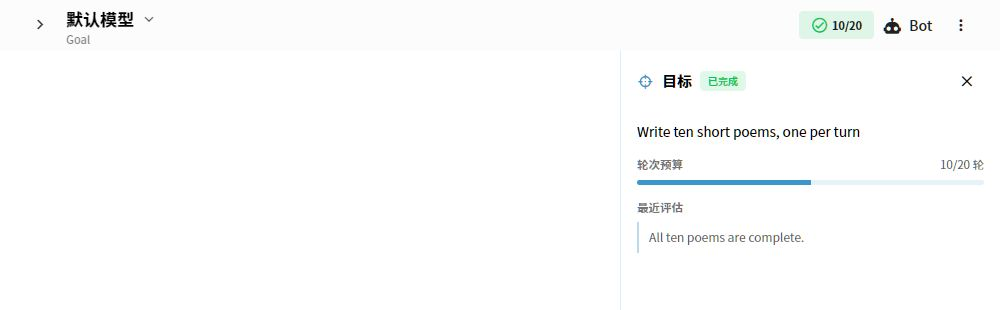

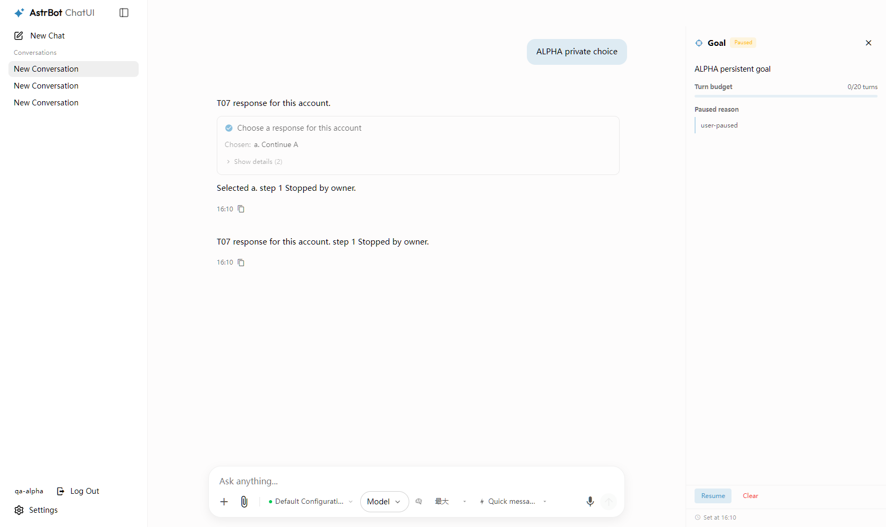

通过 **设置 → 通信模式 → WebSocket**，可在 WebSocket 通路继续使用相同的文本、附件、配置、模型及思考强度选项；默认仍为 SSE。WebSocket 同样支持引用本人当前会话的消息。排队消息发送到当前会话前会等待配置选择完成，发送到后台会话则沿用该会话自己的配置绑定。

打开 **+ → 实时对话**，再点击光球即可在当前会话开始语音聊天；页面会先准备好当前配置及输入参数。实时对话会将原始录音与识别文本保留在本人历史中，播放流式音频，并通过本账户附件权限预览或下载生成的图片、音频、视频及文件。关闭视图会停止本地录音和播放、清理媒体预览；重新打开本人会话可恢复进行中的实时回复，文本与生成媒体会继续保存到原账户，直至运行完成。退出或切换账户会清理连接，已经运行的任务沿用原有生命周期。

| 原入口 | 当前入口 |
| --- | --- |
| 仅管理员可用的运行控制 | 所有者本人 Chat 中相同位置的停止、目标、交互问题及后续消息入口 |
| Chat 中无法打开实时对话 | **+ → 实时对话** 在当前本人会话中打开现有 Live 视图 |

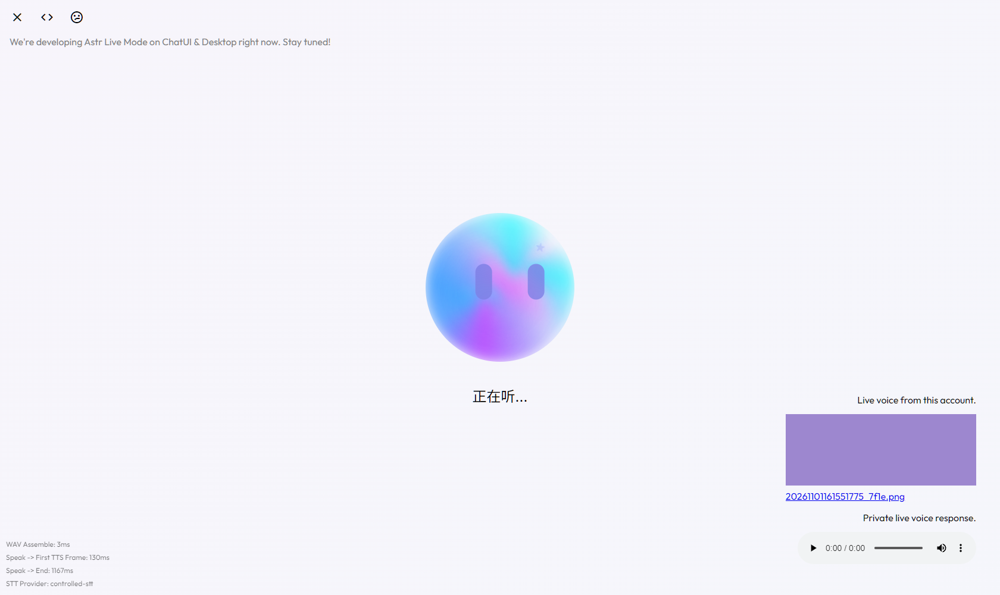

窄屏设备可点击 Chat 左上角的侧栏按钮打开会话列表，在抽屉中使用**创建对话**、重开历史或**退出登录**；Bot 管理导航继续隐藏。

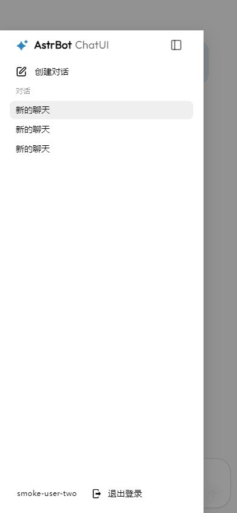

点击 **退出登录** 后可在同一浏览器切换账户；会话列表、未发送的文本草稿、暂存附件、上传队列、媒体预览和旧请求会清理或失效。所有账户（包括管理员）的日常 WebChat 查询和操作都遵守所有者边界。管理员的全量备份与运维日志仍然保留，因此此功能不对受信任的服务器维护者承诺聊天内容保密。

### 完整实例备份与恢复

管理员继续使用原有 **Bot → 设置 → 维护 → 备份管理**。普通账户不能调用完整备份、恢复或运维日志接口，包括兼容地址。Chat 中的个人会话 ZIP 导入导出仍使用原入口，与完整实例恢复分开。

| 原流程 | 多账户流程 |
| --- | --- |
| 备份管理 → 导出备份 | 入口不变；包含稳定账户身份、密码散列、角色、启用状态，以及个人历史、附件、项目、分支、侧聊、已保存选择与配置绑定 |
| 导入备份 → 确认 → 重启 | 入口不变；停止受支持运行任务，恢复后用备份管理员重新登录检查实际结果，再重启并重新登录 |

1. 选择 **导出备份 → 开始导出 → 下载备份**。归档含所有账户和实例配置、数据，请妥善保管。AstrBot 管理的会话及项目工作区也在归档内；位于 AstrBot 数据目录外的绝对自定义工作区，仍需单独进行服务器备份。
2. 在 **导入备份** 中选择 ZIP，点击 **上传并检查**，核对版本信息及覆盖提示后再 **确认导入**。现有格式兼容旧单账户备份和多账户备份。旧归档保留原管理员资源归属；现代归档保持每个账户的身份及资源所有者。
3. 完整恢复期间实例进入维护状态。受支持的模型、Live、目标循环和流式任务，必须在替换数据前停止并完成收尾，避免旧回复写进已恢复的历史；无法完成停止时不清空数据库。范围限于核心和已审计插件的官方生命周期，不承诺控制任意第三方线程或提供执行沙箱。普通重置密码、禁用账户仍沿用原有任务生命周期。
4. 每次完整恢复均生成新的签名密钥，使所有旧 JWT 和文件下载 token 失效，包括旧快照创建时颁发的凭证。401 表示需要重新认证，**不表示恢复成功**。请等待恢复结束，再使用备份中的管理员凭证登录；维护对话框会重新打开实际任务记录。失败或中断时可点击 **重试**、上传另一个有效归档或从 **备份列表** 重新选择，无需手动修改隐藏文件。如果数据替换开始后恢复失败或中断，点击 **立即重启** 只会重新启动维护环境，不代表恢复成功；管理员重新登录后，仍需用有效备份完成重试，才能恢复使用 Chat。
5. 实际记录显示 **导入完成！** 后，点击 **立即重启**。旧运行时在重启前保持停止。沿用自托管实例或 Desktop 的现有重启方式，以公开就绪接口等待启动，不保留已撤销的登录。返回登录页后再次登录。
6. 已启用账户可打开本人的 Chat、预览或下载恢复的附件、选择管理员提供的配置并继续聊天；禁用状态仍然生效。在同一浏览器切换账户时请先退出。管理员保留 Bot 和完整备份、日志等运维功能，日常 Chat 仍不能访问其他账户的会话。

历史中的导入标记与原生文件变更权限元数据会原样保留；完整备份不会把导入的工具卡片变成查看或恢复服务器文件的权限。旧归档只为实际安全提取的合法成员登记附件；恢复或重复启动不会为服务器残留文件补授权。

### 管理普通账户

管理员在 **Bot → 多用户管理** 中，找到目标普通账户后选择 **重置密码**，输入符合页面密码规则的新密码并确认。用户需要用新密码重新登录，原密码与已有登录凭证随即失效；历史会话仍归原账户。重置密码不会启用已禁用账户。

选择 **禁用账户** 后，确认框会显示目标登录名及影响，确认后状态变为 **已禁用**。该账户无法再登录，旧凭证也不能发送消息、下载受保护资源或重新订阅聊天流；已经运行的任务沿用原有生命周期。选择 **启用账户** 可恢复访问，用户须重新登录；选择 **删除账户** 并确认后，会永久删除账户及其所属数据。此入口只管理普通账户，不提供角色修改或管理员禁用操作。

用户页面在后续请求收到凭证失效结果时会退出当前身份、清理聊天显示与草稿并返回登录页。已撤销的凭证也不能访问受保护附件。重新订阅聊天流时会验证账户当前状态与凭证版本。

### 个人项目、分支与侧边聊天

在 **项目 → +** 中创建项目、编辑现有工作区设置，或使用项目行的 **新建会话** 按钮开始聊天。可拖动本人的会话加入或移出本人的项目。项目列表、工作区预览和下载按当前账户归属校验。项目工作区模式及管理员配置的工具能力保持原有语义，不为每个账户新增服务器文件系统或执行沙箱。

在自己的机器人回复下点击 **分支**，即可复制截至该回复的历史，在同一项目内创建新会话。新分支继承来源配置，保留本人附件引用；删除父会话、分支或侧聊不会破坏其他存活会话仍引用的附件。选中自己的回复文字后可 **在新分支中询问**；右上角的 **新建侧边聊天** 则以空上下文开始。两种侧边会话创建时继承父会话配置，随后可在侧边输入框的配置胶囊中独立选择管理员已有配置。关闭面板会保留会话，可从侧边聊天菜单重新打开；停止或删除只影响本人目标侧聊，刷新页面可重新订阅仍在生成的回复。

| 旧入口 | 当前入口 |
| --- | --- |
| 共用管理员登录下的项目、分支及侧边聊天 | 仍位于 Chat 的原有位置，各账户分别操作本人的资源 |

管理员日常 Chat 同样只访问本人的项目与会话。退出或切换账户会清理项目列表、选中项、最近工作区路径和侧边流式连接，迟到响应不会回填到下一账户的页面。项目关联、分支关系、侧聊及配置绑定在服务重启后保留。

### 选择配置与聊天输入参数

在输入框旁的配置胶囊中选择管理员创建的配置文件。选择只绑定当前会话，首次发送也会使用该配置；选择“默认配置文件”会明确覆盖更宽泛的路由规则。新对话沿用本账户最近选择的配置，重新打开已有会话则恢复该会话自己的绑定。

配置使用本地 Agent 执行器时，现有模型菜单可选择管理员已配置并启用的聊天模型。思考强度菜单可以选择管理员定义的既有预设与强度值，两者均按账户保存，并随每条消息发送；快捷消息可从菜单中的“编辑快捷消息”新增、修改、排序或删除，仅影响当前账户。上述操作不会修改实例共享设置。同一浏览器切换账户时，实时模型选择会重置，随后读取该账户记忆的选择。

| 原有行为 | 当前行为 |
| --- | --- |
| 配置胶囊读取管理配置与全局路由 | 同一个胶囊通过本人会话的消费接口选择配置 |
| 选择思考强度会修改实例默认值 | 选值只为当前账户保存；管理员另行编辑共享预设定义 |

配置文件、供应商、模型定义和思考强度预设仍由管理员创建或编辑。快捷消息则由每个账户独立编辑和保存。普通用户只看到使用型选择器，没有配置编辑、供应商连接测试或管理页面。配置元数据只包含标识、名称和执行器类型；模型选项不返回凭据或服务器地址。

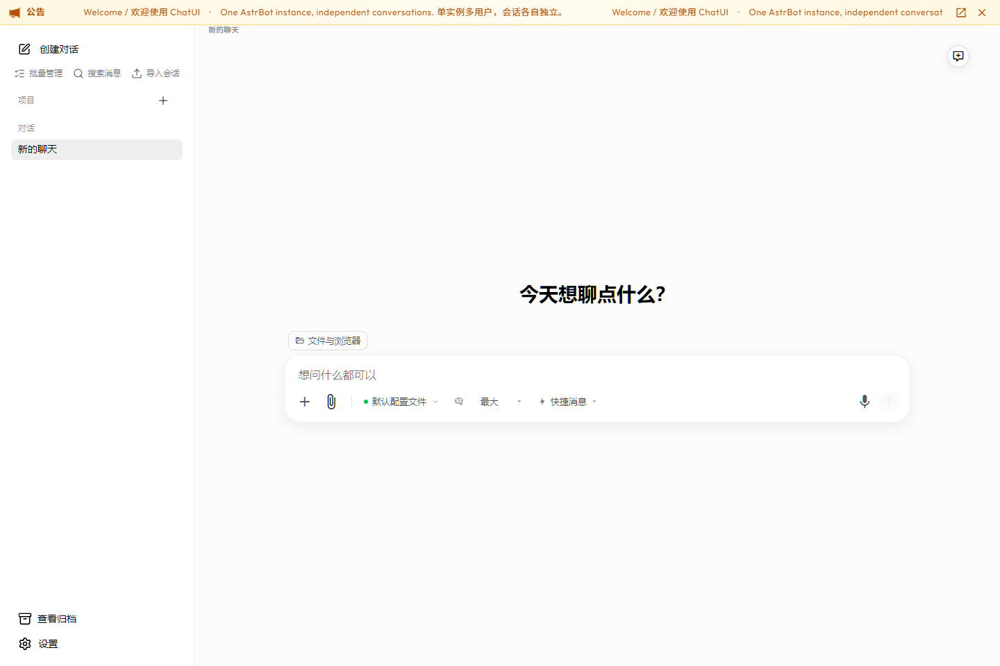

### 在本人聊天中使用工具与产物

输入区保留现有技能菜单、托管终端指示器、项目状态和工作区入口。选择技能只会为当前会话排队一次加载提示，不会修改技能、插件或共享配置。工具能力仍跟随管理员提供的配置及既有启用规则；服务管理控件仍仅对管理员开放。

从终端指示器打开输出窗口，可以查看输出、停止任务或清理已结束的记录。操作同时核对聊天会话与终端任务，知道其他账户的任务 ID 也不能访问。切换账户后，旧终端输出、技能队列、结果卡片和扩展缓存会清空。

文件变更卡片以原始会话和生成消息／运行记录为来源，不能替换路径、备份或来源标识。文件在生成结果后发生变化时，旧卡片不能读取后来覆盖的内容或撤销覆盖它。撤销删除仅使用该次删除的确切回收站条目，并再次验证原文件或目录的证据。旧删除记录、并发候选不唯一、回收对象发生变化等情况仍显示记录，但不提供撤销按钮。导入历史中的卡片仅用于展示。管理员的日常 Chat 同样遵守这些归属规则。

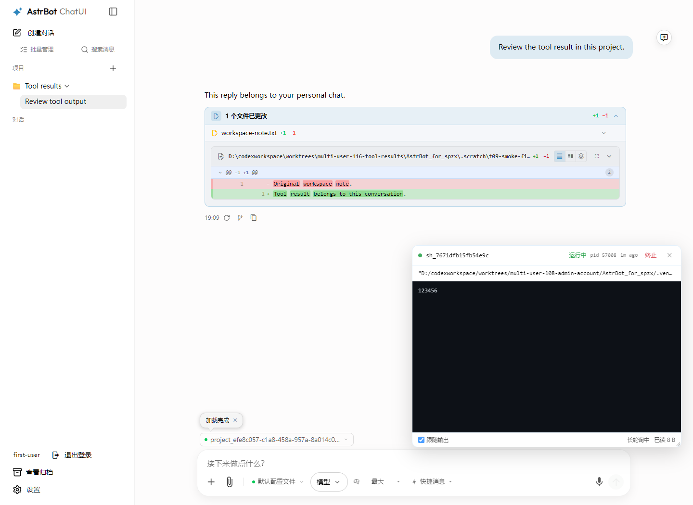

使用扩展时需要同步更新宿主与 spcode、Browser Use 插件。宿主只接受实际带归属守卫标记的处理器，旧版插件不会因占用了相同 URL 而获得消费权限。旧 `/api/plug/…` 入口执行相同检查，删除恢复兼容入口交由核心校验确切记录。spcode 文件操作限定在本人会话经服务端解析的工作区内，主目录／磁盘快捷入口指向这个工作区；Git 历史导出通过本人附件下载。普通账户不会获得插件管理、全局服务状态、任意服务器文件浏览或权限根目录编辑能力。

| 旧入口或行为 | 当前账户入口或行为 |
| --- | --- |
| 多账户改造过渡期间隐藏 Chat 工具 | 在同一 Chat 输入区和工作区中显示已适配的消费操作 |
| 技能菜单读取技能管理列表 | 读取本人会话的技能消费清单，管理仍在扩展页面 |
| 文件变更只提交路径、备份和校验值 | 由本人会话的原始消息或运行记录授权 |
| 删除撤销恢复同路径最新记录 | 仅恢复该次删除绑定的确切回收对象 |
| Git 历史版本在服务器上打开 | 通过本人附件边界下载导出文件 |

实例仍共享所配置的工具和运行时。这是应用资源归属隔离，不是每账户独立文件系统或执行沙箱。管理员保留已说明的全量备份和日志等运维能力。

## 打开 Agent 文件引用

在主聊天中点击 Agent 回复里的显式文件链接，会打开现有文件侧栏。文件消费校验当前账户、会话及服务端解析的工作区，任意服务器路径或从他人会话复制的引用都不能授权读取。每次点击支持的引用读取本人工作区的当前内容；生成附件则通过独立的本人预览／下载边界消费，不会改变 Agent 权限。

整文件使用 `[名称](G:/project/main.py)`，单行追加 `#L12`，闭区间追加 `#L12-L18`。
行号从一开始，始终指源文本。也支持 POSIX 宿主路径，例如
`[源码](/home/user/main.py#L12)`。路径使用正斜杠，空格和文件名特殊字符需要百分号编码，
例如 `[笔记](G:/My%20Project/notes%23draft.md#L2-L4)`。
普通路径文字、代码块、相对链接和网页链接保持原有行为；流式尚未完成的链接不会读取文件。

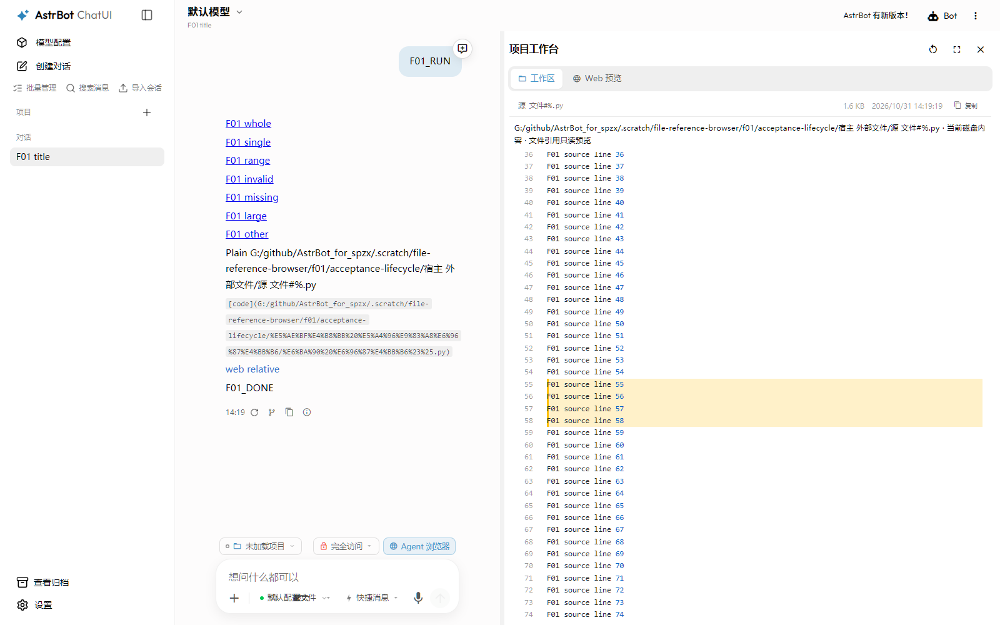

文件引用通过已鉴权的 spcode 服务访问本人会话的工作区文件。插件不可用时按提示安装或启用 spcode。
文件不存在、不可读、格式不支持、超限或行范围失效时会显示明确状态；无效范围不会伪报高亮成功。
带行定位的 Markdown 引用显示源文本，避免把渲染后的视觉行当作源文件行号。
项目文件、Git、文档、终端和浏览器入口仍保留在原工作台。
加载项目后，点击 **工作区** 可退出引用预览并返回项目文件列表。
也可以在 **Git 变更** 中使用文件的 **打开 → 在文件浏览器中打开** 菜单，
查看所选项目文件。主动导航仍会检查未保存的编辑；后台项目或 worktree 刷新不会退出引用。

### 预览图片、文档与表格

图片、PDF、DOCX、XLSX、CSV 和 Markdown 的绝对路径引用在同一个文件侧栏复用现有查看器，
支持本人项目工作区和本人会话工作区中的文件。整份 CSV 显示表格；带行号的 CSV 和 Markdown 显示**源文本**，
CSV 引号内的换行也按源文件行号定位。图片、PDF 和 Office 文档收到文本行号时明确提示无法定位，
不会伪报高亮成功，也不新增 Office、PDF 或图片编辑器。

字节预览保持既有扩展名／MIME 白名单和 50 MiB 上限，源文本保持 5 MiB 上限。
中文、空格、`#`、`%` 等文件名字符按链接编码指向实际文件。重新点击引用读取磁盘当前内容；
切换目标时取消或忽略旧字节／解析请求，并释放图片 URL 和 PDF 任务。
元数据与字节读取都需要启用 spcode。

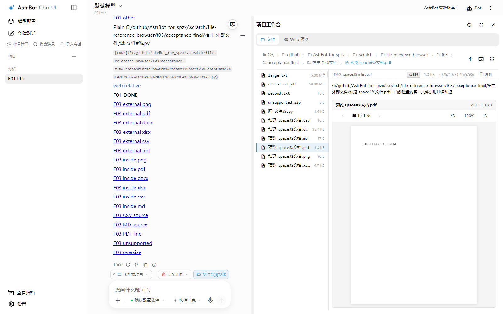

### 编辑、冲突与未保存跳转

在文本预览中点击 **编辑**，可修改并保存本人会话工作区内不超过 2 MiB 的文本。即使 Agent 处于只读模式，已支持的人工编辑仍校验本人资源归属，不会改变 Agent 权限、允许目录、项目或 worktree。保存保留原编码、BOM 和主导换行风格。

带着草稿点击文件引用、路径、目录，或切换会销毁编辑器的工作台页签、侧栏、会话时，选择 **保存并打开**、**放弃并打开** 或 **取消**。保存失败或冲突会停止跳转，完整草稿仍留在编辑器。关闭或刷新浏览器时使用浏览器自己的离开提示。

外部程序改动文件后，普通保存不会覆盖磁盘内容。可以明确 **从磁盘重新加载**（放弃草稿），或 **覆盖已确认版本**（保留草稿写入）；确认后的磁盘版本若再次变化，会重新冲突。保存期间继续输入的内容仍算未保存，不会因早先请求成功而被标成已保存。

后台 worktree 增删、项目卸载或切换会保留正在显示的文件和草稿，不因轮询自动关闭编辑器。需要离开时，主动点击引用、切换工作台或返回当前项目文件列表，再选择保存、放弃或取消。

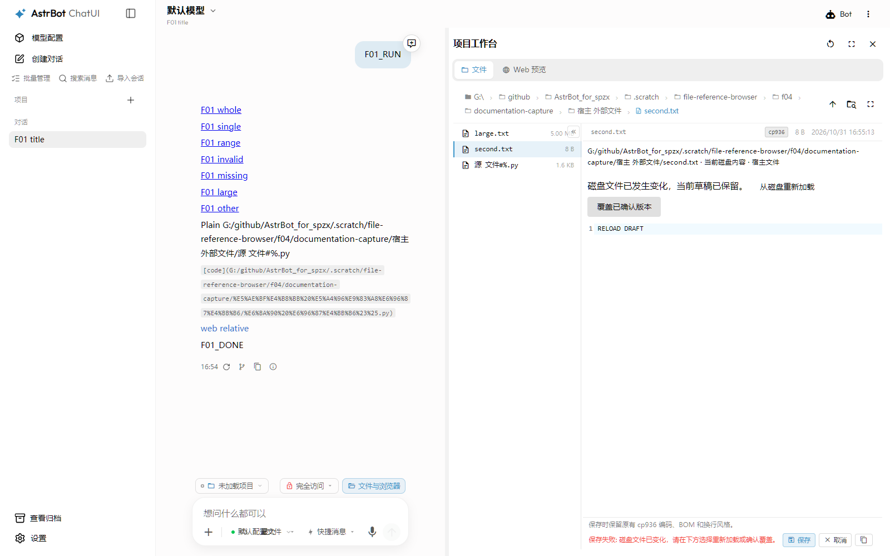

版本检查属于乐观并发控制：暂存后、替换前再次核对磁盘版本，但无法锁定任意外部编辑器在最后检查与系统替换之间的写入。文件失效、权限不足、编码或落盘失败均保留草稿并明确报错；旧项目相对写入接口的范围保持不变。

### 文件重命名与回收站

在文件预览顶部选择 **编辑**，再在编辑工具栏选择 **重命名**，可在原目录内修改文件名；目标必须仍属于本人会话的工作区。原 **预览 → 重命名** 入口调整为 **预览 → 编辑 → 重命名**。确认框显示固定的完整目标路径，重名、权限不足或目标失效会显示错误。成功后侧栏转到新路径，历史聊天中的旧引用仍指向原路径。

文件预览工具栏使用红色 **删除** 按钮（原 **移入回收站**）。点击后，二次确认仍明确说明会移入系统回收站，确认按钮为 **移入回收站**，可通过操作系统恢复。本人工作区的文件及文档侧栏使用相同删除方式；回收站不可用或拒绝操作时保留文件，不执行永久删除。

文件预览顶部将 **编辑**、**复制**、**删除** 放在同一行，不再显示额外的路径与“当前磁盘内容 · 宿主文件”说明行。完整路径仍可通过悬停文件名查看；引用行号无效或不适用时会保留提示。

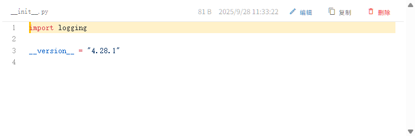

有未保存内容时，先选择 **保存并打开**、**放弃并打开** 或 **取消**。取消、保存失败或冲突会停止管理操作。请求执行期间保持操作目标固定，不切换到其他文件。人工文件管理经过 WebUI 鉴权并遵循宿主权限，不改变 Agent 的项目或权限。

Windows 安全回收要求 Windows 8 及以上、插件的 `pywin32` 依赖和本地固定磁盘。不支持的位置或缺少原生能力时，会在删除前返回错误，不使用旧删除后端。若操作系统或文件系统无法保证重命名不覆盖已有目标，也会明确失败。

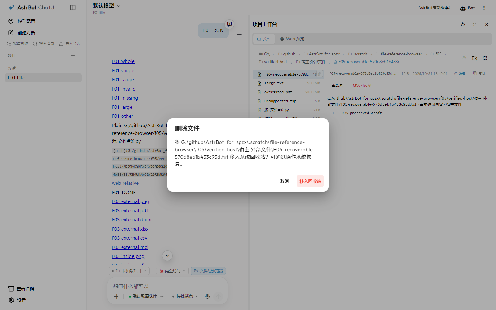

### 浏览宿主目录与盘符

无需加载项目：点击输入框上方的 **文件与浏览器 → 文件**。现有目录选择器和主目录／盘符快捷入口会打开当前会话解析出的工作目录。选择位置只改变文件浏览，不会加载项目。

点击面包屑的最后一段，输入文件或目录的绝对路径，或相对当前列表目录的路径，按 **Enter** 跳转。文件在现有预览中打开，文本可进入编辑。路径和父级导航必须位于当前账号的会话工作目录内，越界路径会被拒绝。路径栏显示实际解析后的目标。不存在或不可读的路径显示错误，目录超限时保留现有的前 1000 项提示。

路径栏右侧的 **后退到上次浏览的目录**（左箭头）按当前文件浏览器的访问顺序逐次返回目录，不同于 **上一级目录**。同目录内切换文件和加载失败的目录不计入历史；没有历史记录时按钮禁用。**返回当前加载的项目目录**（带房屋的文件夹图标）直接打开已加载项目的根目录；未加载项目时禁用。两种操作都先检查未保存的编辑，取消后保留当前文件和后退记录。

加载项目后，**工作区 → 工作区** 仍可返回原项目文件列表。文件浏览与文件引用共用导航生命周期。后台轮询保留已打开的文件和草稿，每次读取或保存仍检查当前账号和工作目录。Git 变更／历史、文档、终端继续使用原项目上下文，Web 预览和 Agent 浏览器入口保留。

| 旧入口 | 当前入口 |
| --- | --- |
| 无项目时的 Agent 浏览器 | 文件与浏览器 → 文件／Web 预览 |
| 仅接受项目相对路径的输入 | 文件栏末级面包屑 → 宿主绝对路径或相对当前列表目录的路径 |
| 任意宿主目录和盘符快捷入口 | 现有快捷入口打开当前账号的会话工作目录 |

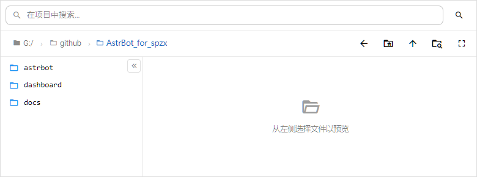

## 紧凑的 Git 变更列表

在 **项目工作台 → Git 变更** 中，文件行使用较小的复选框、字体和操作按钮，减少大量改动占用的空间。文件复选框小于目录复选框；暂存、取消暂存、恢复和打开菜单仍可使用。

没有直属改动文件、且只有一个子目录的连续层级始终合并为一行，例如 `dashboard/src/components/chat/message_list_comps`。点击合并目录直接展开或折叠末级目录中的文件；遇到分叉或直属文件时保留对应目录。旧版 **展开层级 → 点击合并目录展开文件**，展开全部也会保留合并路径，不再还原中间层级。目录计数、增删统计和批量选择覆盖整个子树，文件操作继续使用原始完整路径。

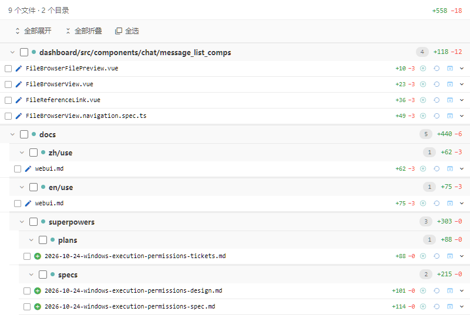

## 切换 Git 工作树

在 **项目工作台** 的 **工作区 / Git 变更 / Git 历史** 标签中，顶部的 **工作树** 区域会根据侧栏宽度自动调整：按钮能放进两行时直接显示；需要更多行时，工作树下拉菜单会与 **当前分支** 下拉菜单并排显示在同一行。点击当前工作树打开菜单，选择要查看的工作树。加宽侧栏或减少工作树后，空间足够会自动恢复按钮。窄侧栏会隐藏文字标签和刷新说明，保留两个选择器及操作图标。

入口映射：下拉模式原来的 **工作树行 → +** 改为 **工作树下拉菜单 → 新建 worktree**；按钮组模式仍保留 **+**。两种显示方式都保留工作树的右键管理菜单；下拉列表显示完整路径，便于区分同名工作树。

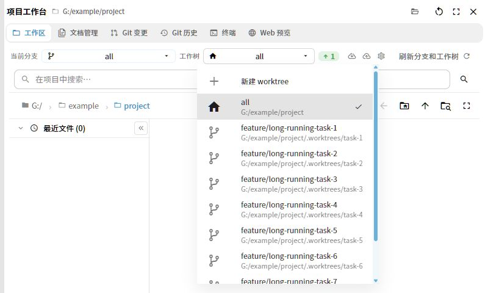

## 双因素认证

AstrBot WebUI支持基于 TOTP（Time-based One-Time Password）的双因素认证。

### 开启双因素认证

1. 点击左下角 `设置 → 安全`，找到 `WebUI 安全`。
2. 打开“启用 WebUI TOTP 双因素认证”开关，WebUI将显示二维码。
3. 使用任意支持 TOTP 的验证器应用（如 Google Authenticator 等）扫描二维码。
4. 输入验证器应用生成的 6 位验证码完成验证。
5. 系统会生成恢复码，用于丢失验证器设备后的登录。请务必妥善保存。

如需更换 TOTP 密钥，可在 TOTP 管理弹窗中操作，更换时需要先验证当前的 TOTP 验证码。

### 恢复码相关

- 恢复码仅可使用一次。使用恢复码登录后，双因素认证会被自动关闭，需要重新设置。
- 在 TOTP 管理弹窗中可以重新生成恢复码。
- 若恢复码丢失，将无法通过常规途径恢复账户访问权限，需要手动编辑 `data/cmd_config.json`，将 `dashboard.totp.enable` 设为 `false` 并手动清空 `dashboard.totp.secret` 和 `dashboard.totp.recovery_code_hash` 以关闭双因素认证。

### 安全性相关

- 启用双因素认证后，修改 TOTP 相关配置时需要先验证当前的 TOTP 验证码，以防止未经授权的修改。
- 修改管理面板密码会撤销所有受信任设备。

## ChatUI

AstrBot 内置 ChatUI，可在浏览器中直接与已配置的模型对话。

主聊天区的模型回复不再显示左侧头像，正文可使用更多横向空间。回答结束后，中间工作过程收进“已工作”胶囊：灰阶浅底、细线对勾和稍加重的时长文字；点击仍可展开或收起。

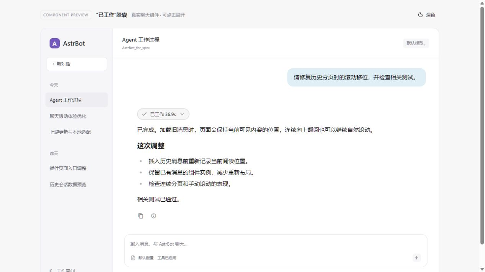

顶部模型菜单会记住每个会话选择的提供商和模型，切回会话时自动恢复。选择模型、发送消息或重新生成回复时会保存记录；没有记录的会话沿用当前选择。记录仅保存在当前浏览器，不跨设备同步，也不改变思考强度设置。切换项目后，输入框会自动获得焦点；切换会话仍会恢复上次浏览位置。

思考侧栏打开后会跟随最新活动。向上滚动或拖动滚动条时暂停跟随，向下滚回底部后恢复。通过搜索或文件变更入口打开侧栏时，优先显示定位结果，流式输出不会将其拉回底部。

聊天区右侧原先的黄/红色消息定位条改为灰阶短刻度。较长、较深的刻度表示当前阅读的轮次，空心刻度表示继承会话。悬停或使用键盘聚焦可预览摘要：标题是用户提问，下方灰字是对应回复的正文摘要，思考内容及工具日志不混入。点击即可定位；密集刻度会合并显示，展开列表每页最多显示 20 轮提问及回复摘要，并默认打开当前轮次所在页。跳转到未加载的历史时会自动加载消息。触屏设备可直接点击刻度操作。

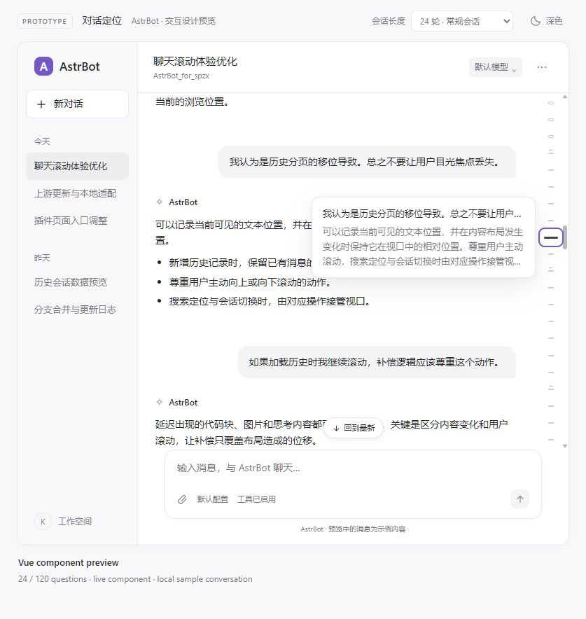

ChatUI 支持以下常用能力：

- 创建、重命名、删除对话，并在左侧会话列表中切换历史对话。
- 在聊天页选择配置文件、模型提供商与模型；如果启用了 Provider 会话隔离，也可以为当前会话单独选择模型。
- 发送文本、图片、文件与语音输入；上传附件时会展示预览，并根据文件签名辅助识别文件类型。
- 查看模型思考过程、工具调用状态、知识库或网页搜索引用来源，以及每条回复的 Token 和耗时统计。
- 对已有回复执行复制、重新生成，或使用其他模型重新生成。
- 编辑用户消息后从该消息继续生成，也可以针对某段内容开启分支追问。
- 切换流式/普通响应模式，以及 SSE/WebSocket 通信模式。

聊天输入区的配置胶囊、`+ → 配置文件` 菜单和选择弹窗均将内置 `default` 配置显示为“默认配置文件”（英文界面为 `Default Configuration`）；配置 ID 仍为 `default`。自定义配置继续显示原名称。

聊天附件最大为 512 MiB。32 MiB 及以上的文件采用分片上传，附件卡片显示上传百分比和取消按钮。上传失败后，可点击重试按钮补传缺失分片，或移除失败卡片以放弃上传。重试时请保持页面打开；刷新页面或重启 AstrBot 后无法恢复原上传会话，上传会话闲置一小时后也会失效。原有图片预览仍可使用。

每次上传使用独立的磁盘文件名，聊天界面仍显示原文件名。不同截图即使都叫 `image.png` 也会分别保存，删除其中一个附件不会影响另一个。已有附件不需要重命名。

发送后的音频和视频附件卡片包含播放器和下载按钮，可直接播放或按原文件名下载。包含媒体的附件行会自动换行，避免播放器被卡片裁切；图片预览和普通文件下载仍使用原有入口。

`设置 → 维护` 中的备份导入同样显示上传进度，上传失败后可点击“继续上传”。分片备份上传最大支持 8 GiB。新增控件位于原聊天附件区和备份导入弹窗，入口位置没有变化。

### 侧边聊天与分支追问

打开一个对话后，悬停或点击消息区右上角的对话气泡加号按钮 **新建侧边聊天**。菜单列出当前主对话已保存的侧聊，选择 **新建侧边聊天** 可再开一段。新侧聊从空白开始，不引用某条消息，也不继承主对话上下文；请在侧聊中自行补充问题需要的背景。

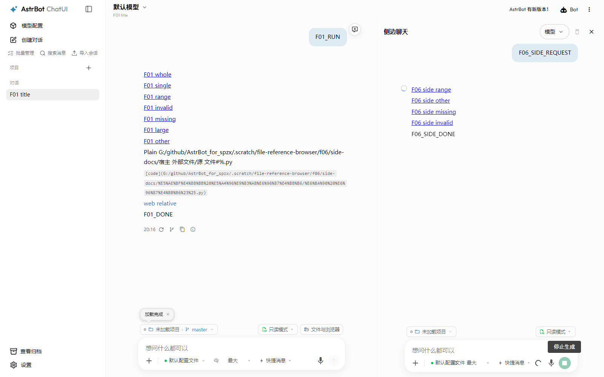

关闭面板、打开文件、切换对话或离开聊天页只会收起侧聊，历史仍保留。回到同一主对话后，从侧聊菜单选择已保存的标题即可重新打开。回复仍在生成时，重新打开也会保留已流出的内容并继续更新。需要移除侧聊时明确点击删除按钮；删除记录需要成功连接后端。

侧聊 Agent 回复中的文件引用与主聊使用相同的宿主绝对路径 Markdown 链接和现有文件侧栏。点击引用会收起侧聊，读取磁盘当前文件，并高亮有效的源文本行范围。之后切换项目或 worktree 也不会改变历史引用的绝对目标；查看文件不会改变 Agent 的项目、执行目录或权限。需要继续侧聊时从菜单重新打开。

切换会离开未保存编辑时，先选择 **保存并打开**、**放弃并打开** 或 **取消**。取消、保存失败或冲突会保留编辑器和草稿。文件不存在、无法读取或行范围失效时，文件侧栏显示具体反馈；spcode 不可用时，启用插件后可重试引用。

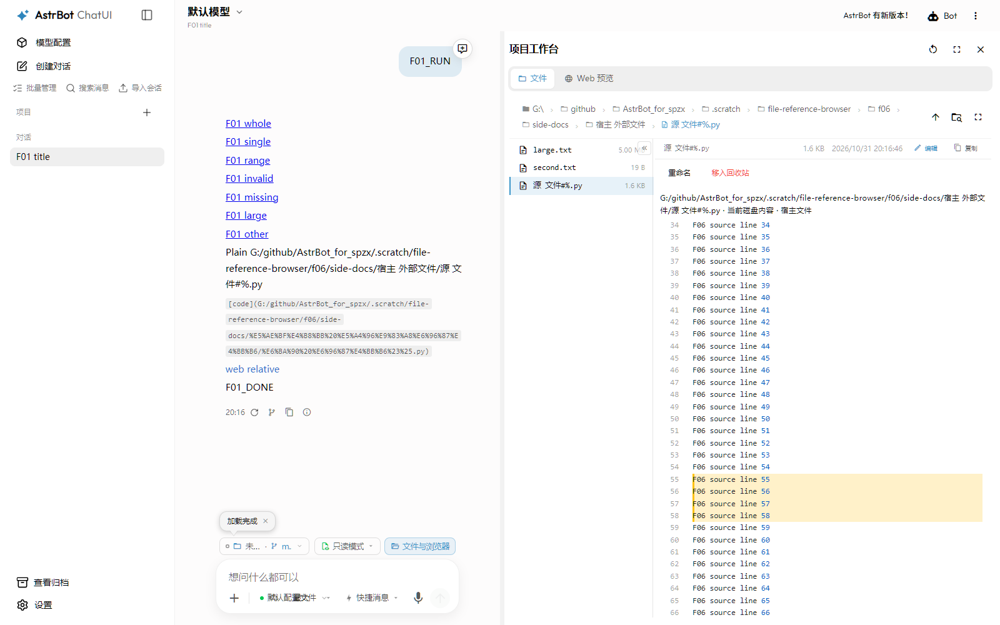

普通 **分支** 仍从回复中选中文字后点击 **在新分支中询问** 发起，保留引用文字及截至该回复检查点的上下文。关闭面板后记录仍在，可从回复中的分支标记或数量入口重新打开；删除按钮用于明确删除该分支。它也不同于将整个对话分支为另一个会话的操作。

桌面端可拖动面板 **左边缘** 调整分支追问或侧边聊天的宽度。窄屏手机布局中面板占满屏幕，不显示调宽手柄。

手机上点击右上角 **×** 返回主对话。侧聊和普通分支关闭面板后均保留历史。

### 项目工作台 Web 预览

为当前对话加载项目后，点击输入框上方的 **工作区**（提示为 **查看工作区文件、改动和历史**）打开 **项目工作台**，再选择 **终端** 旁的 **Web 预览**。文件和 Web 预览也可在无项目时进入；其他项目标签在识别到 Git 仓库或非 Git 项目后显示，项目检查尚未完成或失败时可能暂不可见。

1. 先自行启动网站的开发服务器，预览不会替你启动它。
2. 输入 HTTP(S) 地址后按 **Enter**，或选择建议的本地端口。例如 `localhost:5173` 会补全为 `http://localhost:5173/`；不带协议的公网主机名默认使用 HTTPS。这里的 localhost 指运行浏览器的机器，可能与 AstrBot 服务器不同。
3. 点击 **新建预览页面**（+）添加页面，通过标签切换，用 × 关闭标签。关闭最后一个标签后会保留一个空白页面。切换页面时，其他预览保持加载。
4. 使用 **刷新**、**在新标签页打开**，或点击地址栏中的星号收藏当前页面地址。每个项目最多保存 12 个收藏、预览标签及当前标签，仅保存在当前浏览器，不跨浏览器或设备同步。没有项目时，标签保留到预览组件重新挂载为止。切换工作台标签不会重新加载已打开的预览。

下图展示网页预览组件中同时打开的两个页面。

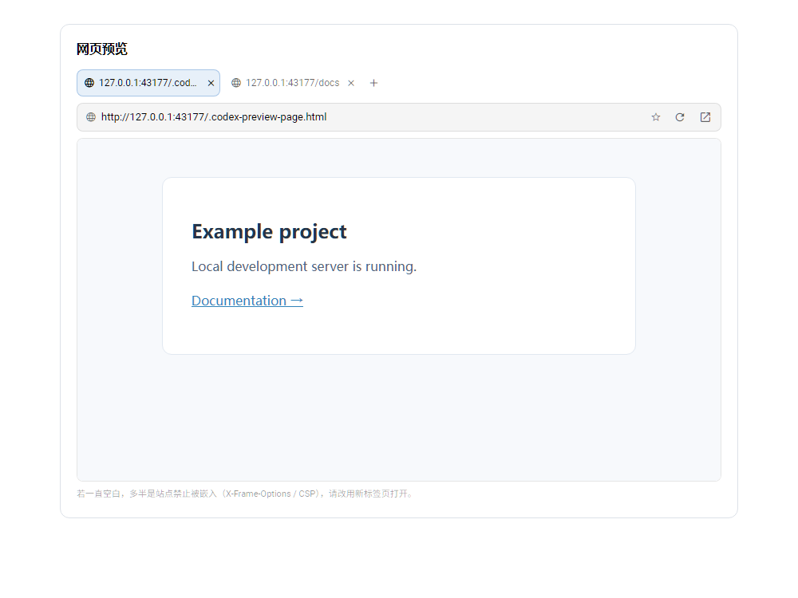

这是内嵌网页，没有前进、后退按钮。地址栏保留入口地址，不跟随页内链接或重定向更新。网站的框架策略可能禁止嵌入，HTTPS 管理面板也可能阻止 HTTP 预览；无法嵌入时可选择 **在新标签页打开**。iframe 使用沙箱，与管理面板同源的地址还有额外隔离，不会绕过浏览器或目标网站限制。不支持 file、data 和 JavaScript 地址。

| 旧入口或行为 | 当前入口或行为 |
| --- | --- |
| 选中回复文字 → 在新分支中询问 | 入口不变，仍打开可保留的普通分支；桌面端新增左边缘拖动调宽 |
| 关闭即销毁的临时侧聊 | 消息区 → 侧聊菜单 → 新建侧边聊天或已保存标题；上下文独立，历史保留至明确删除 |
| 侧聊中的文件引用 | 打开同一文件侧栏；从侧聊菜单的已保存标题重新打开侧聊 |
| 未加载项目时没有工作台入口 | 输入框上方的文件与浏览器；加载项目后仍从工作区进入 |
| 工作区 → 工作区 / 文档管理 / Git 变更 / Git 历史 / 终端 | 原有标签保留；项目工作台在终端之后新增 Web 预览 |

> [!NOTE]
> 为保证消息接收顺序，同一浏览器会话建议只保留一个 ChatUI 页面。如果你在多个标签页中同时打开聊天页面，系统可能会提示需要重新建立连接。

## 可视化配置

点击左栏 `配置文件`，先从页面顶部选择要修改的配置文件。分区依次为 `AI`、`平台与消息`、`访问控制`、`插件`、`扩展功能`，也可以使用顶部搜索定位配置项。

- `AI` 中，内置 AI 的设置分为 `模型`、`人格`、`能力`、`高级`；AI 标题旁的 `… → 更换执行方式` 用于接入第三方 Agent。
- `访问控制` 中设置管理员 ID 和白名单，包括白名单日志与管理员豁免选项。
- `平台与消息` 中设置消息触发方式、会话隔离和发送行为。
- `插件` 中选择该配置文件启用的插件集合。单个插件的参数请在 `插件` 页面中点击对应插件的齿轮图标（`插件配置`）修改。
- `平台与消息 → 文本转图像` 中设置文本转图像的输出开关和字数阈值；渲染策略、渲染服务地址与自定义模板在 `设置 → 外观` 中配置。
- `扩展功能` 中设置分段回复和群聊上下文感知。

| 旧入口 | 新入口 |
| --- | --- |
| AI 配置 / 平台配置 / 插件配置 | AI / 平台与消息 / 插件 |
| 平台配置 → 基本 → 管理员 ID | 访问控制 → 管理员 → 管理员 ID |
| 平台配置 → 白名单 | 访问控制 → 白名单 |

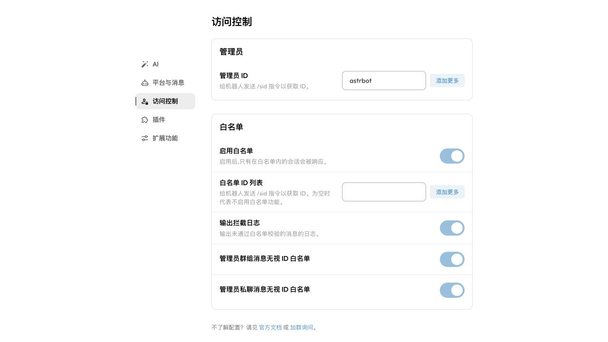

明确选择模型后，可点击选择器右侧的齿轮打开模型设置弹窗；模型和回退模型的选择菜单中也有齿轮入口。点击齿轮不会改变模型选择或回退顺序。保存模型设置会立即影响所有引用该模型的配置文件；当前配置文件的模型选择仍需点击 `保存配置`。自动选择模式下不显示右侧齿轮。

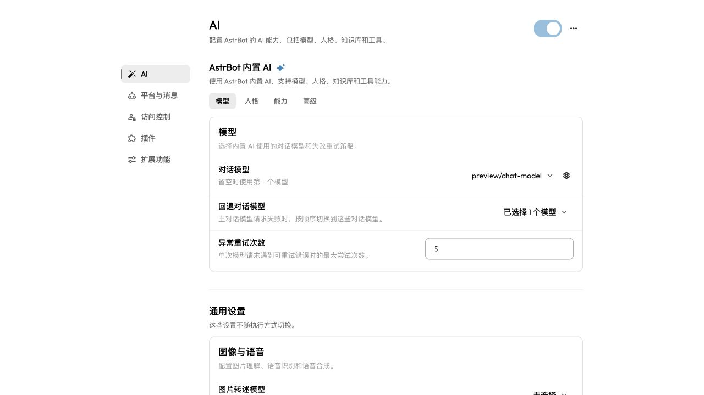

修改完成后，点击右下角磁盘图标的 `保存配置` 按钮，确认保存成功提示。

在 Bot 编辑器中选择默认配置或会话路由配置时，也可以点击配置选项右侧的箭头，在侧边抽屉中编辑该配置文件。抽屉中的修改同样需要点击 `保存配置`。

点击右下角 `{}` 图标的 `编辑配置文件` 按钮，可直接编辑当前配置文件的 JSON。编辑后先点击 `应用此配置`，将内容暂存到可视化编辑器，再关闭编辑窗口并点击 `保存配置`。

### 系统设置

全局设置位于左下角 `设置`，不在配置文件选择器中：

- `常规`：时区、外部回调地址、日志和缓存。
- `外观`：侧边栏、主题和文本转图像。
- `网络`：HTTP 代理、Python 依赖源和 GitHub 加速地址。Docker 下的代理填法见 [Docker 部署](/deploy/astrbot/docker.md)。
- `安全`：WebUI HTTPS、登录限速和 TOTP。
- `维护`：备份、恢复和重启。
- `OpenAPI`：开发者访问密钥。

系统配置修改后自动保存，请确认保存成功提示；如果页面提示需要重启，再按提示重启 AstrBot。

## 默认人格

默认人格现在是人格管理页中的一条真实记录，ID 为 `default`。可以编辑其提示词、预设对话、工具和技能，不能删除或重复创建。已有同名人格会保留原有内容；首次启动时只在缺少该记录的情况下创建。选择器在根目录将它置顶，预览和编辑均读取已保存的内容。

WebChat 未显式选择人格时，仍使用聊天页的默认系统提示词开关；显式选择“默认人格”时使用该记录中的提示词。其他平台的默认人格使用这条可编辑记录。本地人格的工具/技能选择继续区分“全部”和“无”。

## 插件

点击左栏 `插件`，顶部可切换 `插件`、`技能`、`MCP` 和 `管理行为`。在 `插件` 标签内，通过 `已安装` 与 `插件市场` 切换查看本地插件和市场插件。

在已安装或插件市场页面，也可以点击右下角 `安装插件`（+）按钮，以 URL / 文件上传的方式手动安装插件。

`技能` 和 `MCP` 页面支持搜索。技能列表还会显示技能来源，便于区分内置、项目和其他技能。

> 由于插件更新机制，AstrBot Team 无法完全保证插件市场中插件的安全性，请您仔细甄别。因为插件原因造成损失的，AstrBot Team 不予负责。

### 插件加载失败处理

如果插件加载失败，管理面板会显示错误信息，并在 `加载失败插件` 列表中提供 **“重载”** 按钮。这允许你在修复环境（如安装缺失依赖）或修改代码后，无需重启整个程序即可快速重新加载插件。

## 数据与日志 {#数据}

点击管理面板左侧的 `数据与日志`，可以在同一页面通过顶部标签切换 `统计`、`对话`、`日志` 和 `追踪`。首次打开时默认显示 `统计`，之后会自动回到上次打开的标签页。

### 统计

`统计` 页面汇总平台实例、消息、模型调用、Tokens 和运行时间等数据，并展示消息趋势、平台消息排名、模型调用趋势、模型用量排名以及会话模型用量排名。页面顶部可以切换 1 天、3 天或 1 周的统计范围。

### 对话

`对话` 页面用于检索和管理已经保存的对话记录：

- 可以按关键词、机器人 ID、私聊/群聊类型和 UMO 筛选，并按创建时间或更新时间排序。
- 对话列表默认按每页 30 条从服务端分页加载；开启“按会话分组”后，分页单位会切换为 UMO 会话，展开后可查看该会话下的全部对话。只有选中某条对话后，才会加载并在右侧显示完整消息。
- 支持编辑标题、多选导出和多选删除。
- 右侧预览顶部的 `{}` 按钮可以在只读 Monaco 编辑器中查看自动换行的原始 `history` JSON。
- 预览从历史开头显示，按原始顺序列出消息角色和工具结果。顶部工具栏可切换 Markdown，并在 12–18 px 范围调节字号（默认 13 px），阅读偏好会保存在浏览器中。图片显示为小缩略图，工具参数和结构化内容可按需展开。`reasoning_content` 字段显示在“思考过程”下，`{type: "think", think: "..."}` 内容块则在“结构化内容”下显示为 JSON。检查点记录不出现在阅读器及消息计数中，但仍保留在原始 JSON 中。
- 如果仍需使用原有的表格式页面，可以点击右上角的 `回到旧版`。

### 日志

`日志` 页面显示 AstrBot 的实时运行日志，可以按日志级别筛选，也可以从页面中安装缺失的 Pip 库。需要查看 DEBUG 日志时，请先在 `设置 → 常规 → 日志` 中将 `控制台日志级别` 设为 `DEBUG`。

在搜索框中输入关键词可筛选日志并高亮匹配内容；搜索在普通和全屏日志视图中都可使用。

### 追踪

`追踪` 页面实时显示 AstrBot 的运行追踪记录，适合调试模型调用路径和工具调用过程。可以通过页面顶部的开关启用或禁用追踪记录。

> [!NOTE]
> 当前仅记录部分 AstrBot 主 Agent 的模型调用路径，后续会不断完善。

## 指令管理

通过 `插件 → 管理行为 → 指令`，可以集中管理所有已注册的指令，默认不显示系统插件。

支持按插件、类型（指令 / 指令组 / 子指令）、权限与状态过滤，配合搜索框快速定位。指令组行可展开查看子指令，徽章显示子指令数量，子指令行会缩进区分层级。

可以对每个指令 启用/禁用、重命名。

## 更新管理面板

在 AstrBot 启动时，会自动检查管理面板是否需要更新，如果需要，第一条日志（黄色）会进行提示。

使用浏览器版 WebUI 时，打开右上角 `⋮ → 更新 AstrBot`，展开 `高级设置`，在 `单独更新管理面板到最新版本` 中点击 `下载并更新`。更新成功后页面会自动刷新。桌面端的更新入口会打开桌面应用更新对话框。

也可以使用 `/dashboard_update` 命令手动更新管理面板（管理员指令）。

管理面板文件在 data/dist 目录下。如果需要手动替换，请在 https://github.com/AstrBotDevs/AstrBot/releases/ 下载 `dist.zip` 然后解压到 data 目录下。

## Agent 浏览器实时观测

当前主聊天执行 Browser Use 浏览器工具时，如果工作区侧栏处于关闭状态，会自动展开并进入 **Web 预览 → Agent 浏览器**，无需逐级点击。已打开的工作区侧栏保留当前页面。每轮回复最多自动展开一次；主动关闭后，该轮后续操作不会反复弹出。切换聊天或在等待期间手动打开其他面板会取消旧的自动展开。历史消息、普通回复中的工具名称和其他聊天的操作不会触发此行为；插件不可用或浏览器被其他聊天占用时保留手动入口。

Windows 离线部署需同时携带 Browser Use `0.3.0` 完整插件包、包含本功能的 AstrBot 后端以及匹配的 Dashboard 构建。插件 ZIP 不升级宿主或前端；仅有 AstrBot `4.28.1` 版本号不足以判断是否包含这些改动。对照插件 `runtime/manifest.json` 的 `astrbot_revision`、`dashboard_sha256` 和前端 `dist/assets/browser-observer-build.json`。停止 AstrBot 后分别安装，并通过 `--webui-dir` 指向匹配的 `dist`。下方打包命令还会在前端 ZIP 旁输出匹配后端源码 ZIP 和 SHA256；后端源码包需要已有的兼容 AstrBot Python 环境，现有 data 目录应与新代码分开保留。插件安装器拒绝覆盖现有插件，持久数据保存在独立的 `plugin_data` 中。

维护者先执行 Dashboard 生产构建，再用 `python scripts/package_browser_observer_dashboard.py --plugin-revision <plugin-commit> --output <dashboard.zip>` 生成含版本和提交信息的前端包及 SHA256。完整链路可用 `python scripts/browser_observer_acceptance.py --plugin-zip <完整插件.zip> --dashboard-dir <dist> --evidence-dir <尚不存在的临时目录>` 验证：从最终 ZIP 安装、真实登录、完整聊天界面、确定性本地模型、真实插件管理与 Chromium。需要 AstrBot 开发依赖及 `aiohttp playwright psutil`。该本机代理隔离验证不替代实际断网目标机和真实 vLLM 联调。入口缺失时先核对配套版本和缓存；`runtime_unavailable` 查看插件加载日志与独立解释器路径；`busy` 在占用聊天关闭浏览器；401/403 需登录并使用自己拥有的聊天。

启用配套的 Browser Use 插件后，在当前聊天让 Agent 打开网页。未加载代码项目时，从输入框上方的 **文件与浏览器 → Web 预览 → Agent 浏览器** 进入观测；加载项目后，入口保持为 **工作区 → Web 预览 → Agent 浏览器**，先显示当前快照，再持续更新实际 Chromium 的画面。画面会跟随 Agent 选择的标签页，当前标签关闭后也会跟随到新的当前页。顶部一行显示连接状态点、页面标题、网址和操作按钮；窄侧栏优先显示网址，标题可悬停查看。地址栏右侧的刷新图标用于“刷新快照”。图像尺寸、观测序号、标签页和完整操作说明收进画面右下角的 **信息** 图标，点击展开浮层。画面中的登录态和表单值来自 Agent 控制的浏览器，默认画面只读，接管确认后可操作；观测图片不会加入模型上下文。

画面下方的「最近动作」默认收起，点击标题可展开图标时间线，显示当前动作和最近 32 个动作结果，包含导航、点击、输入、滚动和标签页操作；当前操作有浅色背景，结果以状态徽标区分。执行中或等待、成功、失败、超时和取消都有独立状态。输入摘要统一隐藏内容；实际执行提供可靠坐标时，侧栏按视口比例短暂显示操作位置圆环。导航（包括原地址重载）、切页、滚动、下一动作或两秒后，旧标记失效。无法定位时只显示动作摘要。同一页面的新滚动位置或视口状态先于图片到达时，保留上一帧，显示同步提示；旧画面不能作为输入目标，匹配的新帧加载后才恢复输入与标记。切换聊天、页面或失去访问权限仍立即清除旧画面。取消不撤销已经发生的网页操作。

正常观测通过 SSE 持续接收画面，不会每隔几秒重新请求快照或刷新网页。浏览器尚未打开时每 3 秒查询一次状态，以发现新会话；断流后会重新授权、读取快照并恢复订阅。

旧 iframe 入口由 **Web 预览** 对应到 **Web 预览 → 网页预览**，书签行为不变。浏览器被占用时，其他聊天无法查看或操作。需要交给另一聊天时，先让所有者聊天关闭全部浏览器会话。隐藏侧栏、切换工作区标签或将 Dashboard 浏览器页放到后台，会断开当前画面订阅，浏览器操作继续执行。重新打开会读取新快照并恢复连续观测。短暂断流会自动重连；也可点击 **刷新快照** 立即重新同步。切换聊天会立即移除旧画面、动作和订阅，再按当前聊天权限恢复。页面刷新后重新打开侧栏即可恢复观测。

卸载代码项目不会关闭正在观看的 Agent 浏览器；Git、文件、文档、终端和原 iframe 预览仍保留原入口。界面区分浏览器空闲、其他聊天占用、插件禁用、断开和重新连接。恢复时先读取一致快照，再接收动作增量；恢复窗口过期或运行代次变化时显示重新同步提示，仅获取最新图片。同一聊天恢复观测不会重启浏览器或清除登录态。只读观测最多约每秒四帧，只保留最新待发画面，静止页面可能不产生新帧；实际帧率与延迟取决于页面和运行环境。插件重新启用后会重新查询浏览器身份。

下图使用本机示例网页和确定性观测事件展示紧凑面板。浏览器地址和控制按钮共用一行，暂停、断线和输入反馈合并到画面底部的单行状态栏；长提示可悬停查看，或点击 **信息** 查看完整说明。键盘退出入口从文字按钮改为底部的 **退出键盘控制** 图标。原正文区的「网页预览 / Agent 浏览器」切换入口仍在顶部「Web 预览」标签旁的下拉菜单中。**Web 预览** 的两种模式均隐藏原分支／工作树栏；切回 **工作区、Git 变更或 Git 历史** 等项目页后恢复显示。画面右下角的全屏按钮可单独放大浏览器画面，点击退出按钮或按 Esc 返回侧栏；面板支持浅色、深色和窄侧栏。

**停止执行**会停止当前聊天的 Agent 任务，等待在途浏览器动作完成或取消，并拒绝排队及后续浏览器动作；浏览器仍可观看。**关闭浏览器**还会关闭会话并释放占用，新任务使用隔离的新登录配置。已经发生的网页操作不会撤销。隐藏面板只停止观看。禁用插件会结束它拥有的浏览器、动作、画面流和 MCP 资源，旧请求不能重新拉起服务；重新启用后建立新运行代次，无需重启 AstrBot。

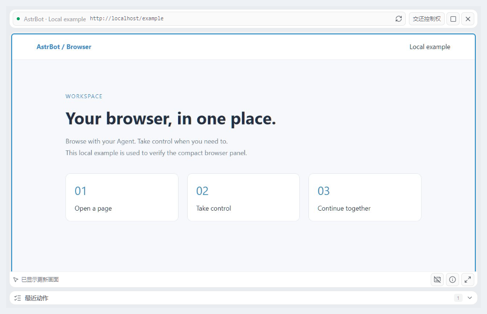

### 接管 Agent 浏览器

仍从上述 **Agent 浏览器** 面板进入，可在 Agent 运行中或结束后点击 **接管浏览器**。
切换期间显示等待提示，确认在途浏览器动作静止后才允许人工输入。
服务端确认控制权之前，画面保持只读。接管后可单击显示的网页，使用原有私有
Chromium、标签页及登录态。点击 **交还控制权** 后，运行时先重新读取页面，再开放
Agent 操作。运行中的本地 Agent 会暂停，不占工具超时或持续调用模型；接管前未执行的
动作作废。只有明确交还才恢复原轮次，并根据最新标签、页面和元素重新决定下一步，不重放
旧点击。同聊天的新消息不会解除暂停。若原轮次已经取消或结束，交还只保留浏览器供下一条
请求使用，不会凭空启动任务。

控制权绑定当前已登录账号、聊天和客户端连接，同一浏览器最多一个人工控制者。
隐藏或关闭面板、切换聊天、观测中断或输入通道断连后，立即停止本地输入并保持浏览器
暂停。请主动重新接管并交还，之后再发起新任务。停止执行、关闭浏览器保持原语义。
不提供 `manual_control_version` 的旧插件保持只读并显示升级提示。具备点击接管能力但不提供
`keyboard_input_version` 的插件保留点击和交还，并显示键盘升级提示。
接管后，可在画面内双击目标，并使用垂直或水平滚轮。人工画面内的滚轮作用于远程网页，画面外仍正常滚动本地 ChatUI。坐标按实际图片区域映射到远端 CSS 视口，支持窄侧栏、本地缩放及全屏。**正在依次发送操作** 表示等待操作确认；**操作已确认 · 等待页面画面** 表示运行时已接受操作，但新图片尚未加载；**已显示更新画面** 表示后续一致画面已加载，并非仅接口返回成功。控制状态显示人工控制，时间线中的人工动作标记为 **人工**，全屏内也可直接 **交还控制权**。

导航、切换标签、视口变化、文档及嵌套区域滚动会使旧位置样本失效。相邻且目标一致的滚轮增量会合并，新画面到达时丢弃过期滚轮样本；点击、文字与按键保持有序，独立于可替换的画面缓冲。失败后停止输入，不自动重放。人工观测的采集目标上限为每秒 10 次，实际频率取决于页面和机器，保留单个待发画面、有界动作/输入队列及原有 JPEG 大小限制。复杂拖放、文件传输及系统窗口不在本功能范围。缺少 `pointer_input_version: 1` 的旧插件仍可单击，并显示滚轮/双击升级提示。

其他窗口显示 **只读：另一窗口正在控制此浏览器**。刷新或重连先同步状态与新画面，
暂停后需重新接管并明确交还。**输入确认丢失** 表示操作可能已经执行，请检查页面后再
操作；未发送队列已丢弃，不会重放点击或提交。退出登录及撤销账号/聊天访问权也会停止
输入。停止保留浏览器；关闭或禁用插件会结束其生命周期。重启不能复用旧控制凭证。

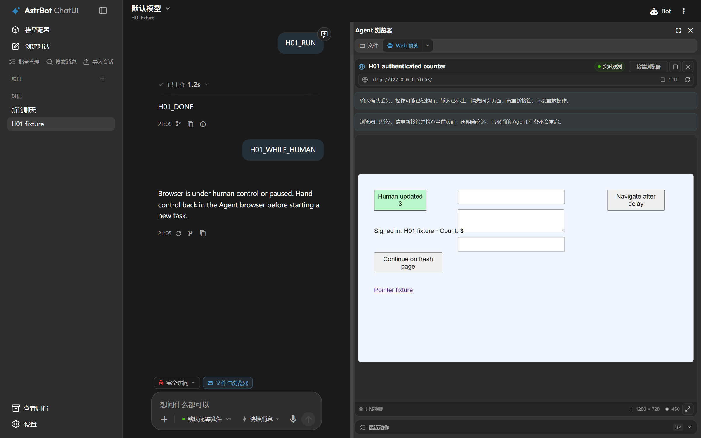

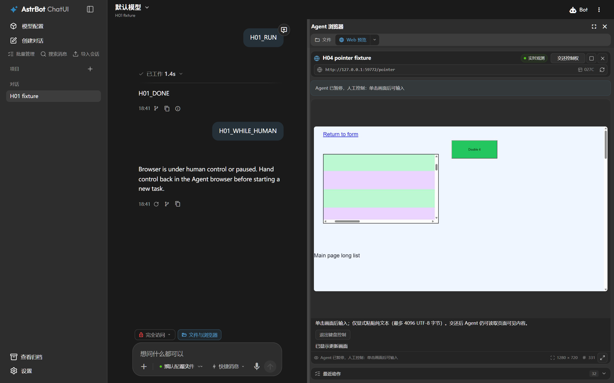

全屏内保留状态提示和 **交还控制权** 按钮，图片按控件之外的实际可用空间缩放；留白区域不产生远程点击。

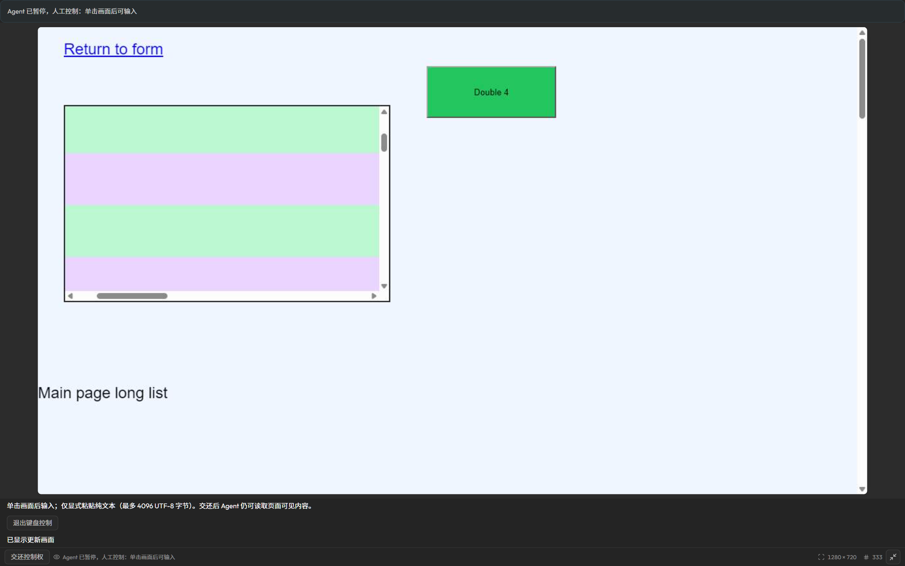

确认接管后，单击画面使远程键盘输入获得焦点。支持中英文、Tab、Enter、方向键、退格和编辑快捷键，以及用户主动粘贴的纯文本（最多 2048 字符 / 4096 UTF-8 字节）。输入法组合与候选保留在本地，最终提交一次，取消组合不录入。画面拥有焦点时，全屏下的 Tab/Escape 也会发送到远程页面。点击 **退出键盘控制** 可回到本地控件，点击 **交还控制权** 才会明确交还给 Agent。点击聊天输入框或其他本地控件会释放已按下的按键；目标变化会丢弃排队输入，需重新聚焦画面。操作摘要不包含密码或输入负载；交还后 Agent 仍能读取页面可见内容。

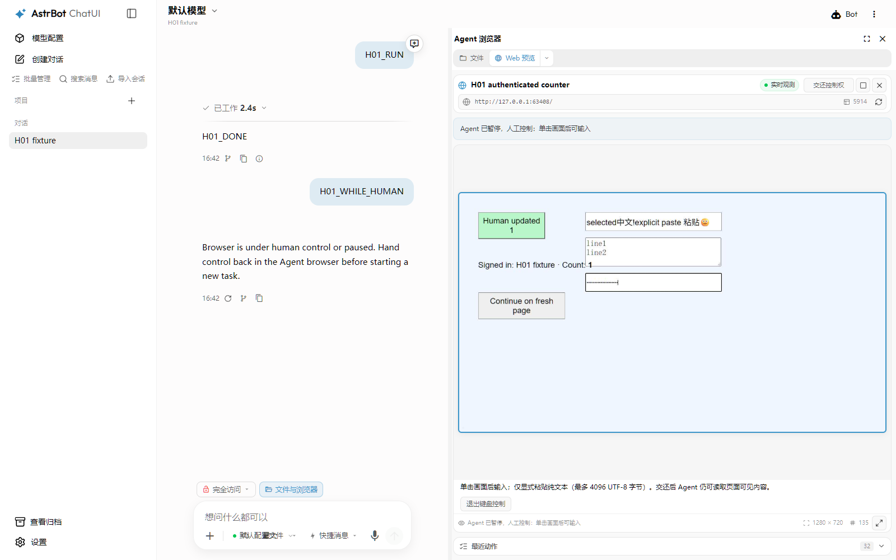

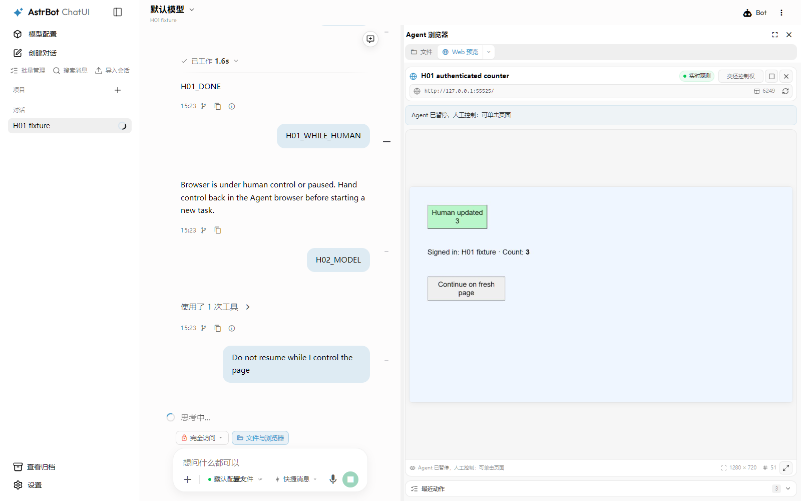

## 自定义 WebUI 端口

修改 data/cmd_config.json 文件内 `dashboard` 配置中的 `port`。

## 忘记密码

修改 data/cmd_config.json 文件内 `dashboard` 配置中的 `password`，将 password 整个键值对删除。

> [!TIP]
> 详细说明请参阅 [FAQ - 管理面板的密码忘记了](/faq.md#管理面板的密码忘记了)。

工作台入口整合：**工作流资产 → 资产 → 团队／工作流**，**角色模板 → 资产 → 角色模板**，**独立运行 → 运行 → 全部运行／进行中／待处理／历史**。直接配置版本化资产并启动运行，无需迁移或旧运行检查；历史页仅显示资产运行。实际截图与控制说明见[资产与运行工作台](./agent-team-workflows.md#导航与旧入口对应)。

旧定义迁移入口、旧运行提示和旧成员长期会话的历史入口已移除。创建角色模板和资产后，从 **资产 → 团队／工作流 → 启动运行** 开始新任务。

## Skill 商店

在 `插件 → 技能` 点击 `打开 Skill 商店`，浏览器会在新标签页打开商店。地址随 `设置 → 更新源` 中的 Core 版本检查地址解析。原内联商店入口现改为此链接；参见 [技能商店步骤与截图](./skills.md#skill-商店)。

## 顶部栏与个人快捷消息

普通用户与管理员使用相同的顶部模型选择器。普通用户的用户名与“退出登录”位于右上角；此位置在管理员界面保留“Bot”按钮。顶部公告对所有已登录账户可见，收起后可通过右上角的公告按钮重新展开。

如需让 Agent 知道当前登录的是哪个账户，管理员可在该会话使用的配置文件中开启 **消息处理 → 用户识别**。提示词会包含当前登录账户名和稳定用户 ID，例如 `johnmac`，并提醒模型不要套用其他用户记忆中的身份。关闭此选项后不注入身份提示。它不会改变记忆插件本身的用户隔离方式。

| 原入口 | 新入口 |
| --- | --- |
| 普通用户输入框中的模型选择 | 聊天顶部的模型选择器 |
| 左下角“查看归档”附近的用户名与退出按钮 | 右上角用户名与“退出登录” |
| 仅使用管理员快捷消息预设 | 快捷消息 → 编辑快捷消息，按账户保存 |
| 账户管理 | 多用户管理 |

快捷消息的现有预设作为尚未自定义账户的初始内容。保存后，管理员和普通用户各有一份，其他账户的修改不会覆盖本人内容；删除所有快捷消息会保留空列表。数据保存在服务器，重新登录后仍可使用。思考强度的全局预设编辑权限不变。

“多用户管理”用于单实例多用户场景：用户通过各自账户登录 ChatUI，共同访问同一个 AstrBot 程序，各自拥有独立会话。管理员可启用已禁用的普通账户；启用后需要重新登录，禁用前的凭证仍无效。

删除账户需要确认，随后永久清理该账户的聊天及关联数据，包括历史、附件、项目关联、个人设置和系统托管工作区。其他账户和管理员保持不变；用户关联的外部主机目录不属于系统托管数据，不会递归删除。删除后重新创建同名账户会获得全新身份，不继承旧数据。

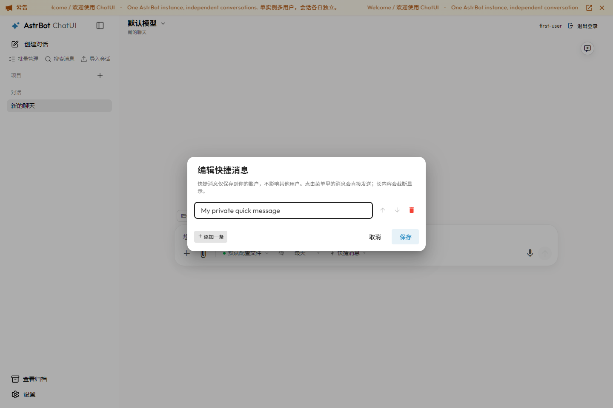

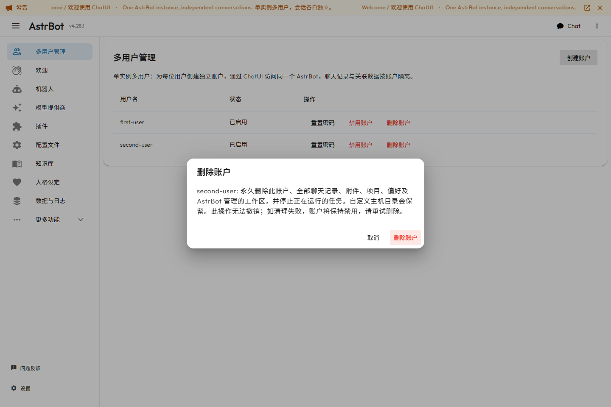

手机端同样通过顶部栏选择模型和退出登录：

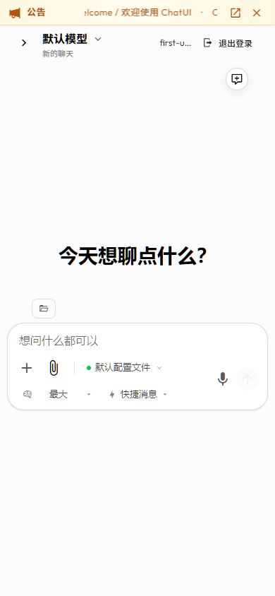

### 离线人工登录验收

Browser Use 0.3.0 需配套宿主和 Dashboard 提交，不能仅核对 AstrBot 版本号。两仓库先提交最终源码；Dashboard 打包传入 `--plugin-revision <插件精确提交>`，核对前端元数据与插件 manifest 的 `plugin_revision`、`astrbot_revision` 一致，核对插件所记 Dashboard ZIP SHA256 和各交付包 `.zip.sha256`。后端源码包需要已有兼容的 AstrBot Python 环境；完整插件只携带 Windows x64 私有 Python/Chromium。

升级先停宿主，备份配套三组件与 data，将旧插件移出 `data/plugins` 后使用原安装器；不可同时加载两份插件，保留独立 `plugin_data`。回退也需停宿主并整体恢复配套组件。重启宿主会结束当前浏览器会话；运行中接管同一任务则保留原会话。

登录任务中等待“接管浏览器”确认，聚焦远端输入框，输入账号和密码并提交网页表单；登录成功后明确点击“交还控制权”。隐藏、失联或刷新只会暂停，需明确恢复。摘要隐藏输入，但交还后的可见网页内容仍可被 Agent 观察。

执行 `python scripts/browser_manual_control_acceptance.py --plugin-zip <完整插件.zip> --dashboard-dir <dist> --evidence-dir <新目录> --login-handoff --pointer-input --text-input --lost-key-target --recovery`，单轮预算回归另用新目录加 `--handoff-boundaries`，不带 `--login-handoff`。脚本从最终 ZIP 经原 PowerShell 安装器安装，将完整 data 树搬迁到中文/空格路径，保留空白执行文件配置，使用真实生产 ChatUI、已安装插件、私有 Chromium 和确定性本地 OpenAI 兼容模型；输出截图、源码/提交核对、延迟/资源/清理测量及网络审计。

仅临时解释器注入 Python socket/DNS 与安装器拦截；私有 Chromium 使用不可达 SOCKS 代理、仅回环绕过、禁止外部解析与 QUIC。实际外部连接拒绝探针、逐进程审计及进程连接采样用于核对这些约束。这是进程内测试隔离，不是系统防火墙或物理断网目标机证明；机制外的原生网络、真实 vLLM、实体 Windows 输入法候选窗口与其他平台仍需独立验证。兼容宿主依赖必须事先安装。
